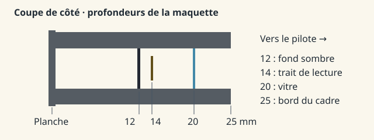

# 2 · Bâtir le planeur avec des anneaux et des baguettes

Pense à un modèle en carton. Un **sommet** est un coin ; une **face** est un morceau de carton tendu entre des coins. Au lieu de taper des milliers de lignes de sommets à la main, tu vas écrire une petite machine à les numéroter. Crée **fabrique.py** à la racine, au même niveau que *src*. À la fin, ce programme écrira **src/SW233/Models/sw233.ac**. Nomme les objets exactement comme ici : plus tard FlightGear cherchera « fil-de-laine », pas « ficelle ».

**Ton repère :** imagine-toi assis dans le planeur. Dans la recette, x va du nez vers la queue, y vers ta droite, z vers le haut, en mètres. Sur un papier dessine le nez à x = 0 et la queue à x = 7,8486. Pose deux crayons à y = −7,7724 et +7,7724 : les extrémités doivent être à la même distance du milieu.

**Fichier à écrire :** `fabrique.py`. Colle les blocs de ce fichier dans l’ordre, sans retirer les espaces du début des lignes.

## A · Prépare la boîte de pièces

Une liste garde les faces de chaque pièce. Dans la palette, les trois nombres sont des quantités de rouge, de vert et de bleu entre 0 et 1. Le dernier nombre règle la transparence ; 0 donne une peinture opaque. Ce sont des couleurs de travail, pas des échantillons de peinture des Cadets.

<!-- atelier-fichier: fabrique.py -->
```python
from pathlib import Path
from math import cos, sin, pi, radians
from collections import defaultdict
import numpy as np

M = Path("src/SW233/Models")
M.mkdir(parents=True, exist_ok=True)
parts = defaultdict(list)
mat = [
    ("jaune", (0.94, 0.66, 0.15), 0),
    ("creme", (1, 0.86, 0.48), 0),
    ("cadre", (0.21, 0.25, 0.23), 0),
    ("caoutchouc", (0.09, 0.10, 0.10), 0),
    ("verre", (0.51, 0.75, 0.84), 0.79),
    ("cadran", (0.045, 0.06, 0.065), 0),
    ("ivoire", (0.97, 0.95, 0.79), 0),
    ("orange", (0.9, 0.31, 0.11), 0),
    ("siege", (0.34, 0.39, 0.32), 0),
]
```

## B · Invente quatre outils réutilisables

Lis les quatre fonctions comme des gestes : `poly` pose une face ; `bridge` relie deux anneaux par des bandes ; `rod` dessine deux petits octogones et les relie pour faire un tube ; `loft` relie des couples comme les arceaux d’une tente. Le sinus et le cosinus servent de compas : ils placent les points à intervalles réguliers autour d’un centre. Exemple : si deux anneaux ont chacun 12 coins, le pont doit produire 12 bandes, pas 11. Le coin précédent du premier coin est le dernier : c’est ce qui ferme la couture.

<!-- atelier-fichier: fabrique.py -->
```python
def poly(n, m, *v):
    parts[n].append((m, v))


def bridge(n, m, a, b):
    for i in range(len(a)):
        poly(n, m, a[i - 1], a[i], b[i], b[i - 1])


def rod(n, m, a, b, r):
    a, b = np.array(a), np.array(b)
    v = b - a
    v = v / np.linalg.norm(v)
    u = np.cross(v, [0, 0, 1] if abs(v[2]) < 0.9 else [0, 1, 0])
    u /= np.linalg.norm(u)
    w = np.cross(v, u)
    ring = [r * (u * cos(i * pi / 4) + w * sin(i * pi / 4)) for i in range(8)]
    bridge(n, m, [a + p for p in ring], [b + p for p in ring])


def loft(n, m, stations):
    rings = [
        [(x, r * cos(i * pi / 6), z + h * sin(i * pi / 6)) for i in range(12)]
        for x, r, z, h in stations
    ]
    for a, b in zip(rings, rings[1:]):
        bridge(n, m, a, b)
    poly(n, m, *rings[0])
    poly(n, m, *rings[-1])
```

## C · Construis une coque ouverte seulement vers le haut


Schéma du maillage, sans textures ; dimensions de maquette.

Le défaut précédent venait d’un tri trop large : des faces étaient supprimées selon leur hauteur moyenne. Les côtés devenaient des trous. Nous dessinons maintenant une section en U : bord gauche, ventre arrondi, bord droit. Le dessus reste ouvert entre x=0,70 et 2,49 m ; les flancs restent entiers. Ce sont des stations de maquette H, guidées par les contours du trois-vues, pas des cotes d’usine. Voir les pointages et les limites dans la [fiche 14](14-enveloppe.md).

La recette complète et les choix du lot42 sont dans la [fiche24](24-formes-avant.md). Chaque station donne x, la demi-largeur du ventre, la hauteur du centre, la demi-hauteur inférieure, la demi-largeur au bord de l’ouverture et la hauteur de ce bord. La verrière réutilisera exactement ses deux derniers nombres. Ainsi ses vitres touchent les flancs au lieu de flotter au-dessus.

<!-- atelier-fichier: fabrique.py -->
```python
from tools.airframe_geometry import build_enclosure, WING_PROFILE

coque = build_enclosure(poly, rod)
```

## D · Raccorde les vitres et les cadres bleus


Schéma du maillage, sans textures ; dimensions de maquette.

Le bord inférieur de la verrière est celui de la coque, au même x, y et z. Les sections courbes à 33 points distinguent flancs vitrés et toit ; le montant du pare-brise est incliné. La [fiche 15](15-panneaux.md) explique les proportions et les limites. Le lot43 reprend les cadres bleus, joints noirs et fixations des références ; leur forme et leur placement restent estimés. Le vitrage central est fixe entre les ailes. Le raccord situé derrière lui est opaque. Les rayons de cadre de 14 mm et de joint de 18 mm sont des choix de maquette H. La verrière avant s’ouvre depuis le lot44. La porte arrière reste fixe.

<!-- atelier-fichier: fabrique.py -->
```python
# Coque, vitres et cadres sont construits ensemble par build_enclosure.
# Leur recette complète est dans la fiche 24 ; les coutures partagent les mêmes points.
```


Contours de travail, sans animation ; voir la fiche 15 pour les hypothèses.

## E · Fabrique une aile, puis son reflet


Schéma du maillage, sans textures ; dimensions de maquette.

Chaque ligne décrit une section d’aile : distance à l’axe, position du bord avant, corde et hauteur.
À la racine, le bord arrière se trouve à 1,99 + 1,524 = 3,514 m du nez du modèle.
La corde vient du manuel, page PDF 9 / A2. La position du bord avant reste estimée.
La liste de fractions dessine une section épaisse. Elle ne reproduit pas un profil aérodynamique mesuré.

Multiplier la distance latérale par −1 ou +1 pour construire les deux côtés.
Relier l’aile au fuselage avec un hauban.
Garder chaque aérofrein séparé pour pouvoir l’animer.
Sa charnière est à x = 2,41 m ; son bord mobile est à x = 2,54 m.
Ces positions restent des choix de maquette.
L’[atelier 29](29-dimensions-et-fuselage.md) explique aussi la largeur corrigée de l’empennage.

<!-- atelier-fichier: fabrique.py -->
```python
for side in (-1, 1):
    s = str(side)
    rings = []
    for y, le, ch, z in [
        (0.44, 1.99, 1.524, 0.74),
        (3.42, 1.99, 1.524, 0.80),
        (7.62, 2.19, 0.83, 0.93),
        (7.7724, 2.23, 0.76, 0.94),
    ]:
        rings.append(
            [
                (le + ch * f, y * side, z + ch * h)
                for f, h in WING_PROFILE
            ]
        )
    for a, b in zip(rings, rings[1:]):
        bridge("aile" + s, 0, a, b)
    poly("aile" + s, 0, *rings[-1])
    rod("hauban" + s, 1, (2.36, 0.36 * side, -0.43), (2.49, 3.65 * side, 0.795), 0.038)
    poly(
        "aerofrein" + s,
        2,
        (2.41, 0.98 * side, 0.86),
        (2.41, 2.13 * side, 0.88),
        (2.54, 2.13 * side, 0.88),
        (2.54, 0.98 * side, 0.86),
    )
    p = [
        (6.85, 0, 0.1),
        (6.87, 1.68 * side, 0.11),
        (7.07, 1.93 * side, 0.11),
        (7.5, 1.93 * side, 0.11),
        (7.79, 1.67 * side, 0.11),
        (7.79, 0, 0.1),
    ]
    # Charnière de maquette : x=7,35 m, z=0,11 m (non mesurée).
    p = [(x, y * (1.1811 / 1.93), .11) for x, y, z in p]
    def coupe(points, mobile):
        resultat = []
        for a, b in zip(points, points[1:] + points[:1]):
            dedans_a = a[0] >= 7.35 if mobile else a[0] <= 7.35
            dedans_b = b[0] >= 7.35 if mobile else b[0] <= 7.35
            if dedans_a: resultat.append(a)
            if dedans_a != dedans_b:
                t = (7.35-a[0])/(b[0]-a[0])
                resultat.append((7.35, a[1]+t*(b[1]-a[1]), .11))
        return resultat
    poly("empennage" + s, 1, *coupe(p, False))
    poly("profondeur" + s, 1, *coupe(p, True))
```

Le contour horizontal est découpé à **x=7,35 m** : partie avant fixe, partie arrière mobile. On place ce contour dans le plan z=0,11 m pour obtenir une charnière droite. Ces deux valeurs sont des choix de maquette, pas des cotes constructeur. La [fiche 10](10-profondeur.md) explique les intersections et les essais.

## F · Termine la queue, le train et les commandes


Schéma du maillage, sans textures ; dimensions de maquette.

La dérive ferme la longueur de référence à 7,8486 m. Deux cercles reliés dessinent une roue ; notre grande roue a un rayon visuel choisi de 0,245 m. Le dessin de visite situe roue, patin, roulette et haubans ; il ne donne pas ces rayons. Les deux sièges sont en tandem : ne les place pas côte à côte. Le levier orange reste à gauche (y négatif).

<!-- atelier-fichier: fabrique.py -->
```python
poly("derive", 0, (6.50, 0, 0.09), (7.1, 0, 1.42), (7.83, 0, 1.42), (7.8486, 0, 0.04))
for name, x, z, r in [("roue", 2.25, -0.60, 0.245), ("roulette", 7.51, -0.27, 0.084)]:
    a = [(x + r * cos(i * pi / 10), -0.075, z + r * sin(i * pi / 10)) for i in range(20)]
    b = [(px, 0.075, pz) for px, _, pz in a]
    bridge(name, 3, a, b)
    poly(name, 3, *a)
    poly(name, 3, *b)
rod("patin", 2, (0.33, 0, -0.52), (1.91, 0, -0.69), 0.038)
for x in (1.52, 2.24):
    poly(
        "sieges",
        8,
        (x, -0.27, -0.22),
        (x, 0.27, -0.22),
        (x + 0.13, 0.27, 0.13),
        (x + 0.13, -0.27, 0.13),
    )
rod("manche", 2, (1.48, 0, -0.33), (1.36, 0, 0.055), 0.022)
rod("poignee-frein", 7, (1.19, -0.34, -0.13), (1.43, -0.34, 0.01), 0.019)
```

## G · Découpe la planche et prépare les cadrans


Schéma du maillage, sans textures ; dimensions de maquette.

La planche est à x = 0,87 ; son bord mesure 2 × 0,39 = 0,78 m. C’est le gabarit de travail de la fiche 1. Pour chaque cadran, note (nom, y, z, rayon). Les fonctions suivantes tracent un trait à une distance donnée du centre et fabriquent les chiffres avec sept segments, comme une petite horloge numérique. Les chiffres sont fixes. Les aiguilles doivent pouvoir tourner sans emporter les chiffres.

<!-- atelier-fichier: fabrique.py -->
```python
# A faceted panel in front of the pilot; scale ticks and numeric legends are real mesh.
px = 0.87
poly(
    "tableau",
    5,
    (px, -0.39, -0.08),
    (px, 0.39, -0.08),
    *[(px, 0.39 * cos(i * pi / 20), 0.015 + 0.26 * sin(i * pi / 20)) for i in range(21)],
)
dials = [("alt", -0.22, 0.087, 0.083), ("ias", 0.17, 0.14, 0.075), ("vsi", 0.295, 0.022, 0.063)]


def point(y, z, r, a):
    return (y + r * sin(a), z + r * cos(a))


def mark(n, x, y, z, r, a, length, width):
    v = (sin(a), cos(a))
    w = (cos(a) * width, -sin(a) * width)
    poly(
        n,
        6,
        *[
            (x, y + v[0] * t + w[0] * k, z + v[1] * t + w[1] * k)
            for t, k in [(r, -1), (r, 1), (r - length, 1), (r - length, -1)]
        ],
    )


def digit(y, z, num, scale):
    segs = [
        ((0, 0), (1, 0)),
        ((1, 0), (1, 1)),
        ((1, 1), (1, 2)),
        ((0, 2), (1, 2)),
        ((0, 1), (0, 2)),
        ((0, 0), (0, 1)),
        ((0, 1), (1, 1)),
    ]
    chars = str(num)
    for j, k in enumerate(chars):
        for seg in {
            "0": "012345",
            "1": "12",
            "2": "01643",
            "3": "01623",
            "4": "5612",
            "5": "05623",
            "6": "056423",
            "7": "012",
            "8": "0123456",
            "9": "012356",
            "-": "6",
        }[k]:
            (a, b), (c, d) = segs[int(seg)]
            yy = y + (j * 1.5 - 0.5 * (len(chars) * 1.5 - 0.5)) * scale
            rod(
                "chiffres",
                6,
                (px + 0.009, yy + a * scale, z + (1 - b) * scale),
                (px + 0.009, yy + c * scale, z + (1 - d) * scale),
                0.00065,
            )
```

## H · Détache les aiguilles

Une aiguille est un triangle indépendant. Place-la à x = 0,87 + 0,012 = 0,882, légèrement devant le fond, du côté du pilote. Si deux faces sont au même endroit, elles peuvent clignoter. Un tour de cadran d’altitude contient dix grands repères ; leur écart est donc 360 ÷ 10 = 36°. Les échelles de la maquette sont idéalisées ; il faudra des photos frontales pour reproduire la vraie typographie.

**L’altimètre de C-FYLP.** Dans la photo de 690 × 517 pixels, découpe (63,207) → (173,321), bords droit et bas exclus, puis agrandis cinq fois. Le centre est proche de (283,290) dans cette copie de 550 × 570. La longue aiguille traverse le secteur 8–9 ; une silhouette courte et large pointe vers 0–1. Les reflets empêchent d’identifier sûrement une troisième aiguille. Notre modèle conserve deux aiguilles : c’est une limite de reproduction à noter.

Dessine cinquante traits : un grand tous les cinq petits. Les dix nombres occupent des secteurs égaux de 36°, choix régulier cohérent avec la photo. La pointe longue mesure 75 mm depuis le centre dans notre maquette ; la courte 44 mm. Ces longueurs et le diamètre du bouton de 24 mm sont des choix de modèle, pas des mesures du constructeur. La grande aiguille se trouve à x = 0,882 ; la petite à 0,883, pour éviter que leurs faces se superposent. Le bouton de calage se situe 60 mm à gauche et 60 mm sous le centre du cadran.

<!-- atelier-fichier: fabrique.py -->
```python
animations = []


def needle(name, y, z, r, property, factor, offset=0):
    poly(
        name,
        7,
        (px + 0.012, y - 0.002, z - 0.005),
        (px + 0.012, y + 0.002, z - 0.005),
        (px + 0.012, y, z + r),
    )
    animations.append((name, y, z, property, factor, offset))


for kind, y, z, r in dials:
    circ = [(px + 0.004, *point(y, z, r, i * pi / 30)) for i in range(60)]
    poly(kind + "-fond", 3, *circ)
    vals, angles = [], []  # Les trois cadrans sont peints à la fiche 6.
    for v, deg in zip(vals, angles):
        a = radians(deg)
        mark("traits", px + 0.008, y, z, r * 0.94, a, r * 0.08, 0.001)
        digit(*point(y, z, r * 0.68, a), v, 0.004)
    if kind == "alt":
        # Longue et fine : centaines ; courte et large : milliers.
        poly("alt-centaines",6,*[(px+.012,y+dy,z+dz) for dy,dz in
             [(-.0014,-.012),(.0014,-.012),(.0011,.067),(0,.075),(-.0011,.067)]])
        poly("alt-milliers",6,*[(px+.013,y+dy,z+dz) for dy,dz in
             [(-.003,-.010),(.003,-.010),(.004,.029),(0,.044),(-.004,.029)]])
        poly("alt-milliers",5,*[(px+.0135,*point(y,z,.004,i*pi/12)) for i in range(24)])
        cy, cz = y-.060, z-.060
        a = [(px+.006,*point(cy,cz,.012,i*pi/12)) for i in range(24)]
        b = [(px+.025,*point(cy,cz,.012,i*pi/12)) for i in range(24)]
        bridge("alt-calage",3,a,b)
        poly("alt-calage",2,*b)
        poly("alt-calage",6,(px+.0255,cy-.001,cz+.003),
             (px+.0255,cy+.001,cz+.003),(px+.0255,cy+.001,cz+.009),
             (px+.0255,cy-.001,cz+.009))
    elif kind == "ias":
        # Aiguille ivoire, pointe longue ; le moyeu sombre tourne avec elle.
        poly("vitesse-mph", 6, *[(px+.012,y+dy,z+dz) for dy,dz in
             [(-.0025,-.014),(.0025,-.014),(.0018,.056),(0,.067),(-.0018,.056)]])
        poly("vitesse-mph", 5, *[(px+.0125,*point(y,z,.004,i*pi/12)) for i in range(24)])
    else:
        poly("vario", 6, *[(px+.012,y+dy,z+dz) for dy,dz in
             [(-.0018,-.012),(.0018,-.012),(.0013,.049),(0,.058),(-.0013,.049)]])
        poly("vario", 5, *[(px+.0125,*point(y,z,.0035,i*pi/12)) for i in range(24)])
```

## I · Pose le Pitot et attache le fil


Schéma du maillage, sans textures ; dimensions de maquette.

La tête est au nez d’après le manuel ; sa forme s’appuie sur la photo avant. Les coordonnées de la baguette et des cinq points du fil sont des hypothèses visuelles. Le premier point (−0,055 ; 0 ; 0,537) est le nœud. Recopie-le dans le cahier : c’est le centre de la rotation à la fiche 4. Le rayon du fil est volontairement assez épais pour rester visible à l’écran. Au lot43, le capot remonte : le mât, son attache, le fil et son pivot XML montent ensemble de 0,30 m ; la forme détaillée du mât reste dans VIS-05g.1.

<!-- atelier-fichier: fabrique.py -->
```python
# Nose-mounted pressure head and a separate moving tuft. Dimensions are visual estimates.
mat.extend([("inox", (0.62, 0.68, 0.69), 0), ("laine", (0.85, 0.085, 0.045), 0)])
rod("embase-pitot", 2, (0.245, 0, 0.170), (0.218, 0, 0.242), 0.022)
rod("tube-pitot", 9, (0.222, 0, 0.227), (-0.055, 0, 0.537), 0.011)
rod("tube-pitot", 9, (-0.055, 0, 0.537), (-0.212, 0, 0.539), 0.011)
rod("attache-laine", 2, (-0.060, 0, 0.533), (-0.048, 0, 0.544), 0.014)
yarn = [
    (-0.055, 0, 0.537),
    (0.018, 0, 0.553),
    (0.10, 0, 0.575),
    (0.17, 0, 0.606),
    (0.235, 0, 0.625),
]
for a, b in zip(yarn, yarn[1:]):
    rod("fil-de-laine", 10, a, b, 0.0048)
```

## I bis · Donner une épaisseur à la poignée rouge

Sur C-FYLP, la boule est sous le compas, sur l’axe : son centre est vers le pixel (344,323), son diamètre apparent environ 51 px. Avec le gabarit de la fiche 1 : 51 / 610 × 0,78 ≈ 0,065 m. Nous choisissons 0,066 m, soit un rayon de 0,033 m. La photo seule ne donne pas la profondeur : les stations entre x = 0,90 et 0,961 m sont des choix de sculpture. Assemble six anneaux sur une petite tige ; fais varier leur rayon pour arrondir la poignée. Ne lui branche pas de commande de largage : il n’y a pas encore de câble.

<!-- atelier-fichier: fabrique.py -->
```python
# Poignée de largage C-FYLP : forme visuelle, aucun câble simulé.
rod("tige-largage", 2, (.872, 0, -.032), (.921, 0, -.032), .009)
red = len(mat)
mat.append(("poignee-bordeaux", (.44, .105, .078), 0))
loft("boule-largage", red, [
    (.90, .008, -.032, .008), (.906, .023, -.032, .023),
    (.92, .033, -.032, .033), (.94, .033, -.032, .033),
    (.954, .023, -.032, .023), (.961, .008, -.032, .008),
])
```

## I bis bis · Construis un aérateur fixe en relief

Le centre (y = 0 ; z = 0,197 m) et le rayon extérieur 0,046 m reprennent le dessin de notre tableau, inspiré de la photo C-FYLP. Ce ne sont pas des cotes constructeur. La saillie de 18 mm et le volet incliné sont des choix de sculpture. Le volet reste fixe ; il ne simule pas une ventilation.

Fabrique des cercles de 48 points. Relie deux cercles pour la paroi extérieure, puis deux rayons pour la lèvre. Le fond reste devant la planche opaque : nous créons une cavité apparente sans percer le tableau. Une ellipse inclinée dans la cavité évoque le volet visible sur la photo, au lieu de la grille peinte précédente.

<!-- atelier-fichier: fabrique.py -->
```python
# Original static vent; dimensions are model estimates, not surveyed aircraft data.
def cercle_aerateur(x, rayon):
    return [(x, rayon*cos(2*pi*i/48), .197+rayon*sin(2*pi*i/48))
            for i in range(48)]

bridge("aerateur-bague", 3, cercle_aerateur(px+.001, .046),
       cercle_aerateur(px+.018, .046))
bridge("aerateur-bague", 2, cercle_aerateur(px+.018, .046),
       cercle_aerateur(px+.018, .037))
bridge("aerateur-conduit", 3, cercle_aerateur(px+.018, .037),
       cercle_aerateur(px+.002, .035))
poly("aerateur-fond", 5, *cercle_aerateur(px+.002, .035))
poly("aerateur-volet", 2, *[(px+.010+.005*sin(2*pi*i/48),
     .034*cos(2*pi*i/48), .197+.012*sin(2*pi*i/48)) for i in range(48)])
```

## Bague de l'anémomètre — VIS-01h

Plan préalable `421cd13`. Le centre (y = 0,17 ; z = 0,14 m) et le rayon de cadran 0,075 m restent inchangés. Le rayon intérieur de la bague vaut 0,076 m : il laisse 1 mm au-delà du cadran. Le rayon extérieur 0,085 m reprend l'encombrement peint. La profondeur de 8 mm est estimée, pas mesurée sur C-FYLP. La bague reste derrière le plan de l'aiguille, à 12 mm.

Relie deux cercles extérieurs, puis le cercle extérieur au cercle intérieur. Ne ferme pas le centre : une face pleine masquerait le cadran. Place quatre vis à 45°, 135°, 225° et 315°, sur le rayon 83 mm ; chacune mesure 6 mm de diamètre. Leurs centres reprennent les fixations peintes de notre modèle. Les fentes sont des petites faces sombres, sans commande interactive.

<!-- atelier-fichier: fabrique.py -->
```python
# Fixed bezel; estimated depth. Dial and animated needle remain unchanged.
def cercle_ias(x, r):
    return [(x, .17+r*cos(i*pi/30), .14+r*sin(i*pi/30)) for i in range(60)]

bridge("ias-bague", 3, cercle_ias(px+.001, .085), cercle_ias(px+.008, .085))
bridge("ias-bague", 2, cercle_ias(px+.008, .085), cercle_ias(px+.008, .076))
bridge("ias-bague", 3, cercle_ias(px+.008, .076), cercle_ias(px+.004, .076))
for i in range(4):
    a = (i+.5)*pi/2
    sy, sz = .17+.083*cos(a), .14+.083*sin(a)
    back = [(px+.008, sy+.003*cos(j*pi/8), sz+.003*sin(j*pi/8)) for j in range(16)]
    front = [(px+.010, y, z) for _, y, z in back]
    bridge("ias-vis", 2, back, front)
    poly("ias-vis", 2, *front)
    poly("ias-fentes", 5, *[(px+.0101,sy+y,sz+z) for y,z in
         [(-.002,-.0004),(.002,-.0004),(.002,.0004),(-.002,.0004)]])
```

## Bague de l'altimètre — VIS-01i

Plan préalable `e4bcc04`. Centre y = −0,22 m, z = 0,087 m ; cadran de rayon 83 mm conservé. La bague commence à 84 mm et se termine à 93 mm, avec une saillie estimée de 8 mm. Les aiguilles restent aux plans 12 et 13 mm. Ces nombres sont des dimensions de maquette, pas des mesures constructeur.

Le bouton est situé 60 mm à gauche et 60 mm sous le centre. Son rayon vaut 12 mm ; sa face est à 25 mm devant le tableau. La bague passe derrière sa face. On omet la fixation à 225° pour ne pas placer une seconde tête de vis sur ce bouton. Les trois autres fixations sont des choix de représentation, à vérifier sur une référence plus précise.

<!-- atelier-fichier: fabrique.py -->
```python
# Altimeter bezel, behind the existing adjustment knob and animated hands.
def cercle_alt(x, r):
    return [(x, -.22+r*cos(i*pi/30), .087+r*sin(i*pi/30)) for i in range(60)]

bridge("alt-bague", 3, cercle_alt(px+.001, .093), cercle_alt(px+.008, .093))
bridge("alt-bague", 2, cercle_alt(px+.008, .093), cercle_alt(px+.008, .084))
bridge("alt-bague", 3, cercle_alt(px+.008, .084), cercle_alt(px+.004, .084))
for i in (0, 1, 3):  # Lower-left position is occupied by the adjustment knob.
    a = (i+.5)*pi/2
    sy, sz = -.22+.091*cos(a), .087+.091*sin(a)
    back = [(px+.008, sy+.003*cos(j*pi/8), sz+.003*sin(j*pi/8)) for j in range(16)]
    front = [(px+.010, y, z) for _, y, z in back]
    bridge("alt-vis", 2, back, front)
    poly("alt-vis", 2, *front)
    poly("alt-fentes", 5, *[(px+.0101,sy+y,sz+z) for y,z in
         [(-.002,-.0004),(.002,-.0004),(.002,.0004),(-.002,.0004)]])
```

## Bague du variomètre — VIS-01j

Plan préalable `a0da1e0`. La photo C-FYLP montre le variomètre en bas à droite du tableau. Elle sert à reconnaître la disposition, pas à mesurer une profondeur. Nous conservons le centre de notre maquette (y = 0,295 m ; z = 0,022 m) et le cadran de rayon 63 mm. Les dimensions ci-dessous sont des choix de représentation, sans cote constructeur revendiquée.

1. Dessine deux cercles de même centre : rayon intérieur 64 mm, extérieur 73 mm. Le premier laisse 1 mm de marge autour du cadran ; le second reprend l'encombrement de sa bordure peinte.
2. Imagine une rondelle : son milieu reste vide pour voir les chiffres. Relie ses cercles par des bandes, sans créer de disque plein. Le côté part de 1 mm devant le tableau et rejoint une face à 8 mm. Le retour intérieur finit à 4 mm.
3. Place quatre vis à 45°, 135°, 225° et 315°, sur un cercle de rayon 71 mm. Leur diamètre est 6 mm ; leur face est à 10 mm. Les fentes sont à 10,1 mm pour ne pas se superposer exactement aux têtes.
4. Garde l'aiguille existante à 12 mm devant le tableau. La bague et les vis restent derrière elle. Ne change ni son centre ni la table des angles dans le XML.
5. Retire les bordures et vis peintes de la fiche 6 : sinon les deux représentations se superposeraient. Garde le titre, les graduations et la texture du cadran.

<!-- atelier-fichier: fabrique.py -->
```python
# Variometer hardware: model dimensions; estimated depth, no change to calibration.
def cercle_vsi(x, r):
    return [(x, .295+r*cos(i*pi/30), .022+r*sin(i*pi/30)) for i in range(60)]

bridge("vsi-bague", 3, cercle_vsi(px+.001, .073), cercle_vsi(px+.008, .073))
bridge("vsi-bague", 2, cercle_vsi(px+.008, .073), cercle_vsi(px+.008, .064))
bridge("vsi-bague", 3, cercle_vsi(px+.008, .064), cercle_vsi(px+.004, .064))
for i in range(4):
    a = (i+.5)*pi/2
    sy, sz = .295+.071*cos(a), .022+.071*sin(a)
    back = [(px+.008, sy+.003*cos(j*pi/8), sz+.003*sin(j*pi/8)) for j in range(16)]
    front = [(px+.010, y, z) for _, y, z in back]
    bridge("vsi-vis", 2, back, front)
    poly("vsi-vis", 2, *front)
    poly("vsi-fentes", 5, *[(px+.0101,sy+y,sz+z) for y,z in
         [(-.002,-.0004),(.002,-.0004),(.002,.0004),(-.002,.0004)]])
```

## Façade de radio — VIS-01l

Plan préalable `5990da5`. La photo C-FYLP montre une façade ronde, un écran au-dessus du centre et deux boutons de tailles différentes. Nous conservons le centre de maquette y = −0,141 m, z = 0,189 m et le rayon extérieur 31 mm. La photo oblique n'autorise pas une mesure d'épaisseur : les 6 mm de saillie de la façade et les 13 mm des boutons sont estimés. Aucun mécanisme intérieur n'est reproduit.

1. Trace un cercle de rayon 31 mm à 1 mm devant le tableau, puis le même cercle à 4 mm. Relie-les pour former le côté du boîtier.
2. Relie ce dernier cercle à un cercle de rayon 29 mm, avancé à 6 mm : ce bord incliné forme le contour. Ferme seulement ce dernier cercle avec la façade destinée à recevoir la texture.
3. Pose l'écran rectangulaire 0,4 mm devant la façade. Sa couleur gris-vert est un choix visuel. L'écran est vide : la radio n'est pas encore fonctionnelle.
4. Construis un petit bouton à gauche et un plus gros en bas à droite. Alterne deux rayons pour donner un bord légèrement cranté. Ajoute les faces avant à 13 mm du tableau.
5. Ajoute deux vis et leurs fentes en haut, puis une pastille rouge décorative au centre supérieur. Ne présente pas cette pastille fixe comme un voyant de fonctionnement.

<!-- atelier-fichier: fabrique.py -->
```python
# Static radio facade. All depths are model estimates, not aircraft measurements.
ry, rz = -.141, .189

def cercle_radio(x, r):
    return [(x, ry+r*cos(i*pi/30), rz+r*sin(i*pi/30)) for i in range(60)]

bridge("radio-contour", 3, cercle_radio(px+.001,.031), cercle_radio(px+.004,.031))
bridge("radio-contour", 2, cercle_radio(px+.004,.031), cercle_radio(px+.006,.029))
poly("radio-face", 5, *cercle_radio(px+.006,.029))
screen_material = len(mat)
mat.append(("radio-ecran", (.33,.38,.30), 0))
poly("radio-ecran", screen_material, *[(px+.0064,ry+y,rz+z) for y,z in
     [(-.0165,.00575),(.0165,.00575),(.0165,.01425),(-.0165,.01425)]])
for name, dy, dz, radius in [("radio-bouton-gauche",-.018,-.006,.0045),
                            ("radio-bouton-droit",.016,-.016,.006)]:
    back = [(px+.006,ry+dy+radius*(1 if i%2 else .91)*cos(i*pi/16),
             rz+dz+radius*(1 if i%2 else .91)*sin(i*pi/16)) for i in range(32)]
    front = [(px+.013,y,z) for _,y,z in back]
    bridge(name,3,back,front)
    poly(name,2,*front)
for dy in (-.019,.019):
    back = [(px+.006,ry+dy+.002*cos(i*pi/8),rz+.019+.002*sin(i*pi/8)) for i in range(16)]
    front = [(px+.0075,y,z) for _,y,z in back]
    bridge("radio-vis",2,back,front)
    poly("radio-vis",2,*front)
    poly("radio-fentes",5,*[(px+.0076,ry+dy+y,rz+.019+z) for y,z in
         [(-.0014,-.0003),(.0014,-.0003),(.0014,.0003),(-.0014,.0003)]])
red_back = [(px+.006,ry+.002*cos(i*pi/12),rz+.022+.002*sin(i*pi/12)) for i in range(24)]
red_front = [(px+.008,y,z) for _,y,z in red_back]
bridge("radio-pastille",10,red_back,red_front)
poly("radio-pastille",10,*red_front)
```

## I ter · Construis une petite boîte ouverte pour le compas

Prends une boîte d’allumettes vide : de face tu vois son ouverture ; en la décalant de côté, tu vois aussi sa paroi. C’est le même effet que nous cherchons sous la bouche d’air. La photo de C-FYLP donne une façade, pas une profondeur. Garde le centre choisi à la fiche 1 (y = 0 ; z = 0,098 m). Le dessin plat faisait 126 × 118 pixels dans la texture à 1 920 pixels/m : environ 66 × 61 mm. Garde cette taille pour la base. Les 25 mm d’épaisseur sont une estimation de maquette.

**Dessine la coupe dans ton cahier.** Trace une ligne pour la planche. En allant vers le pilote, marque le fond initial à 12 mm (ramené à 1 mm pour la rose mobile), le trait ivoire à 14 mm, la vitre à 20 mm et le rebord à 25 mm. Ainsi la vitre est en retrait de 5 mm et le trait est 6 mm derrière elle. Les distances différentes empêchent deux faces de se battre pour le même pixel. Le pied commence à 0,5 mm pour éviter une face coplanaire avec la planche.

Coupe historique du boîtier vide : dans la version mobile, le tambour prend la place de l’ancien fond à 12 mm.



**Assemble.** Arrondis les quatre coins du rectangle avec six points par coin : 4 × 6 = 24 points par contour. Relie les contours par bandes, comme pour les ailes. Ne bouche jamais le milieu du cadre ! Ajoute le fond, le trait, quatre têtes de vis et la vitre transparente. La section suivante ajoute la rose mobile : le compas complet indique le cap. La finition VIS-01n remplace les anciens coins coupés par des arrondis, ajoute le joint et donne du relief aux vis ; voir la section O de la fiche 6.

<!-- atelier-fichier: fabrique.py -->
```python
# Compas C-FYLP, centré sous la bouche. Les profondeurs sont des hypothèses.
def contour_compas(profondeur, demi_largeur, demi_hauteur, coin):
    # Quatre quarts de cercle, six points chacun : contours compatibles.
    w, h, c = demi_largeur, demi_hauteur, coin
    points = []
    for cy, cz, debut in [(w-c,h-c,0),(-w+c,h-c,90),
                           (-w+c,-h+c,180),(w-c,-h+c,270)]:
        for i in range(6):
            angle = radians(debut + i*18)
            points.append((px+profondeur, cy+c*cos(angle), .098+cz+c*sin(angle)))
    return points

# Encombrement conservé ; arrondis et profondeurs sont estimés.
base = contour_compas(.001, .033, .031, .014)
epaules = contour_compas(.021, .033, .031, .014)
bord = contour_compas(.025, .031, .029, .012)
levre = contour_compas(.025, .0255, .015, .004)
ouverture = contour_compas(.025, .0245, .014, .003)
fond = contour_compas(.001, .0245, .014, .003)
bridge("compas-joint", 3, contour_compas(.0005,.034,.032,.015),
       contour_compas(.001,.034,.032,.015))
bridge("compas-joint", 3, contour_compas(.001,.034,.032,.015),base)
bridge("compas-cadre", 3, base, epaules)
bridge("compas-cadre", 3, epaules, bord)
bridge("compas-cadre", 3, bord, levre)
bridge("compas-cadre", 2, levre, ouverture)
bridge("compas-cadre", 3, ouverture, fond)
poly("compas-fond", 5, *fond)
poly("compas-repere", 6, *[(px+.014,y,.098+z) for y,z in
                           [(-.0009,.002),(.0009,.002),(.0009,.010),(-.0009,.010)]])
for y in (-.022, .022):
    for z in (-.021, .021):
        def tete(profondeur, rayon):
            return [(px+profondeur,y+rayon*cos(i*pi/8),
                     .098+z+rayon*sin(i*pi/8)) for i in range(16)]
        bridge("compas-vis", 9, tete(.025,.0024), tete(.026,.002))
        poly("compas-vis", 9, *tete(.026,.002))
        # Une fente sombre, légèrement devant la tête, sans clignotement.
        poly("compas-fentes", 5, *[(px+.0261,y+dy,.098+z+dz) for dy,dz in
                                 [(-.0015,-.0003),(.0015,-.0003),
                                  (.0015,.0003),(-.0015,.0003)]])
poly("compas-vitre", 4, *contour_compas(.020, .0245, .014, .003))
```

**Regarde le résultat dans FlightGear :** [photos de face, de biais et en lumière du soir](06-peinture.md#compas-relief).

## I quater · Enroule les caps sur un tambour

Prends une bande de papier, écris N, E, S, W à intervalles égaux et ferme la boucle. Dans le compas on voit son bord, pas le dessus. Le trait court est devant les graduations et s’arrête au-dessus des lettres. On recule le fond à 1 mm de la planche pour dégager le tambour. Son rayon de 49 mm et la taille des caractères sont des choix de lisibilité. Un tour fait 360° : place un trait tous les 5°, une inscription tous les 30°. Le chiffre 3 désigne 030°. La bande peinte de la fiche 6 remplace les anciens petits polygones des lettres. Le raccord se trouve au sud ; N est au milieu de l’image et doit défiler sans saut au passage du nord.

<!-- atelier-fichier: fabrique.py -->
```python
# Une bande cylindrique ; les lettres seront peintes à la fiche 6.
axe = px - .037
rayon = .049
for i in range(72):
    gauche, droite = radians(-180+i*5), radians(-180+(i+1)*5)
    poly("compas-rose", 5, *[(axe+rayon*cos(a),rayon*sin(a),.098+h)
         for a,h in [(gauche,-.011),(droite,-.011),(droite,.011),(gauche,.011)]])
```

## I quinquies · Deux jeux de quatre plaquettes

Ces deux objets occupent les mêmes places. Le fichier XML ne montrera qu’une langue à la fois. La fiche 5 explique le choix de langue et la fiche 6 prépare les images.

<!-- atelier-fichier: fabrique.py -->
```python
# Order matches the four checklist indices: departure, release, landing, stall.
for langue in ("fr", "en"):
    for y,z in [(-.079,.197),(-.079,.077),(.073,.229),(.073,.035)]:
        poly("plaquettes-"+langue,5,*[(px+.001,y+dy,z+dz) for dy,dz in
             [(-.023,-.033),(.023,-.033),(.023,.033),(-.023,.033)]])
```

## I sexies · Vitres séparées des aiguilles

Une vitre est un disque très mince devant le cadran. Son emplacement est une
estimation du modèle. Nous gardons les aiguilles et leur animation inchangées.
La matière laisse passer 96 % dans le paramètre AC3D ; ce n’est pas une mesure
optique du vrai verre. La fiche 19 explique l’effet d’environnement.

<!-- atelier-fichier: fabrique.py -->
```python
mat.append(("verre-cadrans", (.82,.90,.94), .96))
for nom,y,z,r in [("ias",.17,.14,.067),("alt",-.22,.087,.075),("vsi",.295,.022,.055)]:
    centre = (px+.019,y,z)
    for i in range(64):
        a,b = 2*pi*i/64,2*pi*(i+1)/64
        poly(nom+"-vitre",len(mat)-1,centre,
             (px+.019,y+r*cos(a),z+r*sin(a)),
             (px+.019,y+r*cos(b),z+r*sin(b)))
```

## J · Écris le fichier que lit le simulateur

Le fichier commence par `AC3Db`, la palette, puis `OBJECT world` : la boîte qui contient toutes les pièces. Pour chaque pièce, `numvert` compte les coins et `numsurf` compte les faces ; `refs 4` annonce quatre numéros de coins pour un quadrilatère. Les numéros commencent à zéro. Un coin (x, y, z) de ton cahier devient **(x, z, −y)** dans notre AC3D : pour une extrémité à droite, la troisième colonne devient négative. La section en U définit l’ouverture. L’exporteur écrit toutes les faces sans en supprimer selon leur position. Les rehauts des graduations et du fil servent à leur lisibilité dans le rendu.

<!-- atelier-fichier: fabrique.py -->
```python
mat.append(("cadres-bleus", (.094, .235, .447), 0))
mat.append(("habillage-gris", (.45, .48, .50), 0))
out = ["AC3Db"]
for n, c, t in mat:
    glow = {"ivoire": ".5 .48 .4", "orange": ".4 .12 .04", "laine": ".7 .04 .02"}.get(n, "0 0 0")
    out.append(
        f'MATERIAL "{n}" rgb '
        + " ".join(map(str, c))
        + f" amb 0.3 0.3 0.3 emis {glow} spec .15 .15 .15 shi 12 trans {t}"
    )
out += ["OBJECT world", f"kids {len(parts)}"]
for n, faces in parts.items():
    verts = []
    inds = []
    welded = {}
    smooth = n in {"fuselage", "pare-brise", "verriere", "vitrage-droit", "vitrage-gauche", "raccord-arriere", "dossier-arriere-moule"}
    for m, v in faces:
        ids = []
        for x, y, z in v:
            point = (x, z, -y)
            if smooth:
                if point not in welded:
                    welded[point] = len(verts)
                    verts.append(point)
                ids.append(welded[point])
            else:
                ids.append(len(verts))
                verts.append(point)
        inds.append((m, ids))
    out += (
        ["OBJECT poly", f'name "{n}"', f"numvert {len(verts)}"]
        + [" ".join(f"{c:.5f}" for c in v) for v in verts]
        + ["crease 15", f"numsurf {len(inds)}"]
    )
    for m, ids in inds:
        out += ["SURF 0x30", f"mat {m}", f"refs {len(ids)}"] + [f"{i} 0 0" for i in ids]
    out += ["kids 0"]
(M / "sw233.ac").write_text("\n".join(out) + "\n", encoding="utf8")
```

**À faire maintenant :** enregistre, puis exécute depuis *Mon-Schweizer* :

```powershell
.\.venv\Scripts\python.exe fabrique.py
Get-Content src/SW233/Models/sw233.ac -TotalCount 16
```

**Contrôle :** pour la forme de départ du livre, tu dois lire *AC3Db*, douze matériaux, *OBJECT world* puis le nombre d’objets dans *kids* (voir l’inventaire de la fiche 14). Cherche les deux noms *aerofrein-1* et *aerofrein1*. Si le fichier reste vide, vérifie que le dernier bloc a été enregistré. Si les sièges sont au-dessus du toit, vérifie surtout l’ordre (x,z,−y) ; ne déplace pas les sièges pour masquer une erreur de repère.

## K · Observer chaque pièce séparément

L’[atlas complet](atlas-pieces.md) montre chacun des 49 objets nommés, avec trois vues et ses dimensions. Pour voir les roues et les commandes séparées :


Ces dessins proviennent du fichier AC réellement construit. Ils ne sont pas des captures du simulateur.

## Comparer les pièces du cockpit avec un futur relevé

La [fiche 18](18-releves.md#5-examiner-chaque-pièce) montre séparément coque, pare-brise, vitrages, cadres et contours de porte, avec trois vues et les limites de chaque objet. Ces cotes décrivent ce que ta recette construit, pas les dimensions attestées du planeur réel.

## Aérateur : pièces et vérification native

Plan préalable `f0d34c4`. Quatre pièces ajoutées, modèle désormais composé de 53 objets. Les dimensions et la saillie restent estimées ; le volet est décoratif et fixe.


Dans FlightGear 2024.1.7, à CYJN, simulation figée : le relief se détache du tableau et ne masque pas les instruments voisins. Les deux caps modifient la direction relative de la lumière, pas l'heure. Pour les reproduire, utiliser tools.panel_bench avec le port de la session dédiée. Vue oblique : décalage x caméra 0,15 m, azimut +15°, inclinaison −18°, champ 55°. La profondeur et les couleurs sont des choix de maquette, pas des mesures de C-FYLP.


Le fond ne traverse pas la planche : il est placé 2 mm devant elle. La lèvre est à 18 mm. Cette différence de 16 mm donne la cavité apparente. Aucun cadran ou fichier d'animation n'a été modifié. Les contrôles des sources et la reconstruction du tutoriel réussissent. L'aperçu du paquet reprend la nouvelle vue complète du cockpit ; aucun nouvel essai du sélecteur n'est revendiqué.

## Anémomètre : pièces et essais du relief

VIS-01h, 16 novembre 2026. La bague est ouverte ; les quatre têtes et leurs fentes sont fixes. Le modèle compte maintenant 56 objets.


### Vérifier sans deviner

1. Reconstruire un paquet neuf avec tools/package.py. Les graduations et le XML de l'animation ne changent pas.
2. Charger ce paquet dans FlightGear, à CYJN, puis figer la simulation. Laisser la fenêtre restaurée.
3. Depuis le dépôt, exécuter `python tools/airspeed_bench.py build/essai-bague --port 18110` (adapter le port à la session). Le banc impose quatre indications, conserve leurs valeurs avant/après capture et restaure l'instrument. Il ne simule pas un vol à ces vitesses.
4. Comparer les lectures attendues : 40 kt = 46,031 mph ; 60 = 69,047 ; 85 = 97,816 ; 120 = 138,094. Vérifier que la bague ne masque ni les chiffres ni la pointe.
5. Observer de biais : décalage x de caméra 0,15 m, azimut +15°, inclinaison −18°, champ 55°. Ces paramètres sont des paramètres de caméra, pas des mesures du poste réel.

Les quatre lectures ont été examinées dans FlightGear 2024.1.7 ; cadran et aiguille sont dégagés dans ces vues. Les contrôles des sources, du style Python et la reconstruction du tutoriel réussissent. Cette vérification ne garantit pas tous les angles de caméra possibles. La profondeur et les fixations restent des estimations de maquette inspirées de la référence photographique.


## Altimètre : pièces et vérification du relief

VIS-01i, 16 novembre 2026. Trois objets supplémentaires : bague, têtes et fentes, soit 59 objets au total.


### Refaire les essais

Construire un paquet neuf et le charger dans FlightGear avec `--fdm=null --httpd=18111`. Ce banc est une scène de test sans dynamique de vol. Depuis le dépôt, exécuter :

```powershell
python tools/altimeter_bench.py build/altimetre-relief --port 18111 --pressure
```

Le dossier doit être neuf. Le programme contrôle cinq indications imposées (0, 950, 1000, 1050, 2500 ft), puis trois réglages de pression ; il restaure les valeurs précédentes. Les captures vides sont désormais rejetées. Observer les deux aiguilles, la bordure et le bouton, pas seulement la valeur numérique.

Dans ce banc null, la position vaut 5000 ft mais la pression statique reste 29,92 inHg. Au calage 29,92, l'indication vaut donc 0 ft, pas 5000 ft : cette scène ne valide pas la cohérence atmosphère/altitude en vol. Les calages 28,92 et 30,92 donnent respectivement −947,296 et +902,956 ft. Ils démontrent une réponse au calage, pas une précision certifiée. Les CSV sont joints à la publication.


La vue oblique emploie x caméra −0,15 m, azimut −15°, inclinaison −18°, champ 55° ; son bord inférieur coupe une partie du bouton. Les vues rapprochées montrent sa face dégagée et son repère tournant avec la pression. Le clic manuel n'a pas été rejoué : le lot reste ouvert pour cette vérification d'interaction. La fenêtre de pression demeure non chiffrée, comme avant.

La profondeur et le choix de trois fixations restent estimés. Source visuelle : photo C-FYLP du fonds de références ; les diamètres reprennent la maquette existante. Le changement ne modifie ni les aiguilles ni les commandes XML. Reconstruction et contrôles de sources réussis ; nouvel aperçu cockpit inclus dans le paquet, sans nouvel essai du sélecteur.

Complément : le [réglage à la souris](06-peinture.md#j--régler-laltimètre-à-la-souris) est maintenant vérifié de face et de biais. Le geste efficace est un glissement horizontal, pas la molette testée.

## Variomètre — pièces et essais du relief

Les trois images suivantes sont des projections du maillage, pas des photographies de l’instrument réel. La bague est un objet ; les quatre têtes de vis sont réunies dans un deuxième objet ; leurs quatre fentes forment le troisième. La recette ci-dessus les reconstruit dans cet ordre.

La bague ouverte : observer le trou central et la faible épaisseur de profil.


Les quatre têtes de vis : les vues de côté montrent leur saillie de 2 mm au-dessus de la bague.


Les quatre fentes : ce sont des faces sombres, pas des trous traversants.


Poursuis avec les [captures natives, mesures et essais pas à pas](06-peinture.md#k--variomètre-en-relief--vérifier-et-comparer). Les pièces antérieures, le cadran et son animation sont conservés.

## Radio — observer chaque pièce

Ces projections sont calculées à partir du maillage : elles montrent les pièces, pas des mesures de la radio réelle. La recette VIS-01l ci-dessus les fabrique dans cet ordre. Chaque vue ajuste son échelle à la pièce ; ne compare pas les tailles apparentes de deux images différentes.

Le côté et le bord incliné : le cercle ne bouche pas la façade.


La façade ronde reçoit la texture originale ; son écran est une autre pièce.


Un rectangle indépendant, légèrement avancé pour éviter le scintillement entre deux faces superposées.


Le petit bouton : 9 mm de diamètre extérieur, 7 mm de profondeur au-dessus de la façade.


Le gros bouton : 12 mm de diamètre extérieur ; les rayons alternés donnent les petits crans.


Deux têtes de vis au-dessus de l’écran. Leur diamètre de 4 mm est estimé.


Les traits sombres sont des faces posées 0,1 mm devant les vis.


Une pastille rouge fixe de 4 mm de diamètre. Elle ne signale aucun état électrique.


Pour voir ces pièces assemblées et comprendre leur peinture, poursuis avec la [fiche 6, section M](06-peinture.md#m--façade-de-radio-en-relief).

## O · Comprendre la finition du compas, pièce par pièce

Le plan VIS-01n a été enregistré dans le commit `262c780` avant toute modification. Reprends les blocs I ter et I quater ci-dessus : ils contiennent déjà la recette complète actuelle. Ne colle pas un deuxième compas à la fin du programme.

### Observer avant de dessiner

Sur la photo C-FYLP (fichier `5d81c6bf…`, répertorié dans les [références](../references/cockpits-et-fsx.md)), regarde sous l’aérateur : le compas présente des coins arrondis et quatre fixations autour de sa fenêtre. L’ancien boîtier avait de grands coins coupés droits et des vis plates. La photo est oblique : elle aide à choisir la silhouette, mais ne donne ni profondeur mesurée ni rayon exact. Nous conservons les dimensions de maquette déjà expliquées en I ter. Ce choix évite de confondre une amélioration visuelle avec une nouvelle mesure de l’avion réel.

### Passer du rectangle aux arrondis

Dessine un rectangle de 66 × 62 mm sur ton cahier. À chaque coin, remplace l’angle par un quart de cercle de rayon 14 mm. Un quart de tour fait 90° ; cinq petits intervalles de 18° donnent six points, extrémités comprises. Quatre coins donnent 24 points. Les segments droits relient les fins des arcs. La fonction `contour_compas` applique ce même ordre à tous les contours pour que `bridge` puisse relier le point numéro 0 au numéro 0, puis 1 à 1, etc.

| Élément | Dimensions de maquette | Pourquoi ce choix ? |
|---|---|---|
| Base du boîtier | 66 × 62 mm ; coins R14 mm | Encombrement antérieur conservé, silhouette arrondie estimée |
| Bord avant | 62 × 58 mm ; coins R12 mm ; à 25 mm du tableau | Le rétrécissement forme un biseau |
| Joint | 68 × 64 mm ; de 0,5 à 1 mm devant le tableau | Dépasse de 1 mm autour de la base ; ne ferme pas la fenêtre |
| Lèvre de fenêtre | 51 × 30 mm puis ouverture 49 × 28 mm | Un filet de 1 mm souligne le guichet |
| Vis | centres y = ±22 mm, z = 98 ±21 mm | Restent à l’intérieur des coins arrondis |
| Têtes | diamètre 4,8 mm à la base, 4 mm devant ; hauteur 1 mm | Le biseau donne un relief visible de biais |
| Fentes | 3 × 0,6 mm ; 0,1 mm devant les têtes | Trait sombre séparé pour éviter deux surfaces confondues |

Toutes ces profondeurs et tous ces rayons sont estimés. Le centre du compas reste y = 0, z = 0,098 m. La vitre reste à 20 mm et le repère à 14 mm devant le tableau. La rose et son axe ne changent pas.

### Reconnaître les huit objets

Les illustrations suivantes sont des projections du maillage, pas des photos du simulateur. Chaque vignette ajuste sa propre échelle ; lis les dimensions imprimées plutôt que de comparer les tailles des vignettes. Les captures de l’ensemble dans FlightGear sont dans la [fiche 6, section O](06-peinture.md#o--finition-du-compas).

Le joint : une petite marche derrière le boîtier, nouvelle pièce.


Le cadre : parois, biseau et lèvre ouverte. Le centre reste vide.


Le fond : ferme le guichet derrière le tambour. Son contour suit les nouveaux arrondis.


Les vis : quatre petits cylindres biseautés à seize côtés, réunis dans un objet.


Les fentes : quatre rectangles sombres, nouvelle pièce séparée.


La vitre : contour arrondi compatible, même matériau transparent et même profondeur.


Le repère fixe : conservé sans modification ; il donne la direction de lecture.


La rose mobile : conservée sans modification, avec ses graduations et caractères originaux.


### Reconstruire et contrôler

Exécute `fabrique.py` depuis la racine de ton atelier, puis reconstruis le paquet comme à la fiche 12. Le fichier AC3D contient désormais 72 objets au lieu de 70 : deux objets ajoutés, quatre contours ou assemblages modifiés, 66 objets conservés exactement dans le contrôle des faces et sommets. Parmi eux, la rose, le repère et les autres instruments restent identiques. Le fichier des animations est inchangé. Le programme `tools/check_workbook.py` reconstruit aussi l’avion depuis les blocs de ce tutoriel pour vérifier qu’ils produisent bien les sources publiées.

## P · Un tambour lisse pour recevoir les nouvelles lettres

Imagine une boîte de conserve sans ses couvercles. Si tu colles une étiquette autour, le dessin tourne avec la boîte. C’est notre nouveau compas : la **rose** est le tambour ; la **texture** est l’étiquette. Le plan a été commité avant les travaux (`590ccd4`).

### Ton petit exercice en papier

1. Découpe une bande de papier. Écris N au milieu.
2. Place E à un quart de sa longueur depuis la gauche, W aux trois quarts.
3. Écris une moitié de S à chaque extrémité. Quand tu rejoins les deux bouts, tu retrouves S.
4. Tiens un crayon immobile devant la bande : c’est le repère fixe. Fais tourner seulement la bande.

Le dessin publié utilise les inscriptions déjà présentes dans le projet : N, 3, 6, E, 12, 15, S, 21, 24, W, 30 et 33. Le nombre 12 représente 120°. La police exacte de l’instrument photographié reste inconnue.

### Construire le support

Le bloc I quater ci-dessus est la recette à recopier dans `fabrique.py`. Il remplace les anciens caractères faits de petits carrés ; ne conserve pas les deux versions. Le rayon reste 49 mm et la hauteur 22 mm, deux dimensions de maquette déjà utilisées. Aucun nouveau relevé sur l’avion réel n’a été fait.

Un tour vaut 360°. Nous divisons ce tour par 5° : **360 ÷ 5 = 72 faces**. Chaque face a quatre coins : en bas à gauche, en bas à droite, en haut à droite, en haut à gauche. Dans la boucle, `i` commence à 0 et s’arrête à 71. La première face va de −180° à −175°, la dernière de 175° à 180°. Leurs extrémités se touchent derrière le tambour.

Le sinus et le cosinus placent les coins sur le cercle, comme un compas de géométrie. L’axe reste à x = 0,833 m et z = 0,098 m. La propriété et le sens de rotation dans le XML restent inchangés.


**Pourquoi le dessin paraît-il vide ici ?** C’est normal : cette image montre les pièces du fichier éditable. La peinture est ajoutée quand tu construis le paquet, à la fiche 6. Le fichier `src/SW233/Models/sw233.ac` ne doit pas contenir deux séries de lettres.

Seule la pièce `compas-rose` change : elle passe de 334 faces à 72. Les 71 autres objets du planeur sont conservés. Le nombre total d’objets reste 72. Continue avec la [fiche 6, section P](06-peinture.md#p--des-lettres-plus-nettes-pour-le-compas).
