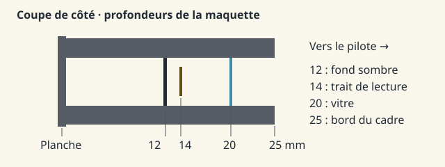

# 2 · Bâtir le planeur avec des anneaux et des baguettes

Pense à un modèle en carton. Un **sommet** est un coin ; une **face** est un morceau de carton tendu entre des coins. Au lieu de taper des milliers de lignes de sommets à la main, tu vas écrire une petite machine à les numéroter. Crée **fabrique.py** à la racine, au même niveau que *src*. À la fin, ce programme écrira **src/SW233/Models/sw233.ac**. Nomme les objets exactement comme ici : plus tard FlightGear cherchera « fil-de-laine », pas « ficelle ».

**Ton repère :** imagine-toi assis dans le planeur. Dans la recette, x va du nez vers la queue, y vers ta droite, z vers le haut, en mètres. Sur un papier dessine le nez à x = 0 et la queue à x = 7,8486. Pose deux crayons à y = −7,7724 et +7,7724 : les extrémités doivent être à la même distance du milieu.

**Fichier à écrire :** `fabrique.py`. Colle les blocs de ce fichier dans l’ordre, sans retirer les espaces du début des lignes.

## A · Prépare la boîte de pièces

Une liste garde les faces de chaque pièce. Dans la palette, les trois nombres sont des quantités de rouge, de vert et de bleu entre 0 et 1. Le dernier nombre règle la transparence ; 0 donne une peinture opaque. Ce sont des couleurs de travail, pas des échantillons de peinture des Cadets.

<!-- atelier-fichier: fabrique.py -->
```python
from pathlib import Path
from math import cos, sin, pi, radians
from collections import defaultdict
import numpy as np

M = Path("src/SW233/Models")
M.mkdir(parents=True, exist_ok=True)
parts = defaultdict(list)
mat = [
    ("jaune", (0.94, 0.66, 0.15), 0),
    ("creme", (1, 0.86, 0.48), 0),
    ("cadre", (0.21, 0.25, 0.23), 0),
    ("caoutchouc", (0.09, 0.10, 0.10), 0),
    ("verre", (0.51, 0.75, 0.84), 0.79),
    ("cadran", (0.045, 0.06, 0.065), 0),
    ("ivoire", (0.97, 0.95, 0.79), 0),
    ("orange", (0.9, 0.31, 0.11), 0),
    ("siege", (0.34, 0.39, 0.32), 0),
]
```

## B · Invente quatre outils réutilisables

Lis les quatre fonctions comme des gestes : `poly` pose une face ; `bridge` relie deux anneaux par des bandes ; `rod` dessine deux petits octogones et les relie pour faire un tube ; `loft` relie des couples comme les arceaux d’une tente. Le sinus et le cosinus servent de compas : ils placent les points à intervalles réguliers autour d’un centre. Exemple : si deux anneaux ont chacun 12 coins, le pont doit produire 12 bandes, pas 11. Le coin précédent du premier coin est le dernier : c’est ce qui ferme la couture.

<!-- atelier-fichier: fabrique.py -->
```python
def poly(n, m, *v):
    parts[n].append((m, v))


def bridge(n, m, a, b):
    for i in range(len(a)):
        poly(n, m, a[i - 1], a[i], b[i], b[i - 1])


def rod(n, m, a, b, r):
    a, b = np.array(a), np.array(b)
    v = b - a
    v = v / np.linalg.norm(v)
    u = np.cross(v, [0, 0, 1] if abs(v[2]) < 0.9 else [0, 1, 0])
    u /= np.linalg.norm(u)
    w = np.cross(v, u)
    ring = [r * (u * cos(i * pi / 4) + w * sin(i * pi / 4)) for i in range(8)]
    bridge(n, m, [a + p for p in ring], [b + p for p in ring])


def loft(n, m, stations):
    rings = [
        [(x, r * cos(i * pi / 6), z + h * sin(i * pi / 6)) for i in range(12)]
        for x, r, z, h in stations
    ]
    for a, b in zip(rings, rings[1:]):
        bridge(n, m, a, b)
    poly(n, m, *rings[0])
    poly(n, m, *rings[-1])
```

## C · Donne du volume à la coque

Chaque ligne représente une tranche : (distance au nez, demi-largeur, hauteur du centre, demi-hauteur). Par exemple à 1,35 m la coque est large de 2 × 0,46 = 0,92 m ; son sommet atteint −0,27 + 0,34 = +0,07 m. Ces chiffres sont des stations de dessin H ; ils ne figurent pas dans un devis de masse. Douze points par tranche donnent une première coque légère à dessiner.

<!-- atelier-fichier: fabrique.py -->
```python
loft(
    "fuselage",
    0,
    [
        (0, 0.024, -0.28, 0.025),
        (0.22, 0.23, -0.27, 0.19),
        (0.66, 0.4, -0.27, 0.31),
        (1.35, 0.46, -0.27, 0.34),
        (2.48, 0.47, -0.27, 0.36),
        (3.25, 0.38, -0.20, 0.32),
        (5, 0.21, -0.12, 0.22),
        (7.61, 0.065, -0.03, 0.105),
    ],
)
```

## D · Laisse voir le pilote à travers la verrière

Pose un demi-anneau au-dessus de chaque station, puis relie les demi-anneaux avec le matériau transparent. Trois stations reçoivent en plus des tubes opaques pour les montants. Si tu utilises la peinture jaune à la place du verre, la vue avant sera bouchée même si la forme est correcte.

<!-- atelier-fichier: fabrique.py -->
```python
# Upper half of canopy only, lower body leaves an open pilot sightline.
stations = [
    (0.50, 0.24, 0.05, 0.03),
    (0.91, 0.397, 0.07, 0.28),
    (1.55, 0.43, 0.09, 0.52),
    (2.13, 0.44, 0.1, 0.60),
    (2.78, 0.39, 0.1, 0.47),
    (3.16, 0.34, 0.1, 0.14),
]
rings = [
    [(x, r * cos(i * pi / 8), z + h * sin(i * pi / 8)) for i in range(9)] for x, r, z, h in stations
]
for a, b in zip(rings, rings[1:]):
    for j in range(8):
        poly("verriere", 4, a[j], a[j + 1], b[j + 1], b[j])
for k in (1, 3, 5):
    for i in range(8):
        rod("arceaux", 2, rings[k][i], rings[k][i + 1], 0.013)
```

## E · Fabrique une aile, puis son reflet

Pour chaque aile, les quatre lignes sont (distance à l’axe, position du bord avant, corde, hauteur). À la racine, le bord arrière est à 1,99 + 1,57 = 3,56 m du nez. Une petite liste de fractions dessine une section épaisse ; ce n’est pas un profil aérodynamique mesuré. Multiplier la distance latérale par −1 ou +1 fabrique les deux côtés sans inverser l’avant. Un hauban joint aile et fuselage. Pour chaque aérofrein, la charnière est à x = 2,41 ; le bord mobile est à 2,54. Ce rectangle doit rester une pièce séparée : si on le soude à l’aile, l’animation soulèvera toute l’aile.

<!-- atelier-fichier: fabrique.py -->
```python
for side in (-1, 1):
    s = str(side)
    rings = []
    for y, le, ch, z in [
        (0, 1.99, 1.57, 0.74),
        (3.42, 1.99, 1.57, 0.80),
        (7.62, 2.19, 0.83, 0.93),
        (7.7724, 2.23, 0.76, 0.94),
    ]:
        rings.append(
            [
                (le + ch * f, y * side, z + ch * h)
                for f, h in [
                    (0, 0),
                    (0.09, 0.054),
                    (0.3, 0.072),
                    (0.72, 0.040),
                    (1, 0.002),
                    (0.68, -0.028),
                    (0.19, -0.038),
                ]
            ]
        )
    for a, b in zip(rings, rings[1:]):
        bridge("aile" + s, 0, a, b)
    poly("aile" + s, 0, *rings[-1])
    rod("hauban" + s, 1, (2.36, 0.36 * side, -0.43), (2.49, 3.65 * side, 0.795), 0.038)
    poly(
        "aerofrein" + s,
        2,
        (2.41, 0.98 * side, 0.86),
        (2.41, 2.13 * side, 0.88),
        (2.54, 2.13 * side, 0.88),
        (2.54, 0.98 * side, 0.86),
    )
    p = [
        (6.85, 0, 0.1),
        (6.87, 1.68 * side, 0.11),
        (7.07, 1.93 * side, 0.11),
        (7.5, 1.93 * side, 0.11),
        (7.79, 1.67 * side, 0.11),
        (7.79, 0, 0.1),
    ]
    # Charnière de maquette : x=7,35 m, z=0,11 m (non mesurée).
    p = [(x, y, .11) for x, y, z in p]
    def coupe(points, mobile):
        resultat = []
        for a, b in zip(points, points[1:] + points[:1]):
            dedans_a = a[0] >= 7.35 if mobile else a[0] <= 7.35
            dedans_b = b[0] >= 7.35 if mobile else b[0] <= 7.35
            if dedans_a: resultat.append(a)
            if dedans_a != dedans_b:
                t = (7.35-a[0])/(b[0]-a[0])
                resultat.append((7.35, a[1]+t*(b[1]-a[1]), .11))
        return resultat
    poly("empennage" + s, 1, *coupe(p, False))
    poly("profondeur" + s, 1, *coupe(p, True))
```

Le contour horizontal est découpé à **x=7,35 m** : partie avant fixe, partie arrière mobile. On place ce contour dans le plan z=0,11 m pour obtenir une charnière droite. Ces deux valeurs sont des choix de maquette, pas des cotes constructeur. La [fiche 10](10-profondeur.md) explique les intersections et les essais.

## F · Termine la queue, le train et les commandes

La dérive ferme la longueur de référence à 7,8486 m. Deux cercles reliés dessinent une roue ; notre grande roue a un rayon visuel choisi de 0,245 m. Le dessin de visite situe roue, patin, roulette et haubans ; il ne donne pas ces rayons. Les deux sièges sont en tandem : ne les place pas côte à côte. Le levier orange reste à gauche (y négatif).

<!-- atelier-fichier: fabrique.py -->
```python
poly("derive", 0, (6.50, 0, 0.09), (7.1, 0, 1.42), (7.83, 0, 1.42), (7.8486, 0, 0.04))
for name, x, z, r in [("roue", 2.25, -0.60, 0.245), ("roulette", 7.51, -0.27, 0.084)]:
    a = [(x + r * cos(i * pi / 10), -0.075, z + r * sin(i * pi / 10)) for i in range(20)]
    b = [(px, 0.075, pz) for px, _, pz in a]
    bridge(name, 3, a, b)
    poly(name, 3, *a)
    poly(name, 3, *b)
rod("patin", 2, (0.33, 0, -0.52), (1.91, 0, -0.69), 0.038)
for x in (1.52, 2.39):
    poly(
        "sieges",
        8,
        (x, -0.27, -0.22),
        (x, 0.27, -0.22),
        (x + 0.13, 0.27, 0.13),
        (x + 0.13, -0.27, 0.13),
    )
rod("manche", 2, (1.48, 0, -0.33), (1.36, 0, 0.055), 0.022)
rod("poignee-frein", 7, (1.19, -0.34, -0.13), (1.43, -0.34, 0.01), 0.019)
```

## G · Découpe la planche et prépare les cadrans

La planche est à x = 0,87 ; son bord mesure 2 × 0,39 = 0,78 m. C’est le gabarit de travail de la fiche 1. Pour chaque cadran, note (nom, y, z, rayon). Les fonctions suivantes tracent un trait à une distance donnée du centre et fabriquent les chiffres avec sept segments, comme une petite horloge numérique. Les chiffres sont fixes. Les aiguilles doivent pouvoir tourner sans emporter les chiffres.

<!-- atelier-fichier: fabrique.py -->
```python
# A faceted panel in front of the pilot; scale ticks and numeric legends are real mesh.
px = 0.87
poly(
    "tableau",
    5,
    (px, -0.39, -0.08),
    (px, 0.39, -0.08),
    *[(px, 0.39 * cos(i * pi / 20), 0.015 + 0.26 * sin(i * pi / 20)) for i in range(21)],
)
dials = [("alt", -0.22, 0.087, 0.083), ("ias", 0.17, 0.14, 0.075), ("vsi", 0.295, 0.022, 0.063)]


def point(y, z, r, a):
    return (y + r * sin(a), z + r * cos(a))


def mark(n, x, y, z, r, a, length, width):
    v = (sin(a), cos(a))
    w = (cos(a) * width, -sin(a) * width)
    poly(
        n,
        6,
        *[
            (x, y + v[0] * t + w[0] * k, z + v[1] * t + w[1] * k)
            for t, k in [(r, -1), (r, 1), (r - length, 1), (r - length, -1)]
        ],
    )


def digit(y, z, num, scale):
    segs = [
        ((0, 0), (1, 0)),
        ((1, 0), (1, 1)),
        ((1, 1), (1, 2)),
        ((0, 2), (1, 2)),
        ((0, 1), (0, 2)),
        ((0, 0), (0, 1)),
        ((0, 1), (1, 1)),
    ]
    chars = str(num)
    for j, k in enumerate(chars):
        for seg in {
            "0": "012345",
            "1": "12",
            "2": "01643",
            "3": "01623",
            "4": "5612",
            "5": "05623",
            "6": "056423",
            "7": "012",
            "8": "0123456",
            "9": "012356",
            "-": "6",
        }[k]:
            (a, b), (c, d) = segs[int(seg)]
            yy = y + (j * 1.5 - 0.5 * (len(chars) * 1.5 - 0.5)) * scale
            rod(
                "chiffres",
                6,
                (px + 0.009, yy + a * scale, z + (1 - b) * scale),
                (px + 0.009, yy + c * scale, z + (1 - d) * scale),
                0.00065,
            )
```

## H · Détache les aiguilles

Une aiguille est un triangle indépendant. Place-la à x = 0,87 + 0,012 = 0,882, légèrement devant le fond, du côté du pilote. Si deux faces sont au même endroit, elles peuvent clignoter. Un tour de cadran d’altitude contient dix grands repères ; leur écart est donc 360 ÷ 10 = 36°. Les échelles de la maquette sont idéalisées ; il faudra des photos frontales pour reproduire la vraie typographie.

**L’altimètre de C-FYLP.** Dans la photo de 690 × 517 pixels, découpe (63,207) → (173,321), bords droit et bas exclus, puis agrandis cinq fois. Le centre est proche de (283,290) dans cette copie de 550 × 570. La longue aiguille traverse le secteur 8–9 ; une silhouette courte et large pointe vers 0–1. Les reflets empêchent d’identifier sûrement une troisième aiguille. Notre modèle conserve deux aiguilles : c’est une limite de reproduction à noter.

Dessine cinquante traits : un grand tous les cinq petits. Les dix nombres occupent des secteurs égaux de 36°, choix régulier cohérent avec la photo. La pointe longue mesure 75 mm depuis le centre dans notre maquette ; la courte 44 mm. Ces longueurs et le diamètre du bouton de 24 mm sont des choix de modèle, pas des mesures du constructeur. La grande aiguille se trouve à x = 0,882 ; la petite à 0,883, pour éviter que leurs faces se superposent. Le bouton de calage se situe 60 mm à gauche et 60 mm sous le centre du cadran.

<!-- atelier-fichier: fabrique.py -->
```python
animations = []


def needle(name, y, z, r, property, factor, offset=0):
    poly(
        name,
        7,
        (px + 0.012, y - 0.002, z - 0.005),
        (px + 0.012, y + 0.002, z - 0.005),
        (px + 0.012, y, z + r),
    )
    animations.append((name, y, z, property, factor, offset))


for kind, y, z, r in dials:
    circ = [(px + 0.004, *point(y, z, r, i * pi / 30)) for i in range(60)]
    poly(kind + "-fond", 3, *circ)
    vals, angles = [], []  # Les trois cadrans sont peints à la fiche 6.
    for v, deg in zip(vals, angles):
        a = radians(deg)
        mark("traits", px + 0.008, y, z, r * 0.94, a, r * 0.08, 0.001)
        digit(*point(y, z, r * 0.68, a), v, 0.004)
    if kind == "alt":
        # Longue et fine : centaines ; courte et large : milliers.
        poly("alt-centaines",6,*[(px+.012,y+dy,z+dz) for dy,dz in
             [(-.0014,-.012),(.0014,-.012),(.0011,.067),(0,.075),(-.0011,.067)]])
        poly("alt-milliers",6,*[(px+.013,y+dy,z+dz) for dy,dz in
             [(-.003,-.010),(.003,-.010),(.004,.029),(0,.044),(-.004,.029)]])
        poly("alt-milliers",5,*[(px+.0135,*point(y,z,.004,i*pi/12)) for i in range(24)])
        cy, cz = y-.060, z-.060
        a = [(px+.006,*point(cy,cz,.012,i*pi/12)) for i in range(24)]
        b = [(px+.025,*point(cy,cz,.012,i*pi/12)) for i in range(24)]
        bridge("alt-calage",3,a,b)
        poly("alt-calage",2,*b)
        poly("alt-calage",6,(px+.0255,cy-.001,cz+.003),
             (px+.0255,cy+.001,cz+.003),(px+.0255,cy+.001,cz+.009),
             (px+.0255,cy-.001,cz+.009))
    elif kind == "ias":
        # Aiguille ivoire, pointe longue ; le moyeu sombre tourne avec elle.
        poly("vitesse-mph", 6, *[(px+.012,y+dy,z+dz) for dy,dz in
             [(-.0025,-.014),(.0025,-.014),(.0018,.056),(0,.067),(-.0018,.056)]])
        poly("vitesse-mph", 5, *[(px+.0125,*point(y,z,.004,i*pi/12)) for i in range(24)])
    else:
        poly("vario", 6, *[(px+.012,y+dy,z+dz) for dy,dz in
             [(-.0018,-.012),(.0018,-.012),(.0013,.049),(0,.058),(-.0013,.049)]])
        poly("vario", 5, *[(px+.0125,*point(y,z,.0035,i*pi/12)) for i in range(24)])
```

## I · Pose le Pitot et attache le fil

La tête est au nez d’après le manuel ; sa forme s’appuie sur la photo avant. Les coordonnées de la baguette et des cinq points du fil sont des hypothèses visuelles. Le premier point (−0,055 ; 0 ; 0,237) est le nœud. Recopie-le dans le cahier : c’est le centre de la rotation à la fiche 4. Le rayon du fil est volontairement assez épais pour rester visible à l’écran.

<!-- atelier-fichier: fabrique.py -->
```python
# Nose-mounted pressure head and a separate moving tuft. Dimensions are visual estimates.
mat.extend([("inox", (0.62, 0.68, 0.69), 0), ("laine", (0.85, 0.085, 0.045), 0)])
rod("embase-pitot", 2, (0.245, 0, -0.13), (0.218, 0, -0.058), 0.022)
rod("tube-pitot", 9, (0.222, 0, -0.073), (-0.055, 0, 0.237), 0.011)
rod("tube-pitot", 9, (-0.055, 0, 0.237), (-0.212, 0, 0.239), 0.011)
rod("attache-laine", 2, (-0.060, 0, 0.233), (-0.048, 0, 0.244), 0.014)
yarn = [
    (-0.055, 0, 0.237),
    (0.018, 0, 0.253),
    (0.10, 0, 0.275),
    (0.17, 0, 0.306),
    (0.235, 0, 0.325),
]
for a, b in zip(yarn, yarn[1:]):
    rod("fil-de-laine", 10, a, b, 0.0048)
```

## I bis · Donner une épaisseur à la poignée rouge

Sur C-FYLP, la boule est sous le compas, sur l’axe : son centre est vers le pixel (344,323), son diamètre apparent environ 51 px. Avec le gabarit de la fiche 1 : 51 / 610 × 0,78 ≈ 0,065 m. Nous choisissons 0,066 m, soit un rayon de 0,033 m. La photo seule ne donne pas la profondeur : les stations entre x = 0,90 et 0,961 m sont des choix de sculpture. Assemble six anneaux sur une petite tige ; fais varier leur rayon pour arrondir la poignée. Ne lui branche pas de commande de largage : il n’y a pas encore de câble.

<!-- atelier-fichier: fabrique.py -->
```python
# Poignée de largage C-FYLP : forme visuelle, aucun câble simulé.
rod("tige-largage", 2, (.872, 0, -.032), (.921, 0, -.032), .009)
red = len(mat)
mat.append(("poignee-bordeaux", (.44, .105, .078), 0))
loft("boule-largage", red, [
    (.90, .008, -.032, .008), (.906, .023, -.032, .023),
    (.92, .033, -.032, .033), (.94, .033, -.032, .033),
    (.954, .023, -.032, .023), (.961, .008, -.032, .008),
])
```

## I ter · Construis une petite boîte ouverte pour le compas

Prends une boîte d’allumettes vide : de face tu vois son ouverture ; en la décalant de côté, tu vois aussi sa paroi. C’est le même effet que nous cherchons sous la bouche d’air. La photo de C-FYLP donne une façade, pas une profondeur. Garde le centre choisi à la fiche 1 (y = 0 ; z = 0,098 m). Le dessin plat faisait 126 × 118 pixels dans la texture à 1 920 pixels/m : environ 66 × 61 mm. Garde cette taille pour la base. Les 25 mm d’épaisseur sont une estimation de maquette.

**Dessine la coupe dans ton cahier.** Trace une ligne pour la planche. En allant vers le pilote, marque le fond initial à 12 mm (ramené à 1 mm pour la rose mobile), le trait ivoire à 14 mm, la vitre à 20 mm et le rebord à 25 mm. Ainsi la vitre est en retrait de 5 mm et le trait est 6 mm derrière elle. Les distances différentes empêchent deux faces de se battre pour le même pixel. Le pied commence à 0,5 mm pour éviter une face coplanaire avec la planche.

Coupe historique du boîtier vide : dans la version mobile, le tambour prend la place de l’ancien fond à 12 mm.



**Assemble.** Découpe mentalement les quatre coins d’un rectangle : il reste huit points. Fais cinq contours de cette forme. Relie leurs bords par bandes, comme pour les ailes. Ne bouche jamais le milieu du cadre ! Ferme seulement le fond, ajoute le trait, quatre têtes de vis et la vitre transparente. Ce compas est décoratif : il ne montre aucun cap.

<!-- atelier-fichier: fabrique.py -->
```python
# Compas C-FYLP, centré sous la bouche. Les profondeurs sont des hypothèses.
def contour_compas(profondeur, demi_largeur, demi_hauteur, coin):
    w, h, c = demi_largeur, demi_hauteur, coin
    return [(px + profondeur, y, .098 + z) for y, z in
            [(-w+c,-h),(w-c,-h),(w,-h+c),(w,h-c),
             (w-c,h),(-w+c,h),(-w,h-c),(-w,-h+c)]]

base = contour_compas(.0005, .033, .031, .006)
epaules = contour_compas(.021, .033, .031, .006)
bord = contour_compas(.025, .031, .029, .005)
ouverture = contour_compas(.025, .0245, .014, .003)
fond = contour_compas(.001, .0245, .014, .003)
bridge("compas-cadre", 3, base, epaules)
bridge("compas-cadre", 2, epaules, bord)
bridge("compas-cadre", 3, bord, ouverture)
bridge("compas-cadre", 2, ouverture, fond)
poly("compas-fond", 5, *fond)
poly("compas-repere", 6, *[(px+.014,y,.098+z) for y,z in
                           [(-.0009,.002),(.0009,.002),(.0009,.010),(-.0009,.010)]])
for y in (-.024, .024):
    for z in (-.022, .022):
        poly("compas-vis", 9, *[(px+.0255, y+.0022*cos(i*pi/4),
                                 .098+z+.0022*sin(i*pi/4)) for i in range(8)])
poly("compas-vitre", 4, *contour_compas(.020, .0245, .014, .003))
```

**Regarde le résultat dans FlightGear :** [photos de face, de biais et en lumière du soir](06-peinture.md#compas-relief).

## I quater · Enroule les caps sur un tambour

Prends une bande de papier, écris N, E, S, W à intervalles égaux et ferme la boucle. Dans le compas on voit son bord, pas le dessus. Le trait court est devant les graduations et s’arrête au-dessus des lettres. On recule le fond à 1 mm de la planche pour dégager le tambour. Son rayon de 49 mm et la taille des caractères sont des choix de lisibilité. Un tour fait 360° : place un trait tous les 5°, une inscription tous les 30°. Le chiffre 3 désigne 030°. Les deux côtés du nord se rejoignent sans couture.

<!-- atelier-fichier: fabrique.py -->
```python
# Une seule pièce mobile ; tout le reste du boîtier reste fixe.
axe = px - .037
rayon = .049
def carte(angle, t, hauteur, r):
    a = radians(-angle) + t/rayon
    return (axe+r*cos(a), r*sin(a), .098+hauteur)

def case(angle, gauche, droite, bas, haut, matiere, r):
    poly("compas-rose", matiere, *[carte(angle,t,h,r) for t,h in
         [(gauche,bas),(droite,bas),(droite,haut),(gauche,haut)]])

# Une facette par tranche de 5 degrés ; les marques sont devant le fond.
for deg in range(0,360,5):
    demi = rayon*radians(2.5)
    case(deg,-demi,demi,-.011,.011,5,rayon)
    case(deg,-.00048,.00048,.004,.010 if deg%10 == 0 else .007,6,rayon+.0003)

# Chaque lettre ou chiffre est un petit pochoir de quelques colonnes.
pochoirs = {
    "N":"1001/1101/1011/1001/1001", "E":"111/100/110/100/111",
    "S":"111/100/111/001/111", "W":"10001/10001/10101/10101/01010",
    "1":"010/110/010/010/111", "2":"111/001/111/100/111",
    "3":"111/001/111/001/111", "5":"111/100/111/001/111",
    "6":"111/100/111/101/111", "0":"111/101/101/101/111",
    "4":"101/101/111/001/001", "7":"111/001/010/010/010",
}
for deg, mot in enumerate(["N","3","6","E","12","15","S","21","24","W","30","33"]):
    pas = .00175
    lignes = [pochoirs[c].split("/") for c in mot]
    largeur = sum(len(g[0])+1 for g in lignes)-1
    origine = -largeur*pas/2
    for g in lignes:
        for j, ligne in enumerate(g):
            for i, encre in enumerate(ligne):
                if encre == "1":
                    t, h = origine+i*pas, .001-j*pas
                    case(deg*30,t,t+pas,h-pas,h,6,rayon+.00045)
        origine += (len(g[0])+1)*pas
```

## J · Écris le fichier que lit le simulateur

Le fichier commence par `AC3Db`, la palette, puis `OBJECT world` : la boîte qui contient toutes les pièces. Pour chaque pièce, `numvert` compte les coins et `numsurf` compte les faces ; `refs 4` annonce quatre numéros de coins pour un quadrilatère. Les numéros commencent à zéro. Un coin (x, y, z) de ton cahier devient **(x, z, −y)** dans notre AC3D : pour une extrémité à droite, la troisième colonne devient négative. La condition sur les faces du fuselage laisse une ouverture au-dessus de la place avant ; conserver les numéros de sommets évite de renuméroter toutes les autres faces. Les rehauts des graduations et du fil servent à leur lisibilité dans le rendu.

<!-- atelier-fichier: fabrique.py -->
```python
out = ["AC3Db"]
for n, c, t in mat:
    glow = {"ivoire": ".5 .48 .4", "orange": ".4 .12 .04", "laine": ".7 .04 .02"}.get(n, "0 0 0")
    out.append(
        f'MATERIAL "{n}" rgb '
        + " ".join(map(str, c))
        + f" amb 0.3 0.3 0.3 emis {glow} spec .15 .15 .15 shi 12 trans {t}"
    )
out += ["OBJECT world", f"kids {len(parts)}"]
for n, faces in parts.items():
    verts = []
    inds = []
    for m, v in faces:
        ids = []
        for x, y, z in v:
            ids.append(len(verts))
            verts.append((x, z, -y))
        if n != "fuselage" or not (
            0.66 < sum(p[0] for p in v) / len(v) < 2.48 and sum(p[2] for p in v) / len(v) > -0.13
        ):
            inds.append((m, ids))
    out += (
        ["OBJECT poly", f'name "{n}"', f"numvert {len(verts)}"]
        + [" ".join(f"{c:.5f}" for c in v) for v in verts]
        + [f"numsurf {len(inds)}"]
    )
    for m, ids in inds:
        out += ["SURF 0x30", f"mat {m}", f"refs {len(ids)}"] + [f"{i} 0 0" for i in ids]
    out += ["kids 0"]
(M / "sw233.ac").write_text("\n".join(out) + "\n", encoding="utf8")
```

**À faire maintenant :** enregistre, puis exécute depuis *Mon-Schweizer* :

```powershell
.\.venv\Scripts\python.exe fabrique.py
Get-Content src/SW233/Models/sw233.ac -TotalCount 16
```

**Contrôle :** pour la forme de départ du livre, tu dois lire *AC3Db*, douze matériaux, *OBJECT world* puis *kids 41*. Cherche les deux noms *aerofrein-1* et *aerofrein1*. Si le fichier reste vide, vérifie que le dernier bloc a été enregistré. Si les sièges sont au-dessus du toit, vérifie surtout l’ordre (x,z,−y) ; ne déplace pas les sièges pour masquer une erreur de repère.
