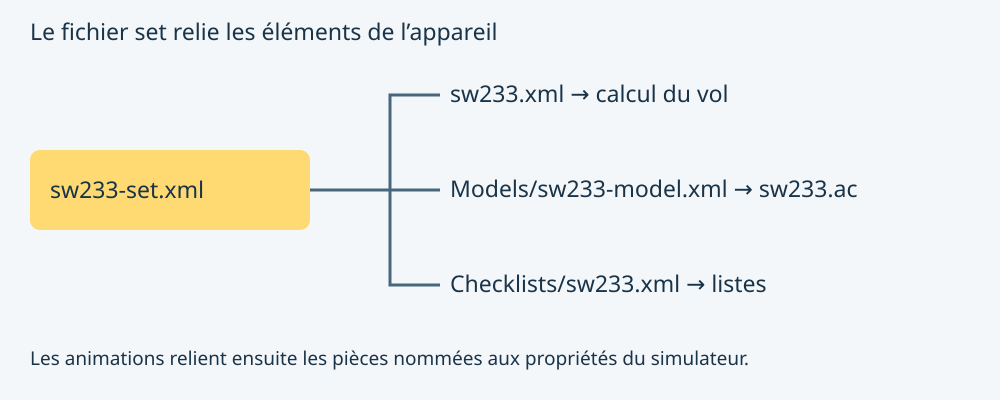

# 4 · Donner un nom à l’avion et faire tourner les bonnes pièces



Tu vas écrire deux fichiers, et non un seul. La fiche **set** est l’étiquette sur la boîte : elle indique à FlightGear quel avion ouvrir. Le fichier **model** est le mode d’emploi des pièces mobiles. Une animation est une règle : « lis ce nombre, multiplie-le, tourne cette pièce autour de ce point ». Les balises XML doivent toujours se refermer en ordre inverse.

**Fichier à écrire :** `src/SW233/sw233-set.xml`. Colle les blocs de ce fichier dans l’ordre, sans retirer les espaces du début des lignes.

## A · Nomme et relie

Commence par une seule racine PropertyList. Dans sim, la description est le titre affiché ; le nom de fichier sw233-set.xml détermine l’identifiant sw233. `jsb` choisit JSBSim ; `aero` vaut sw233 sans extension pour charger sw233.xml.

<!-- atelier-fichier: src/SW233/sw233-set.xml -->
```xml
<?xml version="1.0" encoding="UTF-8"?>
<!-- SPDX-License-Identifier: GPL-3.0-only
     Original SW233 integration. No global weather or joystick overrides. -->
<PropertyList>
    <sim>
        <description>Schweizer SGS 2-33 — Cadets de l’aviation royale du Canada (prototype)</description>
        <author>Steve Prud'Homme et contributeurs SW233</author>
        <long-description>Prototype libre du Schweizer SGS 2-33 pour FlightGear. Licence GPL-3.0-only. Aerateur central et bagues anemometre, altimetre et variometre en relief 3D fixe. Radio COM1 generique : affichage actif, reglages 1 MHz et 25 kHz ; audio non valide. Calage altimetre lisible en inHg. Compas anime avec boitier arrondi, joint et vis en relief ; rose texturee et caracteres lisses. Tableau noir affine, vis et supports de cartes textures. Plaquettes et listes FR/EN par menu ou Ctrl+L ; initiales mnemotechniques rouges, cartes de droite degagees. Cockpit raccorde, vitrage facette et contours de porte fixes ; commandes et masses configurables ; modele de vol experimental. Projet aux couleurs des Cadets de l'aviation royale du Canada : livree finale encore a realiser. Teste sous Windows avec FlightGear 2024.1.7 ; Linux non valide.</long-description>
        <aircraft-version>0.1.0-dev</aircraft-version>
        <minimum-fg-version>2024.1.7</minimum-fg-version>
        <flight-model>jsb</flight-model>
        <aero>sw233</aero>
        <model>
            <path>Aircraft/SW233/Models/sw233-model.xml</path>
        </model>
```

## B · Assieds-toi à la place avant

Pour la caméra, l’ordre est droite, haut, arrière. Le milieu du siège est à droite = 0, hauteur choisie = 0,50 m et recul choisi = 1,65 m. Ne copie pas l’ordre des colonnes AC3D. L’angle −18° aide à voir la planche ; le champ de 80° et le plan proche de 0,02 m ont été choisis dans le simulateur. La balise internal permet d’afficher l’intérieur.

<!-- atelier-fichier: src/SW233/sw233-set.xml -->
```xml
        <view n="0">
            <internal type="bool">true</internal>
            <config>
                <!-- View system: right, up, aft offsets (metres). -->
                <x-offset-m>0</x-offset-m>
                <y-offset-m>0.50</y-offset-m>
                <z-offset-m>1.65</z-offset-m>
                <pitch-offset-deg>-18</pitch-offset-deg>
                <default-field-of-view-deg>80</default-field-of-view-deg>
                <ground-level-nearplane-m>0.02</ground-level-nearplane-m>
            </config>
        </view>
```

## C · Donne l’adresse des listes

Ce chemin part du dossier SW233, pas du dossier Models. La liste sera écrite à la séance suivante. Les tags servent au classement : ils ne transforment pas un avion motorisé en planeur.

<!-- atelier-fichier: src/SW233/sw233-set.xml -->
```xml
        <menubar><default><menu n="100">
            <label>SW233</label><enabled type="bool">true</enabled>
            <item><label>Occupants et centrage</label><binding>
                <command>nasal</command><script>sw233_load.dialog.open();</script>
            </binding></item>
            <item><label>Français - plaquettes et listes</label><binding>
                <command>nasal</command><script>sw233_language.choose("fr");</script>
            </binding></item>
            <item><label>English - placards and checklists</label><binding>
                <command>nasal</command><script>sw233_language.choose("en");</script>
            </binding></item>
            <item><label>FR / EN (Ctrl+L)</label><binding>
                <command>nasal</command><script>sw233_language.toggle();</script>
            </binding></item>
            <item><label>Checklists / Listes</label><binding>
                <command>dialog-show</command><dialog-name>checklist</dialog-name>
            </binding></item>
        </menu></default></menubar>
        <checklists include="Checklists/sw233.xml"/>
        <sw233>
            <language type="string">fr</language>
            <translations>
                <fr include="Checklists/sw233.xml"/>
                <en include="Checklists/sw233-en.xml"/>
            </translations>
        </sw233>
        <tags>
            <tag>glider</tag>
            <tag>unpowered</tag>
        </tags>
    </sim>
    <nasal><sw233_load><file>Nasal/occupants.nas</file></sw233_load><sw233_radio><file>Nasal/radio.nas</file></sw233_radio><sw233_language><file>Nasal/language.nas</file></sw233_language></nasal>
    <input><keyboard><key n="12">
        <name>Ctrl-L</name><desc>SW233 : plaquettes et checklists FR / EN</desc>
        <repeatable type="bool">false</repeatable>
        <binding><command>nasal</command><script>sw233_language.toggle();</script></binding>
    </key></keyboard></input>
</PropertyList>
```

**Fichier à écrire :** `src/SW233/Models/sw233-model.xml`. Colle les blocs de ce fichier dans l’ordre, sans retirer les espaces du début des lignes.

## D · Indique le dessin

Le chemin est relatif à ce fichier : sw233.ac est dans le même dossier. Les accents ne sont pas permis par magie dans les noms : copie exactement les noms écrits par ta recette.

<!-- atelier-fichier: src/SW233/Models/sw233-model.xml -->
```xml
<PropertyList>
  <path>sw233.ac</path>
```

## Centaines de pieds

<a name="altimetre"></a>

Les deux aiguilles lisent **instrumentation/altimeter/indicated-altitude-ft**. L’ancienne version lisait la position géométrique du planeur ; le calage de pression n’aurait donc pas modifié ses aiguilles. Le nouvel instrument dépend de la pression statique et du calage. La propriété et la syntaxe du bouton ont été vérifiées dans FlightGear 2024.1.7, notamment son fichier local *Aircraft/c172p/Models/Interior/Panel/Instruments/alt/alt.xml*.

À 500 ft, 500 × 0,36 = 180° : un demi-tour de la grande aiguille. Son pivot est au centre du cadran gauche.

<!-- atelier-fichier: src/SW233/Models/sw233-model.xml -->
```xml
  <animation>
    <type>rotate</type>
    <object-name>alt-centaines</object-name>
    <property>instrumentation/altimeter/indicated-altitude-ft</property>
    <factor>0.36</factor>
    <offset-deg>0</offset-deg>
    <center>
      <x-m>0.882</x-m>
      <y-m>-0.22</y-m>
      <z-m>0.087</z-m>
    </center>
    <axis>
      <x>-1</x>
      <y>0</y>
      <z>0</z>
    </axis>
  </animation>
```

## Milliers de pieds

La petite aiguille fait le tour en 10 000 ft : 360 / 10 000 = 0,036 degré par pied. À 500 ft elle fait 18°, pas 180°.

<!-- atelier-fichier: src/SW233/Models/sw233-model.xml -->
```xml
  <animation>
    <type>rotate</type>
    <object-name>alt-milliers</object-name>
    <property>instrumentation/altimeter/indicated-altitude-ft</property>
    <factor>0.036</factor>
    <offset-deg>0</offset-deg>
    <center>
      <x-m>0.882</x-m>
      <y-m>-0.22</y-m>
      <z-m>0.087</z-m>
    </center>
    <axis>
      <x>-1</x>
      <y>0</y>
      <z>0</z>
    </axis>
  </animation>
```

## Vitesse

<a name="anemometre"></a>

**1. Mesure d’abord le dessin.** Ouvre la photo de C-FYLP de 690 × 517 pixels (nom commençant par *5d81c6bf* dans [l’inventaire](../references/inventaire.md)). Dans Paint, découpe le rectangle allant de (428,167) à (533,273), bord droit et bord bas exclus ; il fait 105 × 106 pixels. Affiche-le six fois plus grand, sans tourner l’image. Sur ce gabarit de 630 × 636 pixels, le pivot est vers **(328,327)**. À partir de là, 12 heures vaut 0°, 3 heures vaut 90° et les angles augmentent dans le sens des aiguilles d’une montre. Pour chaque nombre, pointe le **trait** qui lui correspond, pas le centre du chiffre.

| mph | Point (colonne, ligne) dans l’agrandissement | Angle retenu |
|---:|---:|---:|
| 20 | 420, 116 | 24° |
| 40 | 523, 200 | 57° |
| 60 | 552, 373 | 102° |
| 80 | 413, 521 | 156° |
| 100 | 238, 530 | 204° |
| 120 | 116, 411 | 248° |
| 140 | 125, 234 | 295° |
| 160 | 263, 122 | 342° |

Tu peux tracer les rayons sur du papier calque et utiliser un rapporteur. Le calcul équivalent est *atan2(colonne − 328, 327 − ligne)*, en degrés, ramené entre 0 et 360. Les points sont approximatifs : déplacer ta marque de deux pixels sur la petite photo change l’angle d’environ 3° ; l’agrandissement ne corrige pas la perspective. Le repos à **5° pour 0 mph** est une hypothèse visuelle ; entre le repos et le premier nombre, nous ne connaissons pas la courbe réelle.

**2. Change d’unité une seule fois.** FlightGear fournit maintenant la **vitesse indiquée** de son anémomètre, en nœuds. L’ancienne animation utilisait la vitesse calibrée du modèle de vol. La table ci-dessous attend des nœuds dans *ind* et rend des degrés dans *dep*. Pour préparer chaque ligne : nœuds = mph × 1609,344 / 1852. Pour prédire ce que tu vas lire, fais l’inverse : 60 kt × 1852 / 1609,344 ≈ **69,05 mph**. Cette valeur se trouve à 9,05/20 du trajet entre les traits de 60 et 80 mph ; l’angle attendu est donc 102 + (156 − 102) × 9,05/20 ≈ **126,4°**. Recopie la table une seule fois dans le modèle : la [recette de peinture](06-peinture.md#peinture-ias) la relira pour placer les traits.

<!-- atelier-fichier: src/SW233/Models/sw233-model.xml -->
```xml
  <animation>
    <type>rotate</type>
    <object-name>vitesse-mph</object-name>
    <property>instrumentation/airspeed-indicator/indicated-speed-kt</property>
    <interpolation>
      <entry><ind>0.000000</ind><dep>5</dep></entry>
      <entry><ind>17.379525</ind><dep>24</dep></entry>
      <entry><ind>34.759050</ind><dep>57</dep></entry>
      <entry><ind>52.138575</ind><dep>102</dep></entry>
      <entry><ind>69.518099</ind><dep>156</dep></entry>
      <entry><ind>86.897624</ind><dep>204</dep></entry>
      <entry><ind>104.277149</ind><dep>248</dep></entry>
      <entry><ind>121.656674</ind><dep>295</dep></entry>
      <entry><ind>139.036199</ind><dep>342</dep></entry>
    </interpolation>
    <center>
      <x-m>0.882</x-m>
      <y-m>0.17</y-m>
      <z-m>0.14</z-m>
    </center>
    <axis>
      <x>-1</x>
      <y>0</y>
      <z>0</z>
    </axis>
  </animation>
```

## Montée et descente

<a name="variometre"></a>

**Lis l’unité avant le nombre.** Sur la photo C-FYLP de 690 × 517 pixels, le petit cadran en bas à droite porte « 100 FEET PER MIN ». Le 5 signifie donc **500 pieds par minute**, pas 5 000. Le zéro est à gauche ; la montée est dans la moitié haute (UP), la descente dans la moitié basse (DOWN). Cette seule photo ne permet pas de dire si l’instrument réel est compensé en énergie totale.

**Refais le pointage.** Dans la photo *5d81c6bf…*, découpe le rectangle de (526,223) à (633,332), bords droit et bas exclus. Agrandis cinq fois : 535 × 545 pixels. Le pivot est estimé en (260,294). Relève les grands traits, avec la même convention d’angle que pour l’anémomètre. La perspective et le flou peuvent déplacer le relevé de plusieurs degrés ; les angles ci-dessous ne sont pas des données d’étalonnage.

| Taux signé (ft/min) | Point (colonne, ligne) dans l’agrandissement | Angle retenu |
|---:|---:|---:|
| −2 000 | 442,322 | −261° |
| −1 500 | 352,433 | −213° |
| −1 000 | 208,458 | −162° |
| −500 | 91,386 | −119° |
| 0 | 71,292 | −90° |
| +500 | 118,188 | −53° |
| +1 000 | 245,110 | −5° |
| +1 500 | 401,155 | 45° |
| +2 000 | 451,278 | 85° |

**Branche l’indication, pas une conversion en double.** L’ancienne aiguille lisait directement la vitesse verticale de la trajectoire en ft/s. Nous utilisons maintenant *instrumentation/vertical-speed-indicator/indicated-speed-fpm*, déjà en ft/min. À +500, la table place l’aiguille en haut à gauche ; à −500, elle arrive en bas à gauche. Pour comparer à la trajectoire dans un relevé de vol, multiplie seulement *velocities/vertical-speed-fps* par 60 : −8,333 ft/s ≈ −500 ft/min. Notre instrument utilise le calcul de vitesse verticale de FlightGear ; nous n’ajoutons pas de compensation d’énergie totale.

<!-- atelier-fichier: src/SW233/Models/sw233-model.xml -->
```xml
  <animation>
    <type>rotate</type>
    <object-name>vario</object-name>
    <property>instrumentation/vertical-speed-indicator/indicated-speed-fpm</property>
    <interpolation>
      <entry><ind>-2000</ind><dep>-261</dep></entry>
      <entry><ind>-1500</ind><dep>-213</dep></entry>
      <entry><ind>-1000</ind><dep>-162</dep></entry>
      <entry><ind>-500</ind><dep>-119</dep></entry>
      <entry><ind>0</ind><dep>-90</dep></entry>
      <entry><ind>500</ind><dep>-53</dep></entry>
      <entry><ind>1000</ind><dep>-5</dep></entry>
      <entry><ind>1500</ind><dep>45</dep></entry>
      <entry><ind>2000</ind><dep>85</dep></entry>
    </interpolation>
    <center>
      <x-m>0.882</x-m>
      <y-m>0.295</y-m>
      <z-m>0.022</z-m>
    </center>
    <axis>
      <x>-1</x>
      <y>0</y>
      <z>0</z>
    </axis>
  </animation>
```

## Fil de laine

La propriété bêta décrit l’air qui arrive de côté. Avec notre axe vertical +z et ce maillage, le facteur −1 fait partir la pointe libre de l’autre côté. À β = 0°, le fil est dans l’axe. La rotation porte seulement sur le fil et non le Pitot.

<!-- atelier-fichier: src/SW233/Models/sw233-model.xml -->
```xml
  <animation>
    <type>rotate</type>
    <object-name>fil-de-laine</object-name>
    <property>fdm/jsbsim/aero/beta-deg</property>
    <factor>-1</factor>
    <center>
      <x-m>-0.055</x-m>
      <y-m>0</y-m>
      <z-m>0.237</z-m>
    </center>
    <axis>
      <x>0</x>
      <y>0</y>
      <z>1</z>
    </axis>
  </animation>
```

## Aérofrein gauche

Le bord avant garde sa place, le bord arrière monte. Propriété 0 = rentré ; 1 = ouvert. Les 85° sont une amplitude visuelle choisie, pas un débattement mesuré sur le planeur réel.

<!-- atelier-fichier: src/SW233/Models/sw233-model.xml -->
```xml
  <animation>
    <type>rotate</type>
    <object-name>aerofrein-1</object-name>
    <property>fdm/jsbsim/fcs/speedbrake-pos-norm</property>
    <factor>85</factor>
    <center>
      <x-m>2.41</x-m>
      <y-m>-0.98</y-m>
      <z-m>0.86</z-m>
    </center>
    <axis>
      <x>0</x>
      <y>-1</y>
      <z>0</z>
    </axis>
  </animation>
```

## Aérofrein droit

Le y du pivot change de signe car on change d’aile, mais on garde le même sens de rotation : les deux bords arrière doivent monter ensemble.

<!-- atelier-fichier: src/SW233/Models/sw233-model.xml -->
```xml
  <animation>
    <type>rotate</type>
    <object-name>aerofrein1</object-name>
    <property>fdm/jsbsim/fcs/speedbrake-pos-norm</property>
    <factor>85</factor>
    <center>
      <x-m>2.41</x-m>
      <y-m>0.98</y-m>
      <z-m>0.86</z-m>
    </center>
    <axis>
      <x>0</x>
      <y>-1</y>
      <z>0</z>
    </axis>
  </animation>
```

## Levier dans le cockpit

Le levier suit la position des aérofreins avec une amplitude visuelle de −35°. Si la poignée se déplace toute entière, vérifie le pivot (1,19 ; −0,34 ; −0,13) avant de changer le signe.

<!-- atelier-fichier: src/SW233/Models/sw233-model.xml -->
```xml
  <animation>
    <type>rotate</type>
    <object-name>poignee-frein</object-name>
    <property>fdm/jsbsim/fcs/speedbrake-pos-norm</property>
    <factor>-35</factor>
    <center>
      <x-m>1.19</x-m>
      <y-m>-0.34</y-m>
      <z-m>-0.13</z-m>
    </center>
    <axis>
      <x>0</x>
      <y>-1</y>
      <z>0</z>
    </axis>
  </animation>
```

<a name="rose-magnetique"></a>

## Lire le cap derrière le trait fixe

Ajoute ce dernier bloc au fichier des animations. Imagine que tu regardes un rouleau à travers un petit guichet. Fais tourner le rouleau (*compas-rose*), sans toucher au guichet ni au trait ! Le centre de rotation est à x = 0,870 − 0,037 = 0,833 m, au milieu de la rose. Un degré indiqué fait tourner le tambour d’un degré autour de l’axe vertical. Les lettres sont disposées dans le sens opposé lors de la construction : à 090°, E arrive sous le trait.

Lis **indicated-heading-deg** : c’est ce qu’indique le compas du simulateur. Le cap vrai se rapporte au nord géographique ; le cap magnétique se rapporte au nord magnétique. L’indication de l’instrument peut en plus différer du cap magnétique. Le branchement suit la propriété utilisée dans le fichier *Aircraft/Instruments-3d/mag-compass.xml* fourni avec FlightGear 2024.1.7.

<!-- atelier-fichier: src/SW233/Models/sw233-model.xml -->
```xml
  <animation>
    <type>rotate</type>
    <object-name>compas-rose</object-name>
    <property>instrumentation/magnetic-compass/indicated-heading-deg</property>
    <factor>1</factor>
    <center><x-m>0.833</x-m><y-m>0</y-m><z-m>0.098</z-m></center>
    <axis><x>0</x><y>0</y><z>1</z></axis>
  </animation>
```

## Calage de l’altimètre

Ajoute ce dernier bloc avant la fermeture finale. Le bouton utilise *knob* et *setting-inhg*, avec un pas de 0,01 pouce de mercure. Les bornes 28–31 inHg et la rotation de −1600°/inHg sont des choix d’interface, pas des spécifications de C-FYLP. Le réglage exact reste lisible dans le navigateur de propriétés ; la fenêtre noire du cadran ne montre pas encore de valeur. L’infobulle est prévue dans le XML, mais les essais automatisés vérifient la propriété, pas le geste de souris.

<!-- atelier-fichier: src/SW233/Models/sw233-model.xml -->
```xml
<animation>
    <type>knob</type>
    <object-name>alt-calage</object-name>
    <property>instrumentation/altimeter/setting-inhg</property>
    <factor>-1600</factor>
    <center><x-m>0.888</x-m><y-m>-0.280</y-m><z-m>0.027</z-m></center>
    <axis><x>1</x><y>0</y><z>0</z></axis>
    <action>
      <binding>
        <command>property-adjust</command>
        <property>instrumentation/altimeter/setting-inhg</property>
        <factor>0.01</factor><min>28</min><max>31</max><wrap>false</wrap>
      </binding>
    </action>
    <hovered>
      <binding>
        <command>set-tooltip</command>
        <tooltip-id>sw233-alt-setting</tooltip-id>
        <label>Calage : %5.2f inHg</label>
        <property>instrumentation/altimeter/setting-inhg</property>
      </binding>
    </hovered>
  </animation>
  <animation>
    <type>rotate</type>
    <object-name>profondeur-1</object-name>
    <property>fdm/jsbsim/fcs/elevator-pos-rad</property>
    <factor>57.29577951308232</factor>
    <center><x-m>7.35</x-m><y-m>0</y-m><z-m>0.11</z-m></center>
    <axis><x>0</x><y>1</y><z>0</z></axis>
  </animation>
  <animation>
    <type>rotate</type>
    <object-name>profondeur1</object-name>
    <property>fdm/jsbsim/fcs/elevator-pos-rad</property>
    <factor>57.29577951308232</factor>
    <center><x-m>7.35</x-m><y-m>0</y-m><z-m>0.11</z-m></center>
    <axis><x>0</x><y>1</y><z>0</z></axis>
  </animation>
  <!-- Functional pressure readout; layout estimated, not an identified instrument replica. -->
  <text>
    <name>alt-pression</name>
    <type>number-value</type>
    <property>instrumentation/altimeter/setting-inhg</property>
    <format>%.2f</format>
    <font>Helvetica.txf</font>
    <character-size>0.007</character-size>
    <axis-alignment>yz-plane</axis-alignment>
    <alignment>center-center</alignment>
    <offsets><x-m>0.876</x-m><y-m>-0.176</y-m><z-m>0.090</z-m></offsets>
  </text>
  <text>
    <name>alt-unite</name>
    <type>literal</type>
    <text>inHg</text>
    <font>Helvetica.txf</font>
    <character-size>0.0035</character-size>
    <axis-alignment>yz-plane</axis-alignment>
    <alignment>center-center</alignment>
    <offsets><x-m>0.876</x-m><y-m>-0.176</y-m><z-m>0.080</z-m></offsets>
  </text>
  <animation>
    <type>material</type>
    <object-name>alt-pression</object-name>
    <object-name>alt-unite</object-name>
    <diffuse><red>0.94</red><green>0.92</green><blue>0.86</blue></diffuse>
    <ambient><red>0.94</red><green>0.92</green><blue>0.86</blue></ambient>
    <emission><red>0.4</red><green>0.39</green><blue>0.36</blue></emission>
  </animation>
  <!-- Generic COM1 active readout: three decimals preserve 25 kHz steps. -->
  <text>
    <name>radio-frequence</name><type>number-value</type>
    <property>instrumentation/comm[0]/frequencies/selected-mhz</property>
    <format>%.3f</format><font>Helvetica.txf</font>
    <character-size>0.0065</character-size>
    <axis-alignment>yz-plane</axis-alignment><alignment>center-center</alignment>
    <offsets><x-m>0.877</x-m><y-m>-0.141</y-m><z-m>0.199</z-m></offsets>
  </text>
  <animation>
    <type>material</type><object-name>radio-frequence</object-name>
    <diffuse><red>0.94</red><green>0.92</green><blue>0.86</blue></diffuse>
    <ambient><red>0.94</red><green>0.92</green><blue>0.86</blue></ambient>
    <emission><red>0.4</red><green>0.39</green><blue>0.36</blue></emission>
  </animation>
  <animation>
    <type>pick</type><object-name>radio-bouton-gauche</object-name>
    <action><button>0</button><repeatable>false</repeatable>
      <binding><command>nasal</command><script>sw233_radio.tune(40);</script></binding>
    </action>
    <action><button>1</button><repeatable>false</repeatable>
      <binding><command>nasal</command><script>sw233_radio.tune(-40);</script></binding>
    </action>
    <hovered><binding><command>set-tooltip</command>
      <tooltip-id>sw233-radio-gauche</tooltip-id>
      <label>COM1 1 MHz : clic gauche + / clic milieu -</label>
    </binding></hovered>
  </animation>
  <animation>
    <type>pick</type><object-name>radio-bouton-droit</object-name>
    <action><button>0</button><repeatable>false</repeatable>
      <binding><command>nasal</command><script>sw233_radio.tune(1);</script></binding>
    </action>
    <action><button>1</button><repeatable>false</repeatable>
      <binding><command>nasal</command><script>sw233_radio.tune(-1);</script></binding>
    </action>
    <hovered><binding><command>set-tooltip</command>
      <tooltip-id>sw233-radio-droit</tooltip-id>
      <label>COM1 25 kHz : clic gauche + / clic milieu -</label>
    </binding></hovered>
  </animation>
  <animation>
    <type>select</type><object-name>plaquettes-fr</object-name>
    <condition><equals><property>sim/sw233/language</property><value>fr</value></equals></condition>
  </animation>
  <animation>
    <type>select</type><object-name>plaquettes-en</object-name>
    <condition><equals><property>sim/sw233/language</property><value>en</value></equals></condition>
  </animation>
</PropertyList>
```

**Contrôle sans voler :** rapproche chaque `object-name` de la ligne `name` correspondante dans le fichier AC3D. Les aiguilles tournent dans le plan de la planche, autour de −x ; la ficelle autour de +z ; les panneaux autour de −y. Un nom faux peut laisser l’objet visible mais immobile. Une balise mal refermée peut empêcher de charger toute la fiche.

**Essai au banc, dans une session de simulation dédiée.** Ouvre le navigateur de propriétés du menu Débogage, puis *instrumentation → magnetic-compass*. Note la valeur de *serviceable*. Mets-la temporairement à faux pour empêcher l’instrument de réécrire ton entrée. Dans *indicated-heading-deg*, saisis successivement 90, 180, 270, 359, 0 et 1. Relis chaque valeur avant de regarder la fenêtre. Le trait reste au centre : E, S et W passent dessous ; puis N se décale légèrement d’une image à la suivante. Remets *serviceable* à sa valeur initiale avant de voler. Si ton entrée change toute seule, l’instrument fonctionne encore : tu observes sa réponse, pas un angle imposé.


Les six vignettes sont des recadrages de FlightGear 2024.1.7 à CYJN. Pour les retrouver, reprends la caméra de face de la fiche 6, avec une inclinaison de −26° et un champ de 17°. Les valeurs affichées au-dessus des images sont les entrées d’essai. En fonctionnement normal, un relevé a donné 4,35° vrais, 17,64° magnétiques et 14,07° indiqués. C’est un instant du simulateur, pas un étalonnage d’un compas réel. Ce banc vérifie la rose et son sens ; les erreurs en virage restent à évaluer.


**Profondeur :** les deux objets suivent la déflexion effective JSBSim, en radians. Le facteur 180/pi convertit en degrés ; autour de +y, une déflexion positive abaisse le bord de fuite. Charnière (7,35 ; 0 ; 0,11) choisie pour cette maquette. [Banc et limites](10-profondeur.md).

## Fenêtre de calage — VIS-01k

Plan préalable : commit `21e793e`. Le nouveau texte lit directement `instrumentation/altimeter/setting-inhg`, comme le bouton. Ne crée pas une copie de cette pression : les deux nombres pourraient se désynchroniser. Le type `number-value` lit un nombre ; `%.2f` l'affiche avec deux chiffres après le point. Ainsi, 30 devient 30.00.

La syntaxe s'appuie sur la [documentation OSG Text de FlightGear](https://wiki.flightgear.org/OSG_Text) et les exemples installés `Aircraft/Instruments-3d/cdu/display-text-value.xml` et `Aircraft/Instruments-3d/kx165/kx165-1.xml`. Aucun modèle ni texture de ces instruments n'est copié.

Dans le bloc XML complet de cette fiche, repère les deux nœuds `text` : `alt-pression` porte le nombre variable ; `alt-unite` porte l'inscription fixe inHg. Le plan `yz-plane` place les lettres sur le tableau. Les deux textes sont à x = 0,876 m, devant le cadran (0,874 m), mais derrière les aiguilles (0,882 et 0,883 m). La pression est centrée à y = −0,176 m, z = 0,090 m. L'unité est 10 mm plus bas. Les caractères mesurent respectivement 7 et 3,5 mm dans notre maquette : ce sont des choix de lisibilité, pas des cotes constructeur.

L'animation de matériau donne une couleur claire aux deux textes. Sans elle, le premier essai produisait des lettres presque noires. L'émission choisie facilite la lecture ; elle ne représente pas un éclairage réel documenté. Aucun script Nasal ni minuteur n'est nécessaire. Les douze animations précédentes, notamment celles du bouton et des aiguilles, sont conservées.

Les valeurs 28 à 31 inHg sont les limites de notre commande existante ; elles ne prouvent pas la plage de l'instrument réel. Voir la [fabrication et les essais illustrés](06-peinture.md#l--fenêtre-de-calage-de-laltimètre).

## Commandes COM1 génériques — VIS-01m

Le module ci-dessous calcule le canal en nombres entiers. Il ne modifie aucune fréquence au chargement et refuse une valeur externe hors grille 25 kHz plutôt que de la corriger silencieusement. Les deux boutons appellent la même fonction avec ±40 canaux (1 MHz) ou ±1 canal (25 kHz).

<!-- atelier-fichier: src/SW233/Nasal/radio.nas -->
```nasal
# SPDX-License-Identifier: GPL-3.0-only
# Generic simulation controls, not a replica of an identified radio.
var frequency = "/instrumentation/comm[0]/frequencies/selected-mhz";
var status = "/sim/sw233/radio/message";
var tune = func(channels) {
    var f = getprop(frequency);
    if (f == nil or !(f >= 118 and f <= 136.975)) {
        setprop(status, "Refus : frequence hors plage 118.000-136.975 MHz");
        return 0;
    }
    var index = math.floor((f-118)*40 + .5);
    if (abs(f-(118+index/40)) > .000001) {
        setprop(status, "Refus : canal hors grille 25 kHz ; utiliser le dialogue radio FlightGear");
        return 0;
    }
    var next = math.max(0, math.min(759, index+channels));
    setprop(frequency, 118+next/40);
    setprop(status, next == index ? "Butee COM1" : "COM1 active reglee");
    return 1;
};
```

### Comprendre les crans et le branchement COM1

Imagine une règle de 760 crans, numérotés de 0 à 759. Le cran 0 représente 118.000 MHz ; chaque cran ajoute 0,025 MHz. La formule `118 + index/40` donne la fréquence. Quarante crans font 1 MHz. Le calcul travaille avec le numéro entier du cran pour éviter d'accumuler des erreurs de nombres décimaux.

La fonction `tune` refuse une valeur absente, hors plage ou éloignée de la grille de plus de 0,000001 MHz. Elle borne le nouveau numéro entre 0 et 759, puis écrit uniquement COM1 active. En fin de bande, elle s'arrête au lieu de revenir au début. Le chargement du module ne modifie aucune fréquence.

Le texte `radio-frequence` du XML complet lit la même propriété avec le format `%.3f`. Il se situe à x = 0,877 m, soit 0,6 mm devant la pièce d'écran, centré à y = −0,141 m et z = 0,199 m. La taille des caractères, 6,5 mm, est un choix de lisibilité, pas une mesure réelle.

Les animations `pick` appellent `sw233_radio.tune` : bouton de souris 0 pour augmenter, bouton 1 pour diminuer. Les essais natifs ont confirmé ici clic gauche et clic milieu. Chaque bouton de façade a une infobulle indiquant son pas. Le chargement `<sw233_radio>` dans `sw233-set.xml` rend le module disponible. Les boutons ne tournent pas visuellement : le nombre affiché confirme l'action.

Voir les [sources et limites](../references/radio-com.md) et les [essais illustrés](06-peinture.md#n--régler-la-fréquence-com1).
