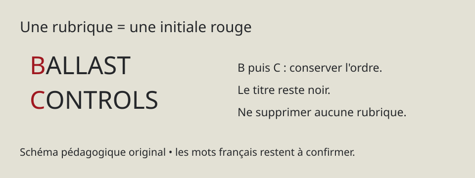

# 5 · Fabriquer les cartes de vérification


Illustration du XML, pas une capture de la fenêtre FlightGear.

Regarde les quatre petites cartes sur les photos du poste avant : elles correspondent à des moments différents. Leur présence [V] nous suggère quatre listes. Le manuel du programme de 2017, PDF p. 213, explique comment reprendre une vérification interrompue. Les textes français ci-dessous sont **un brouillon pour le simulateur**, pas les acronymes Cadets validés. Voir la section G pour la vérification des sources et les initiales rouges.

**Fichier à écrire :** `src/SW233/Checklists/sw233.xml`. Colle les blocs de ce fichier dans l’ordre, sans retirer les espaces du début des lignes.

## A · Avant le départ

Fais une boîte checklist n=0. Pour chaque ligne, name est ce que tu cherches ; value est ce que tu veux pouvoir constater. Exemple : plutôt que « instruments OK », demande si tu sais quel cadran utilise mph et lequel utilise ft. Les tirets, accents et espaces sont autorisés dans les titres : le fichier est en UTF-8.

<!-- atelier-fichier: src/SW233/Checklists/sw233.xml -->
```xml
<?xml version="1.0" encoding="UTF-8"?>
<!-- Original simulation checklists. No automatic actions; tow is not implemented. -->
<PropertyList>
    <auto-tutorials type="bool">false</auto-tutorials>
    <checklist n="0">
        <title>SW233 · Avant départ (simulation)</title>
        <item><name>Chargement</name><value>Scénario et centrage vérifiés</value></item>
        <item><name>Commandes</name><value>Libres ; sens vérifié</value></item>
        <item><name>Instruments</name><value>mph, ft et centaines de ft/min identifiés</value></item>
        <item><name>Aérofreins et trim</name><value>Course et position vérifiées</value></item>
        <item><name>Harnais, verrière et porte</name><value>Revue visuelle simulée</value></item>
    </checklist>
```

## B · Avant le largage

Ajoute une deuxième carte dans la même racine. Dans cette version, aucun câble n’est simulé. Marque donc la répétition comme verbale au lieu de créer une action imaginaire.

<!-- atelier-fichier: src/SW233/Checklists/sw233.xml -->
```xml
    <checklist n="1">
        <title>SW233 · Avant largage (répétition simulée)</title>
        <item><name>Zone et trafic</name><value>Repérés</value></item>
        <item><name>Altitude et position</name><value>Vérifiées dans le scénario</value></item>
        <item><name>Largage</name><value>Revue verbale ; câble non simulé</value></item>
    </checklist>
```

## C · Avant l’atterrissage

Sépare l’observation du vent et du trafic, la lecture de vitesse et la disponibilité des aérofreins. On ne déduit pas une vitesse d’approche d’une photographie de plaquette.

<!-- atelier-fichier: src/SW233/Checklists/sw233.xml -->
```xml
    <checklist n="2">
        <title>SW233 · Avant atterrissage (simulation)</title>
        <item><name>Vent, trafic et piste</name><value>Identifiés</value></item>
        <item><name>Vitesse</name><value>Lue en mph ; adaptée au scénario</value></item>
        <item><name>Aérofreins et trim</name><value>Disponibilité vérifiée</value></item>
        <item><name>Harnais et verrière</name><value>Revue visuelle simulée</value></item>
    </checklist>
```

## D · Avant un exercice

Écris les limites du modèle : une case cochée ne valide pas une vrille. Termine les deux dernières boîtes, checklist puis PropertyList. Les numéros vont de 0 à 3 sans répétition.

<!-- atelier-fichier: src/SW233/Checklists/sw233.xml -->
```xml
    <checklist n="3">
        <title>SW233 · Avant exercice de décrochage (simulation)</title>
        <item><name>Altitude, terrain et trafic</name><value>Marges revues</value></item>
        <item><name>Harnais, verrière et objets</name><value>Revue visuelle simulée</value></item>
        <item><name>Domaine de vol</name><value>Vrille non validée ; pas de démonstration de vrille</value></item>
    </checklist>
    <!-- Short cockpit reminders; full simulation lists are above. -->
    <placards>
        <card n="0"><line>AVANT DÉPART</line><line>LEST</line><line>COMMANDES</line><line>AÉROFREINS</line><line>VERRIÈRE</line></card>
        <card n="1"><line>AVANT LARGAGE</line><line>ZONE</line><line>ALTITUDE</line><line>POSITION</line><line>TRAFIC</line></card>
        <card n="2"><line>AVANT ATTERR.</line><line>AÉROFREINS</line><line>VENT</line><line>VITESSE</line><line>TRAFIC</line></card>
        <card n="3"><line>AVANT DÉCROCH.</line><line>ALTITUDE</line><line>HARNAIS</line><line>VERRIÈRE</line><line>TRAFIC</line></card>
    </placards>
</PropertyList>
```

**Essai :** quand le paquet sera chargé, ouvre **Aide → Aircraft Checklists**. Tu dois trouver les quatre titres et respectivement **5, 3, 4 et 3 lignes**. Si le menu est vide, vérifie le C majuscule de *Checklists* et le chemin d’inclusion dans la fiche set. Si tu coches une ligne, aucune gouverne ne doit se déplacer.

## Recette complète : sw233-en.xml

<!-- atelier-fichier: src/SW233/Checklists/sw233-en.xml -->
```xml
<?xml version="1.0" encoding="UTF-8"?>
<!-- Headwords: 2-33 AOIs 2017, PDF pp. 28/35. Values are simulation adaptations. -->
<PropertyList>
    <auto-tutorials type="bool">false</auto-tutorials>
    <checklist n="0">
        <title>SW233 - PRE TAKE-OFF (simulation)</title>
        <item>
            <name>Ballast</name>
            <value>Scenario loading and balance reviewed</value>
        </item>
        <item>
            <name>Controls</name>
            <value>Movement and direction checked</value>
        </item>
        <item>
            <name>Instruments</name>
            <value>Units, altimeter setting and radio frequency reviewed</value>
        </item>
        <item>
            <name>Spoilers</name>
            <value>Travel checked; position reviewed</value>
        </item>
        <item>
            <name>Trim</name>
            <value>Position reviewed for the scenario</value>
        </item>
        <item>
            <name>Release</name>
            <value>Verbal rehearsal only; tow cable not simulated</value>
        </item>
        <item>
            <name>Straps</name>
            <value>Simulated visual review, both seats</value>
        </item>
        <item>
            <name>Canopy/Door</name>
            <value>Simulated visual review</value>
        </item>
    </checklist>
    <checklist n="1">
        <title>SW233 - PRE RELEASE (simulation)</title>
        <item>
            <name>Area</name>
            <value>Release area identified in the scenario</value>
        </item>
        <item>
            <name>Altitude</name>
            <value>Scenario altitude reviewed</value>
        </item>
        <item>
            <name>Attitude/Position</name>
            <value>Attitude and position reviewed; tow not simulated</value>
        </item>
        <item>
            <name>Traffic</name>
            <value>Surrounding traffic reviewed</value>
        </item>
    </checklist>
    <checklist n="2">
        <title>SW233 - PRE-LANDING (simulation)</title>
        <item>
            <name>Spoilers</name>
            <value>Availability and position checked</value>
        </item>
        <item>
            <name>Wind</name>
            <value>Scenario wind reviewed</value>
        </item>
        <item>
            <name>Airspeed</name>
            <value>Scenario approach speed reviewed in mph</value>
        </item>
        <item>
            <name>Radio</name>
            <value>Call rehearsed; audio operation not validated</value>
        </item>
        <item>
            <name>Trim/Traffic</name>
            <value>Trim position and surrounding traffic reviewed</value>
        </item>
        <item>
            <name>Straps</name>
            <value>Simulated visual review, both seats</value>
        </item>
        <item>
            <name>Canopy</name>
            <value>Simulated visual review</value>
        </item>
    </checklist>
    <checklist n="3">
        <title>SW233 - SAFETY CHECK (simulation)</title>
        <item>
            <name>Altitude</name>
            <value>Scenario margins reviewed; spin behaviour not validated</value>
        </item>
        <item>
            <name>Straps</name>
            <value>Simulated visual review, both seats</value>
        </item>
        <item>
            <name>Canopy</name>
            <value>Simulated visual review</value>
        </item>
        <item>
            <name>Objects</name>
            <value>Loose items reviewed verbally</value>
        </item>
        <item>
            <name>Traffic/Terrain</name>
            <value>Traffic and terrain reviewed in the scenario</value>
        </item>
    </checklist>
    <placards>
        <card n="0">
            <line>PRE TAKE-OFF</line>
            <line>BALLAST</line>
            <line>CONTROLS</line>
            <line>INSTRUMENTS</line>
            <line>SPOILERS</line>
            <line>TRIM</line>
            <line>RELEASE</line>
            <line>STRAPS</line>
            <line>CANOPY/DOOR</line>
        </card>
        <card n="1">
            <line>PRE RELEASE</line>
            <line>AREA</line>
            <line>ALTITUDE</line>
            <line>ATTITUDE/POSITION</line>
            <line>TRAFFIC</line>
        </card>
        <card n="2">
            <line>PRE-LANDING</line>
            <line>SPOILERS</line>
            <line>WIND</line>
            <line>AIRSPEED</line>
            <line>RADIO</line>
            <line>TRIM/TRAFFIC</line>
            <line>STRAPS</line>
            <line>CANOPY</line>
        </card>
        <card n="3">
            <line>SAFETY CHECK</line>
            <line>ALTITUDE</line>
            <line>STRAPS</line>
            <line>CANOPY</line>
            <line>OBJECTS</line>
            <line>TRAFFIC/TERRAIN</line>
        </card>
    </placards>
</PropertyList>
```

## Recette complète : language.nas

<!-- atelier-fichier: src/SW233/Nasal/language.nas -->
```nasal
# SPDX-License-Identifier: GPL-3.0-only
# Session-only language choice. No aircraft controls are written.
var path = "/sim/sw233/language";
var busy = 0;
var apply = func {
    if (busy) return;
    busy = 1;
    var lang = getprop(path);
    if (lang != "fr" and lang != "en") { lang = "fr"; setprop(path,lang); }
    var dialog = props.Node.new({"dialog-name":"checklist"});
    var was_open = fgcommand("dialog-close",dialog);
    var target = props.globals.getNode("/sim/checklists",1);
    target.removeChildren();
    props.copy(props.globals.getNode("/sim/sw233/translations/"~lang),target);
    # Titles change; select the first list and discard old checklist UI state.
    props.globals.getNode("/sim/gui/dialogs/checklist",1).removeChildren();
    setprop("/sim/sw233/language-label",lang == "fr" ? "Français" : "English");
    busy = 0;
    if (was_open) gui.showDialog("checklist");
};
var choose = func(lang) { if (lang == "fr" or lang == "en") setprop(path,lang); };
var toggle = func { choose(getprop(path) == "fr" ? "en" : "fr"); };
setlistener(path,apply,1,0);
```


## G · Les lettres rouges sont un aide-mémoire

**État du travail : les mots anglais ont été comparés aux IEA de 2017 ; les
mots français restent à confirmer.** N'apprends pas la liste française
provisoire comme une liste officielle des Cadets.

Imagine huit petites cases, dans un ordre précis. Chacune contient une chose
à vérifier. Si tu retires une case pour gagner de la place, tu changes ce
que l'élève apprend. C'est pourquoi nous avons rétabli les huit rubriques
anglaises avant le décollage, au lieu des quatre rappels abrégés précédents.



Cette illustration explique la construction ; ce n'est pas une capture de
FlightGear. Les nouvelles captures dans le simulateur restent à ajouter
après validation du texte français.

1. Ouvre la source indiquée dans [le registre des sources](../sources.md#vérifications-mnémotechniques--lot-vis-01p-17-novembre-2026).
   Lis la page imprimée 3-8 (page 28 du PDF). Relève chaque rubrique sans
   changer son ordre : Ballast, Controls, Instruments, Spoilers, Trim,
   Release, Straps, Canopy/Door. Leurs initiales donnent **BCISTRSC**.
2. À la page imprimée 4-3 (PDF 35), relève les autres groupes : **AAAT**
   avant le largage, **SWARTSC** avant l'atterrissage et **ASCOT** pour la
   vérification de sécurité. Attitude/Position forme une rubrique ; ne
   transforme pas le P en une nouvelle étape. Même principe pour
   Trim/Traffic et Traffic/Terrain.
3. Dans le XML anglais, conserve une ligne par rubrique. La liste affichée
   dans la fenêtre emploie les mêmes mots. Son explication indique ce que
   notre simulateur permet réellement : le câble, par exemple, n'est pas
   simulé. Les intitulés viennent de la source ; ces explications sont
   rédigées pour notre prototype.
4. Dans la recette de peinture, le titre est la ligne 0. Il reste noir.
   Pour les lignes suivantes, dessine le texte noir puis sa première lettre
   en rouge sombre (`#a01820`). Le reste garde la couleur `#25272a`.
   On colore l'initiale de la rubrique, pas celle de chaque mot secondaire.
5. Une carte mesure 512 × 768 pixels dans la texture. Le titre commence à
   65 pixels du haut, le premier élément à 185. Répartis les éléments dans
   510 pixels : l'espacement vaut au maximum 130 pixels. La taille des
   lettres diminue si la carte contient davantage d'éléments ou un mot long.
   On fait entrer les mots en adaptant la mise en page, jamais en supprimant
   une vérification.
6. Vérifie les accents : l'accent d'une initiale rouge doit lui aussi être
   rouge. Vérifie le pied « SIMULATION » et l'absence de texte coupé.
7. Reconstruis le paquet et ouvre les deux textures de plaquettes. Puis
   contrôle la lisibilité dans FlightGear, avec le menu Français / English
   et Ctrl+L. La fenêtre native conserve pour l'instant son style de texte :
   le rouge concerne les plaquettes 3D, pas les lignes de cette fenêtre.

Le raccourci Ctrl+L a été confirmé manuellement par l'utilisateur lors de
l'essai précédent. Cela ne valide pas encore le nouveau contenu des cartes.
La fiche native est une liste de textes : ne suppose pas qu'elle possède
une case à cocher pour chaque élément.
