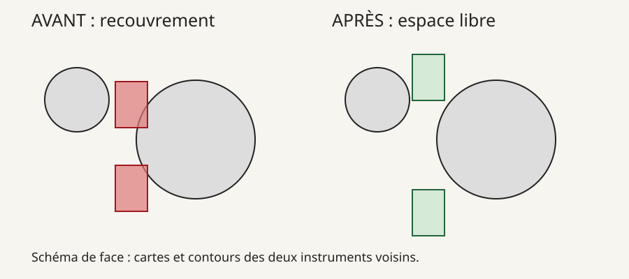

# 5 · Fabriquer les cartes de vérification


Illustration du XML, pas une capture de la fenêtre FlightGear.

Regarde les quatre petites cartes sur les photos du poste avant : elles correspondent à des moments différents. Leur présence [V] nous suggère quatre listes. Le manuel du programme de 2017, PDF p. 213, explique comment reprendre une vérification interrompue. Les textes français ci-dessous expliquent les mots-checks anglais, selon le tableau fourni par le responsable du projet. Ils ne sont pas une transcription des IEA françaises. Voir la section G pour la vérification des sources et les initiales rouges.

**Fichier à écrire :** `src/SW233/Checklists/sw233.xml`. Colle les blocs de ce fichier dans l’ordre, sans retirer les espaces du début des lignes.

## A · Avant le départ

Fais une boîte checklist n=0. Pour chaque ligne, name est ce que tu cherches ; value est ce que tu veux pouvoir constater. Exemple : plutôt que « instruments OK », demande si tu sais quel cadran utilise mph et lequel utilise ft. Les tirets, accents et espaces sont autorisés dans les titres : le fichier est en UTF-8.

<!-- atelier-fichier: src/SW233/Checklists/sw233.xml -->
```xml
<?xml version="1.0" encoding="UTF-8"?>
<!-- English mnemonic letters; French explanations supplied by the project owner.
     Not a transcription of French AOIs. Values are simulation adaptations. -->
<PropertyList>
    <auto-tutorials type="bool">false</auto-tutorials>
    <checklist n="0">
        <title>BCISTRSC - Décollage</title>
        <item>
            <name>B - Lest, masse et centrage</name>
            <value>Scénario, masses et centrage vérifiés</value>
        </item>
        <item>
            <name>C - Commandes de vol</name>
            <value>Course et sens vérifiés</value>
        </item>
        <item>
            <name>I - Instruments et radio</name>
            <value>Unités, calage altimétrique et fréquence relus</value>
        </item>
        <item>
            <name>S - Déporteurs</name>
            <value>Course et position vérifiées</value>
        </item>
        <item>
            <name>T - Compensateur</name>
            <value>Position revue pour le scénario</value>
        </item>
        <item>
            <name>R - Mécanisme de largage</name>
            <value>Répétition verbale ; câble non simulé</value>
        </item>
        <item>
            <name>S - Sangles et harnais</name>
            <value>Revue visuelle simulée des deux places</value>
        </item>
        <item>
            <name>C - Verrière et porte</name>
            <value>Revue visuelle simulée</value>
        </item>
    </checklist>
```

## B · Avant le largage

Ajoute une deuxième carte dans la même racine. Dans cette version, aucun câble n’est simulé. Marque donc la répétition comme verbale au lieu de créer une action imaginaire.

<!-- atelier-fichier: src/SW233/Checklists/sw233.xml -->
```xml
    <checklist n="1">
        <title>AAAT - Largage</title>
        <item>
            <name>A - Zone de largage</name>
            <value>Zone prévue repérée</value>
        </item>
        <item>
            <name>A - Altitude prévue</name>
            <value>Altitude du scénario revue</value>
        </item>
        <item>
            <name>A - Assiette et position derrière le remorqueur</name>
            <value>Assiette et position revues ; remorquage non simulé</value>
        </item>
        <item>
            <name>T - Circulation aérienne</name>
            <value>Trafic environnant repéré</value>
        </item>
    </checklist>
```

## C · Avant l’atterrissage

Sépare l’observation du vent et du trafic, la lecture de vitesse et la disponibilité des aérofreins. On ne déduit pas une vitesse d’approche d’une photographie de plaquette.

<!-- atelier-fichier: src/SW233/Checklists/sw233.xml -->
```xml
    <checklist n="2">
        <title>SWARTSC - Atterrissage</title>
        <item>
            <name>S - Déporteurs</name>
            <value>Disponibilité et position vérifiées</value>
        </item>
        <item>
            <name>W - Vent</name>
            <value>Vent du scénario revu</value>
        </item>
        <item>
            <name>A - Vitesse d’approche</name>
            <value>Vitesse adaptée au scénario, lue en mph</value>
        </item>
        <item>
            <name>R - Communication radio</name>
            <value>Appel répété verbalement ; fonctionnement audio non validé</value>
        </item>
        <item>
            <name>T - Compensateur et trafic</name>
            <value>Position du compensateur et trafic revus</value>
        </item>
        <item>
            <name>S - Sangles et harnais</name>
            <value>Revue visuelle simulée des deux places</value>
        </item>
        <item>
            <name>C - Verrière</name>
            <value>Revue visuelle simulée</value>
        </item>
    </checklist>
```

## D · Avant un exercice

Écris les limites du modèle : une liste parcourue ne valide pas une vrille. Termine les deux dernières boîtes, checklist puis PropertyList. Les numéros vont de 0 à 3 sans répétition.

<!-- atelier-fichier: src/SW233/Checklists/sw233.xml -->
```xml
    <checklist n="3">
        <title>ASCOT - Sécurité</title>
        <item>
            <name>A - Altitude de sécurité</name>
            <value>Marges du scénario revues ; vrille non validée</value>
        </item>
        <item>
            <name>S - Harnais serrés</name>
            <value>Revue visuelle simulée des deux places</value>
        </item>
        <item>
            <name>C - Verrière verrouillée</name>
            <value>Revue visuelle simulée</value>
        </item>
        <item>
            <name>O - Objets libres</name>
            <value>Revue verbale des objets non arrimés</value>
        </item>
        <item>
            <name>T - Circulation aérienne et terrain</name>
            <value>Trafic et terrain du scénario revus</value>
        </item>
    </checklist>
    <placards>
        <card n="0">
            <line>AVANT DÉCOLLAGE</line>
            <line>B - LEST</line>
            <line>C - COMMANDES</line>
            <line>I - INSTRUMENTS/RADIO</line>
            <line>S - DÉPORTEURS</line>
            <line>T - COMPENSATEUR</line>
            <line>R - LARGAGE</line>
            <line>S - SANGLES/HARNAIS</line>
            <line>C - VERRIÈRE/PORTE</line>
        </card>
        <card n="1">
            <line>AVANT LARGAGE</line>
            <line>A - ZONE DE LARGAGE</line>
            <line>A - ALTITUDE</line>
            <line>A - ASSIETTE/POSITION</line>
            <line>T - CIRCULATION</line>
        </card>
        <card n="2">
            <line>AVANT ATTERR.</line>
            <line>S - DÉPORTEURS</line>
            <line>W - VENT</line>
            <line>A - VITESSE</line>
            <line>R - RADIO</line>
            <line>T - COMPENSATEUR/TRAFIC</line>
            <line>S - SANGLES/HARNAIS</line>
            <line>C - VERRIÈRE</line>
        </card>
        <card n="3">
            <line>SÉCURITÉ</line>
            <line>A - ALTITUDE</line>
            <line>S - HARNAIS</line>
            <line>C - VERRIÈRE</line>
            <line>O - OBJETS LIBRES</line>
            <line>T - CIRCULATION/TERRAIN</line>
        </card>
    </placards>
</PropertyList>
```

**Essai :** quand le paquet sera chargé, ouvre **Aide → Aircraft Checklists**. Tu dois trouver les quatre titres et respectivement **8, 4, 7 et 5 lignes**. Si le menu est vide, vérifie le C majuscule de *Checklists* et le chemin d’inclusion dans la fiche set. La lecture des listes ne commande aucune gouverne ; ces listes ne comportent pas de cases à cocher.

## Recette complète : sw233-en.xml

<!-- atelier-fichier: src/SW233/Checklists/sw233-en.xml -->
```xml
<?xml version="1.0" encoding="UTF-8"?>
<!-- Headwords: 2-33 AOIs 2017, PDF pp. 28/35. Values are simulation adaptations. -->
<PropertyList>
    <auto-tutorials type="bool">false</auto-tutorials>
    <checklist n="0">
        <title>BCISTRSC - Take-off</title>
        <item>
            <name>Ballast</name>
            <value>Scenario loading and balance reviewed</value>
        </item>
        <item>
            <name>Controls</name>
            <value>Movement and direction checked</value>
        </item>
        <item>
            <name>Instruments</name>
            <value>Units, altimeter setting and radio frequency reviewed</value>
        </item>
        <item>
            <name>Spoilers</name>
            <value>Travel checked; position reviewed</value>
        </item>
        <item>
            <name>Trim</name>
            <value>Position reviewed for the scenario</value>
        </item>
        <item>
            <name>Release</name>
            <value>Verbal rehearsal only; tow cable not simulated</value>
        </item>
        <item>
            <name>Straps</name>
            <value>Simulated visual review, both seats</value>
        </item>
        <item>
            <name>Canopy/Door</name>
            <value>Simulated visual review</value>
        </item>
    </checklist>
    <checklist n="1">
        <title>AAAT - Release</title>
        <item>
            <name>Area</name>
            <value>Release area identified in the scenario</value>
        </item>
        <item>
            <name>Altitude</name>
            <value>Scenario altitude reviewed</value>
        </item>
        <item>
            <name>Attitude/Position</name>
            <value>Attitude and position reviewed; tow not simulated</value>
        </item>
        <item>
            <name>Traffic</name>
            <value>Surrounding traffic reviewed</value>
        </item>
    </checklist>
    <checklist n="2">
        <title>SWARTSC - Landing</title>
        <item>
            <name>Spoilers</name>
            <value>Availability and position checked</value>
        </item>
        <item>
            <name>Wind</name>
            <value>Scenario wind reviewed</value>
        </item>
        <item>
            <name>Airspeed</name>
            <value>Scenario approach speed reviewed in mph</value>
        </item>
        <item>
            <name>Radio</name>
            <value>Call rehearsed; audio operation not validated</value>
        </item>
        <item>
            <name>Trim/Traffic</name>
            <value>Trim position and surrounding traffic reviewed</value>
        </item>
        <item>
            <name>Straps</name>
            <value>Simulated visual review, both seats</value>
        </item>
        <item>
            <name>Canopy</name>
            <value>Simulated visual review</value>
        </item>
    </checklist>
    <checklist n="3">
        <title>ASCOT - Safety</title>
        <item>
            <name>Altitude</name>
            <value>Scenario margins reviewed; spin behaviour not validated</value>
        </item>
        <item>
            <name>Straps</name>
            <value>Simulated visual review, both seats</value>
        </item>
        <item>
            <name>Canopy</name>
            <value>Simulated visual review</value>
        </item>
        <item>
            <name>Objects</name>
            <value>Loose items reviewed verbally</value>
        </item>
        <item>
            <name>Traffic/Terrain</name>
            <value>Traffic and terrain reviewed in the scenario</value>
        </item>
    </checklist>
    <placards>
        <card n="0">
            <line>PRE TAKE-OFF</line>
            <line>BALLAST</line>
            <line>CONTROLS</line>
            <line>INSTRUMENTS</line>
            <line>SPOILERS</line>
            <line>TRIM</line>
            <line>RELEASE</line>
            <line>STRAPS</line>
            <line>CANOPY/DOOR</line>
        </card>
        <card n="1">
            <line>PRE RELEASE</line>
            <line>AREA</line>
            <line>ALTITUDE</line>
            <line>ATTITUDE/POSITION</line>
            <line>TRAFFIC</line>
        </card>
        <card n="2">
            <line>PRE-LANDING</line>
            <line>SPOILERS</line>
            <line>WIND</line>
            <line>AIRSPEED</line>
            <line>RADIO</line>
            <line>TRIM/TRAFFIC</line>
            <line>STRAPS</line>
            <line>CANOPY</line>
        </card>
        <card n="3">
            <line>SAFETY CHECK</line>
            <line>ALTITUDE</line>
            <line>STRAPS</line>
            <line>CANOPY</line>
            <line>OBJECTS</line>
            <line>TRAFFIC/TERRAIN</line>
        </card>
    </placards>
</PropertyList>
```

## Recette complète : language.nas

<!-- atelier-fichier: src/SW233/Nasal/language.nas -->
```nasal
# SPDX-License-Identifier: GPL-3.0-only
# Session-only language choice. No aircraft controls are written.
var path = "/sim/sw233/language";
var busy = 0;
# Legacy 2024.1 dialog labels do not decode UTF-8 in this tested UI.
# Normalize only the active checklist copy, never source translations or textures.
var display_text = func(text) {
    foreach (var pair; [["é","e"],["è","e"],["ê","e"],["É","E"],
                         ["à","a"],["â","a"],["î","i"],["ô","o"],
                         ["ç","c"],["œ","oe"],["’","'"]])
        text = string.replace(text,pair[0],pair[1]);
    return text;
};
var apply = func {
    if (busy) return;
    busy = 1;
    var lang = getprop(path);
    if (lang != "fr" and lang != "en") { lang = "fr"; setprop(path,lang); }
    var dialog = props.Node.new({"dialog-name":"checklist"});
    var was_open = fgcommand("dialog-close",dialog);
    var target = props.globals.getNode("/sim/checklists",1);
    target.removeChildren();
    props.copy(props.globals.getNode("/sim/sw233/translations/"~lang),target);
    var version = getprop("/sim/version/flightgear");
    var legacy = version != nil and find("2024.1.",version) == 0;
    setprop("/sim/sw233/checklist-ascii",legacy);
    if (legacy) {
        foreach (var list; target.getChildren("checklist")) {
            var title = list.getNode("title");
            title.setValue(display_text(title.getValue()));
            foreach (var item; list.getChildren("item")) {
                foreach (var field; item.getChildren())
                    if (field.getName() == "name" or field.getName() == "value")
                        field.setValue(display_text(field.getValue()));
            }
        }
    }
    # Titles change; select the first list and discard old checklist UI state.
    props.globals.getNode("/sim/gui/dialogs/checklist",1).removeChildren();
    setprop("/sim/sw233/language-label",lang == "fr" ? "Français" : "English");
    busy = 0;
    if (was_open) gui.showDialog("checklist");
};
var choose = func(lang) { if (lang == "fr" or lang == "en") setprop(path,lang); };
var toggle = func { choose(getprop(path) == "fr" ? "en" : "fr"); };
setlistener(path,apply,1,0);
```


## G · Les lettres rouges sont un aide-mémoire

**État du travail : mots anglais comparés aux IEA de 2017 ; explications
françaises fournies par le responsable du projet.** Les lettres anglaises
sont conservées. La version française des IEA n’a pas été consultée.

Imagine huit petites cases, dans un ordre précis. Chacune contient une chose
à vérifier. Si tu retires une case pour gagner de la place, tu changes ce
que l'élève apprend. C'est pourquoi nous avons rétabli les huit rubriques
anglaises avant le décollage, au lieu des quatre rappels abrégés précédents.


Cette illustration explique la construction ; ce n'est pas une capture de
FlightGear. Les captures natives de la section H montrent le résultat et le défaut
de masquage restant à corriger.

1. Ouvre la source indiquée dans [le registre des sources](../sources.md#vérifications-mnémotechniques--lot-vis-01p-17-novembre-2026).
   Lis la page imprimée 3-8 (page 28 du PDF). Relève chaque rubrique sans
   changer son ordre : Ballast, Controls, Instruments, Spoilers, Trim,
   Release, Straps, Canopy/Door. Leurs initiales donnent **BCISTRSC**.
2. À la page imprimée 4-3 (PDF 35), relève les autres groupes : **AAAT**
   avant le largage, **SWARTSC** avant l'atterrissage et **ASCOT** pour la
   vérification de sécurité. Attitude/Position forme une rubrique ; ne
   transforme pas le P en une nouvelle étape. Même principe pour
   Trim/Traffic et Traffic/Terrain.
3. Dans le XML anglais, conserve une ligne par rubrique. La liste affichée
   dans la fenêtre emploie les mêmes mots. Son explication indique ce que
   notre simulateur permet réellement : le câble, par exemple, n'est pas
   simulé. Les intitulés viennent de la source ; ces explications sont
   rédigées pour notre prototype.
4. Dans la recette de peinture, le titre est la ligne 0. Il reste noir.
   Pour les lignes suivantes, dessine le texte noir puis sa première lettre
   en rouge sombre (`#a01820`). Le reste garde la couleur `#25272a`.
   On colore l'initiale de la rubrique, pas celle de chaque mot secondaire.
5. Une carte mesure 512 × 768 pixels dans la texture. Le titre commence à
   65 pixels du haut, le premier élément à 185. Répartis les éléments dans
   510 pixels : l'espacement vaut au maximum 130 pixels. La taille des
   lettres diminue si la carte contient davantage d'éléments ou un mot long.
   On fait entrer les mots en adaptant la mise en page, jamais en supprimant
   une vérification.
6. Vérifie les accents : l'accent d'une initiale rouge doit lui aussi être
   rouge. Vérifie le pied « SIMULATION » et l'absence de texte coupé.
7. Reconstruis le paquet et ouvre les deux textures de plaquettes. Puis
   contrôle la lisibilité dans FlightGear, avec le menu Français / English
   et Ctrl+L. La fenêtre native conserve pour l'instant son style de texte :
   le rouge concerne les plaquettes 3D, pas les lignes de cette fenêtre.

Le raccourci Ctrl+L a été confirmé manuellement par l'utilisateur lors de
l'essai précédent. Cela ne valide pas encore le nouveau contenu des cartes.
La fiche native est une liste de textes : ne suppose pas qu'elle possède
une case à cocher pour chaque élément.


## H · Pourquoi lit-on « S — Déporteurs » en français ?

Le mot anglais **Spoilers** commence par S. Le mot français **Déporteurs**
commence par D. Si nous colorions seulement le D, BCISTRSC deviendrait une
autre série de lettres ! Nous gardons donc le S à gauche, en rouge, et
écrivons son explication française à droite. Même principe pour W — Vent.

Le tableau français a été fourni par le responsable du projet le
17 novembre 2026. Nous conservons cette origine dans le registre des sources.
Une explication traduite n'est pas la preuve qu'un nouveau mot-check français
est officiellement enseigné. La petite carte emploie des intitulés courts ;
la fenêtre de checklist donne les intitulés français complets.

Pour refaire cette étape :

1. Recopie les lettres anglaises, dans l'ordre : BCISTRSC, AAAT, SWARTSC, ASCOT.
2. Associe chaque lettre à une explication française du tableau fourni.
3. Dans chaque champ `name`, écris la lettre, un tiret, puis l'explication.
4. Dans chaque ligne de plaquette, garde la même lettre et le même ordre.
5. Compte les rubriques : 8, 4, 7, 5. Il doit y en avoir autant en français
   qu'en anglais et autant dans la fenêtre que sur la carte correspondante.
6. Reconstruis les textures. Vérifie que le S de « S - DÉPORTEURS » est rouge,
   que le D reste noir, et que les accents ne disparaissent pas.

Les urgences GASP/VEST et GPAS/PTES sont inscrites au ROADMAP dans un travail
séparé. Il faut encore vérifier le manuel bilingue de 2018 et définir ce
que le prototype peut simuler avant de créer leurs listes. Les inspections
au sol sont également recensées séparément.


### Voir le résultat dans FlightGear


Repère les lettres rouges à gauche de chaque ligne. Les cartes conservent
les mêmes initiales que les listes anglaises. L'anémomètre cache encore une
partie des mots sur la droite : cette image montre un défaut à corriger,
pas une validation de lisibilité complète.


Ces vues utilisent le mode statique de développement, sans dynamique de vol.
Les aiguilles visibles ne constituent pas un essai de performances. Pour
refaire l'observation, charge le paquet, sélectionne Français dans le menu
SW233 et compare la vue pilote avec une vue rapprochée du tableau. Regarde
si la dernière lettre de chaque ligne est visible. Un test de fichiers peut
réussir alors qu'une pièce en cache une autre : il faut les deux contrôles.


La texture est complète ; le masquage apparaît dans la scène 3D. Cette
comparaison permet de chercher le problème dans la géométrie et la vue,
plutôt que de supprimer des mots de la liste.


## I · Dégager les cartes cachées par l'anémomètre

**But :** lire tous les mots des cartes de droite sans changer les listes.
Imagine deux étiquettes collées trop près d'une grosse horloge : son bord
cache une partie des phrases. Il faut déplacer les étiquettes, puis regarder
si elles restent sur le panneau.

### 1. Observer avant de toucher au modèle


Sur cette capture native du lot précédent, la carte d'atterrissage est trop
basse et celle de sécurité trop haute. La photo C-FYLP fournie au projet sert
à reconnaître les quatre cartes autour de l'aérateur et du compas. Elle ne
fournit pas leurs dimensions réelles : les déplacements ci-dessous corrigent
notre maquette, sans prétendre mesurer le véritable cockpit.

### 2. Lire les coordonnées comme un quadrillage

Dans la recette `fabrique.py` de la fiche 2, **y** indique le côté du tableau
et **z** la hauteur. L'unité est le mètre : 0,005 m représente 5 mm. La
profondeur **x** des cartes reste à `px + 0.001`. Ne confonds pas ces axes
avec ceux de la caméra ou du fichier AC3D : la fonction d'exportation fait
la conversion expliquée dans la fiche 2.

Chaque carte mesure 46 mm de large et 66 mm de haut. Pour trouver ses
bords, pars du centre et ajoute ou retire la moitié : 23 mm et 33 mm.
L'anémomètre est centré à y = 0,170 m et z = 0,140 m. Sa bague extérieure a
un rayon de 85 mm. Ces nombres viennent du code de notre modèle.



Le dessin est une illustration géométrique, pas une capture FlightGear.
Les rectangles rouges croisent le grand cercle. Les rectangles verts ont
la même taille mais laissent un espace. Le petit cercle représente l'aérateur.

### 3. Déplacer seulement ce qui gêne

| Carte | Ancien centre (y ; z), m | Nouveau centre (y ; z), m | Déplacement |
|---|---|---|---|
| Atterrissage | (0,078 ; 0,190) | (0,073 ; 0,229) | 5 mm vers le centre, 39 mm vers le haut |
| Sécurité | (0,078 ; 0,070) | (0,073 ; 0,035) | 5 mm vers le centre, 35 mm vers le bas |

Dans la section « Deux jeux de quatre plaquettes » de la fiche 2, utilise
ces nouveaux centres pour les deux langues. Les deux cartes de gauche
restent aux mêmes endroits. Les demi-dimensions restent 0,023 et 0,033.
Ne déplace pas l'aiguille ou sa rotation : nous corrigeons les cartes.

**Exercice avec une règle :** dessine un rectangle de 46 × 66 mm. Son centre
est à 23 mm des côtés et à 33 mm du haut et du bas. Déplace ce rectangle sur
un dessin du panneau. Tu déplaces ainsi tous ses coins ensemble sans le
rétrécir ni supprimer un mot.

Pour contrôler la marge, cherche le point du rectangle le plus proche du
centre de l'anémomètre. Calcule sa distance au centre, puis retire le rayon
85 mm. Le rapport `geometry-check.json` publié avec les images donne les
résultats : environ **7,8 mm** entre la carte haute et la bague, **18,2 mm**
pour la carte basse. Avant correction, les résultats étaient négatifs :
−13,9 mm et −6,7 mm, donc leurs emprises se recouvraient. C'est un contrôle
de face ; les vues de biais doivent aussi être examinées.

### 4. Déplacer aussi le support peint

Dans `tools/panel.py`, la liste utilisée pour `card(y,z)` doit contenir les
mêmes centres que le maillage. Sinon, le texte bougerait mais laisserait son
ancien support derrière lui ! La fiche 6 contient la recette synchronisée.

Les deux supports peints de droite sont resserrés autour des cartes : leur
rectangle intérieur passe de 97 × 140 à **89 × 128 pixels** sur la texture du
tableau. Ceux de gauche restent inchangés. Le code ajoute ensuite le contour
sombre. Cette correction laisse une marge au sommet du tableau ; elle ne
change pas les dimensions des faces 3D ni les textures des textes.

**Ne modifie pas les mots-checks pour gagner de la place.** Les fichiers
XML et les deux images de texte sont identiques à ceux du lot précédent.

### 5. Vérifier dans FlightGear


Le gros plan reprend les paramètres de caméra de l'image avant : décalages
0 / 0,5 / 1,7 m, inclinaison −23°, champ 32°. La fenêtre a changé de taille
entre les sessions : compare les emprises, pas des distances en pixels entre
les deux images. Le menu est masqué pendant les nouvelles captures pour ne
pas cacher lui-même une carte.


Choisis Français, puis English dans le menu SW233. Les mots changent, les
cartes restent au même endroit. Lis jusqu'au dernier mot de chaque ligne.


Décale la caméra de 13 cm vers la droite : l'anémomètre ne doit pas cacher
les fins de ligne. Le même contrôle a été réalisé en anglais.


À un champ de 80°, les cartes sont petites : rapproche la vue pour lire le
texte. « Dégagé » signifie qu'aucune pièce ne cache les mots ; cela ne promet
pas qu'un petit texte se lise à toute résolution et à tout zoom.

Pour reproduire les six captures automatiquement, lance une session SW233
réservée au développement avec `--fdm=null` et un port HTTP local, puis
utilise `python -m tools.placard_bench DOSSIER_NEUF --port PORT`. Le script
refuse un modèle dynamique actif, enregistre les réglages, vérifie la taille
des captures et restaure la caméra, la langue et le menu à la fin. Ne l'utilise
pas pendant un vol que tu veux continuer à piloter. `capture.json` conserve
la version, le chemin du paquet et les paramètres de chaque image.

### 6. Faire les derniers contrôles

La reconstruction complète du tutoriel doit donner le même maillage et la
même peinture que les sources. Les 25 tests ont réussi. La comparaison avec
le lot précédent confirme **72 objets inchangés** ; seuls les deux objets
regroupant les plaquettes FR et EN changent. Les sept textures de cadrans,
radio, compas et textes restent identiques ; seule la peinture du tableau
change. Ce sont des essais d'affichage statique, pas une validation du vol.

Les positions restent estimées. Les six vues examinées ne couvrent pas tous
les mouvements de tête possibles en réalité virtuelle : une mesure du vrai
cockpit et d'autres points de vue pourront encore améliorer la disposition.


## J · Ouvrir et vérifier les listes bilingues dans FlightGear

Une plaquette est la petite carte fixée au tableau. Une checklist est une
fenêtre qui donne davantage d'explications. Elles utilisent la même langue,
mais la fenêtre n'a pas la même façon de dessiner ses lettres.

### Ouvrir la première liste

1. Lance le paquet SW233 du lot `checklists-recette-35` avec le lanceur décrit
   à la fiche 12. Pour apprendre à manipuler les fenêtres, reste au sol.
2. Clique sur **SW233**, dans la barre du haut.
3. Choisis **Français - plaquettes et listes**.
4. Rouvre le menu **SW233**, puis choisis **Checklists / Listes**.
5. Une fenêtre intitulée *Aircraft Checklists* apparaît. Si elle gêne ta vue,
   attrape sa barre de titre avec la souris et déplace-la. Ne déplace pas
   la fenêtre entière du simulateur par erreur.
6. Dans le champ **Checklist**, choisis **BCISTRSC - Decollage**. Compte les
   huit lignes. À gauche, tu lis ce qu'il faut examiner ; à droite, ce que
   notre prototype permet de vérifier ou de répéter verbalement.


### Choisir les trois autres listes

Clique sur la petite flèche à droite du champ **Checklist**. Choisis un titre,
puis compare les lignes à la carte correspondante du cockpit.

| Titre français affiché | Titre anglais | Nombre de rubriques |
|---|---|---:|
| BCISTRSC - Decollage | BCISTRSC - Take-off | 8 |
| AAAT - Largage | AAAT - Release | 4 |
| SWARTSC - Atterrissage | SWARTSC - Landing | 7 |
| ASCOT - Securite | ASCOT - Safety | 5 |


Les mots « câble non simulé » et « vrille non validée » sont importants :
afficher une liste ne crée pas ces fonctions dans le planeur. Ces listes
sont des rappels de simulation. Elles n'actionnent ni les gouvernes ni le
largage. Le bouton natif *Toggle marker* n'est pas un certificat de réalisation
de chaque vérification ; notre liste n'a pas de case à cocher par ligne.

### Changer la langue avec la fenêtre ouverte

1. Sélectionne **ASCOT - Securite**.
2. Garde la fenêtre ouverte.
3. Dans le menu **SW233**, choisis **English - placards and checklists**.
4. La fenêtre est reconstruite en anglais et revient à **BCISTRSC - Take-off**.
   Ce retour à la première liste est volontaire : les titres ont changé et
   on ne conserve pas une sélection qui appartient à l'ancienne langue.
5. Vérifie aussi une plaquette du tableau : elle doit être en anglais.
6. Choisis de nouveau Français pour revenir à **BCISTRSC - Decollage**.


Si tu fermes la fenêtre avant de changer de langue, elle reste fermée. Quand
tu la rouvres, elle affiche la première liste dans la nouvelle langue.
Les mots natifs *Group*, *Checklist* et *Aircraft Checklists* appartiennent
à FlightGear : le choix SW233 ne traduit pas toute l'interface du simulateur.

### Pourquoi manque-t-il des accents dans cette fenêtre ?

Lors de l'essai avec FlightGear **2024.1.7**, « Déporteurs » devenait
« Déporteurs » dans cette fenêtre. Le fichier contenait pourtant le bon mot.
Le problème se trouvait dans l'affichage des lettres, pas dans la traduction.

Pour cette famille 2024.1, le script prépare une **copie d'affichage sans
accents** : « Déporteurs » devient « Deporteurs ». Le XML d'origine et les
textures des plaquettes gardent leurs accents. C'est une solution de
compatibilité temporaire, pas une correction typographique complète du
moteur graphique. Les versions autres que 2024.1 ne reçoivent pas cette
conversion ; leur rendu doit être vérifié séparément.

Pour comprendre la recette, imagine un livre et une fiche photocopiée :
on adapte la fiche à l'imprimante, sans effacer les accents du livre.
`display_text` fait les remplacements dans la copie située sous
`/sim/checklists`. Les originaux restent sous `/sim/sw233/translations`.
Les titres sont raccourcis pour tenir dans le sélecteur natif.

### Comprendre les essais automatiques

`tools/checklist_bench.py` compare chaque titre, rubrique et explication
chargés dans FlightGear aux XML du projet, en tenant compte de cette copie
d'affichage. Il photographie les huit listes, effectue douze bascules fenêtre
ouverte puis douze fenêtre fermée, et contrôle le retour à la première liste.
Il vérifie aussi le retour au français pour une propriété de langue invalide
et l'absence de changement des cinq commandes suivies : ailerons, profondeur,
direction, compensateur de profondeur et aérofreins.

Le script fonctionne uniquement dans une session de développement SW233
avec `--fdm=null`. Depuis la racine du dépôt, la commande est
`python -m tools.checklist_bench DOSSIER_NEUF --port PORT`. Les images et
`checks.json` vont dans ce nouveau dossier. La langue et la liste initiales
sont restaurées après l'essai, avec la page 0, puisque chacune de nos listes
tient sur une seule page. Une erreur du banc lors de la première exécution
avait oublié cette page au retour : le banc a été corrigé.

Ces contrôles vérifient l'affichage et les scripts ; ils ne remplacent pas
un essai du clavier physique ni une validation des procédures de vol réel.


### Le raccourci et les limites de cette recette

Ctrl+L utilise la même commande de bascule que le menu. L'utilisateur avait
confirmé son fonctionnement dans le cockpit lors du premier lot bilingue.
Pendant cette recette, deux envois automatisés avec la fenêtre ouverte n'ont
pas changé la langue. Cela ne prouve pas à lui seul une panne du raccourci :
le dialogue ou l'envoi automatisé peut intercepter le clavier. La vérification
physique fenêtre ouverte/fermée est demandée séparément et reste en attente.
En attendant, le menu fournit le changement de langue vérifié.

Pour ton propre essai : ouvre la checklist, note sa langue, appuie sur Ctrl+L
et note le résultat. Ferme la checklist avec sa croix, recommence, puis
rouvre-la pour lire sa langue. Rapporte les deux résultats séparément.
Ne déclare pas « tout fonctionne » si un de ces essais reste inconnu.
