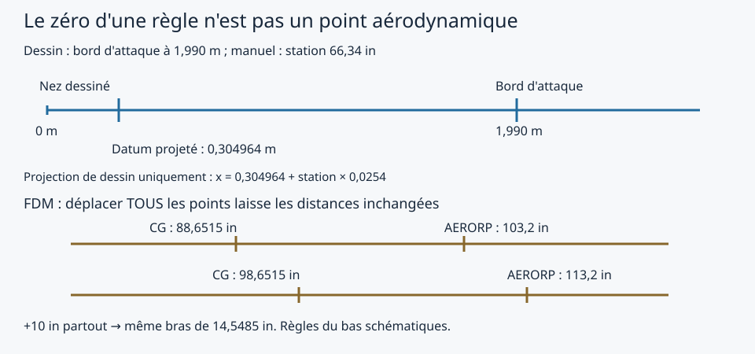

# 9 · Aligner des repères sans changer la physique en cachette

Séance **AUD-01a**, 12 novembre 2026. Nous cherchons ce qu'un déplacement de référence change réellement. Le modèle distribué reste inchangé ; toutes les expériences utilisent des copies temporaires.

## 1. Dessine trois règles, avec leurs noms

Sur une feuille, trace trois flèches vers la droite. Écris « vers la queue ». Ne pose pas les trois zéros l'un sur l'autre sans preuve.

| Règle | Origine et unité | Où la vérifier |
|---|---|---|
| Manuel constructeur | Datum 66,34 pouces devant le bord d'attaque à la racine | Manuel FAA fourni, PDF 14, page imprimée 27 ; relevé et limites dans la fiche 8 |
| JSBSim structurel | Origine historique non identifiée sur un exemplaire ; positions en pouces, x arrière, y droite, z haut | `src/SW233/sw233.xml` : `metrics`, `mass_balance`, `ground_reactions` |
| Maquette de notre recette | Nez de coque dessiné x=0, mètres, x arrière, y droite, z haut | Fiche 2 : sections de coque, aile et écriture AC3D |

Le repère **des forces** de JSBSim est encore différent : il est centré sur le CG, x vers l'avant et z vers le bas. La [documentation JSBSim](https://jsbsim-team.github.io/jsbsim-reference-manual/user/concepts/frames-of-reference/) explique cette distinction. Le fichier AC3D exporté stocke les sommets `(x,z,−y)` de notre recette : ne compare pas sa deuxième colonne directement à la position latérale du FDM.

Dans notre XML, **VRP=(0,0,0)** et **AERORP : x=103,2 ; y=0 ; z=0 pouces**. VRP est la référence de position visuelle ; AERORP est la référence des forces et moments aérodynamiques. Ce ne sont pas deux noms pour le même point. Le [code d'interface FlightGear consulté](https://raw.githubusercontent.com/FlightGear/flightgear/next/src/FDM/JSBSim/JSBSim.cxx) publie la position du VRP depuis `GetLocationVRP()`. Cette branche de développement est une référence de lecture, pas une preuve de l'implantation exacte de chaque version installée.

## 2. Retrouve le bord d'attaque dans la recette

Dans la fiche 2, partie E, repère la ligne **(0, 1.99, 1.57, 0.74)**. Elle signifie : axe de l'aile, bord d'attaque x=1,99 m, corde 1,57 m, hauteur 0,74 m. Le bord de fuite est donc à 3,56 m. Ce sont des choix de maquette, pas des cotes d'usine.

Regarde maintenant la capture native : retrouve le nez de coque, la racine de l'aile, la grande roue et la queue. **N'utilise pas les pixels de cette perspective pour calculer une longueur.** Les nombres viennent de la recette.


Capture FlightGear 2024.1.7, paquet issu du FDM inchangé de la séance précédente ; CYJN, 4 000 ft, cap 010°, date de simulation 21 juin 2026 à 16 h 45 UTC, 1280 × 720. Vue extérieure 1, décalage de cap 270°, inclinaison 12°, champ 45°. **FDM null** : position maintenue pour examiner la géométrie, aucun vol validé par cette image.

Pour refaire cette vue, construis le paquet comme en fiche 7 et lance :

```powershell
fgfs --aircraft=sw233 --fg-aircraft=build/Aircraft --airport=CYJN --in-air --altitude=4000 --heading=010 --fdm=null --start-date-gmt=2026:06:21:16:45:00 --disable-real-weather-fetch --geometry=1280x720 --prop:/sim/current-view/view-number=1 --prop:/sim/current-view/heading-offset-deg=270 --prop:/sim/current-view/pitch-offset-deg=12 --prop:/sim/current-view/field-of-view=45
```

Le décor doit être installé. Si le lanceur rétablit une autre vue, retrouve ces valeurs dans l'arbre des propriétés après le chargement. Retire `--fdm=null` avant de piloter.

## 3. Fais une correspondance de dessin, pas une pesée

Supposons que le bord d'attaque dessiné représente celui auquel le manuel fait référence. Convertis sa station : **66,34 × 0,0254 = 1,685036 m**. Le datum projeté dans notre dessin serait alors à **1,99 − 1,685036 = 0,304964 m** du nez dessiné.

La formule longitudinale devient : **x du dessin = 0,304964 + station du manuel × 0,0254**.

| Station du manuel | Résultat dans cette projection de dessin |
|---|---:|
| Siège avant 43,80 in | 1,417484 m |
| Siège arrière 74,70 in | 2,202344 m |
| Limite avant 78,20 in | 2,291244 m |
| Limite arrière 86,10 in | 2,491904 m |

Ces décimales rendent le calcul reproductible ; elles ne donnent pas cette précision à la maquette. Si le bord d'attaque dessiné est faux de 5 cm, toutes les projections longitudinales le seront aussi de 5 cm. Nous ne connaissons pas une tolérance mesurée pour sa position : **5 cm est un exemple d'incertitude, pas son estimation**. Rien ici ne fixe les hauteurs z des masses.



**Contrôle indépendant :** l'écartement publié entre sièges vaut 30,90 in, contre 42 in dans le FDM. Une translation conserve les distances : elle ne peut pas réparer cette différence de 11,10 in. Il faut donc traiter séparément le positionnement des charges et l'origine du repère. Ne change pas l'échelle du planeur pour forcer l'accord.

## 4. Déplace toute la règle dans une copie temporaire

Le banc `tools/reference_frames.py` lit le XML et translate les **11 éléments location**, chacun de +10 in en x : masses, contacts, AERORP, EYEPOINT et VRP. Il conserve les poids et inerties propres. La copie est chargée dans JSBSim puis supprimée automatiquement ; aucun fichier de l'avion distribué n'est réécrit.

Depuis le dépôt, avec l'environnement de développement :

```powershell
.\.venv\Scripts\python.exe -m tools.reference_frames build/mes-reperes
```

Le dossier doit être nouveau. Ouvre `frames.json`. Tu dois voir :

| Grandeur | Référence | Tous les points +10 in |
|---|---:|---:|
| CG x, in | 88,651546 | 98,651546 |
| AERORP x, in | 103,2 | 113,2 |
| VRP x, in | 0 | 10 |
| Distance AERORP−CG, in | 14,548454 | 14,548454 |
| Commande de profondeur | −0,955170809 | −0,955170809 |
| Altitude après 60 s, ft | 4 557,686177 | 4 557,686177 |

Conditions autonomes JSBSim 1.2.3 : 970 lb, 50 kt CAS, 5 000 ft initiaux, vent nul, commandes latérales et aérofreins nuls. Le résultat prouve l'invariance de cette expérience longitudinale, pas l'identification du datum réel. N'oublier aucun contact ou VRP est essentiel si l'on réalise ensuite une véritable conversion complète.

## 5. Déplace seulement AERORP et regarde la différence

Le troisième cas avance AERORP de 1 in, sans toucher au CG. Le bras devient 13,548454 in. La commande d'équilibre passe à **−0,897666390**, et l'altitude à 60 s à **4 562,416368 ft**. La physique a changé : nous n'avons pas seulement renommé les coordonnées.

Le quatrième cas déplace le même point **et transporte son moment propre**. Pour un déplacement longitudinal structural Δx, la correction est **ΔMy = −Δx/12 × Fz**, en lb·ft lorsque Fz est en livres-force. Dans cet essai symétrique, Fz = −portance × cos(α) − traînée × sin(α). À Δx=−1 in, la correction vaut Fz/12, donc elle est négative avec une portance dirigée vers le haut.

Le programme ajoute cette formule au moment propre dans la copie temporaire. Il retrouve la commande **−0,955170809** et la même pente initiale. L'altitude après 60 s diffère de **0,000294 ft** du témoin ; le test accepte moins de 0,001 ft pour cette trajectoire numérique. Cette petite différence n'est pas une donnée de performance réelle.

**Limite du banc :** la formule utilisée est restreinte au vol symétrique de cet essai. Pour une transformation générale en glissade, il faut les trois forces et le produit vectoriel complet. Ce code expérimental n'est pas ajouté au FDM distribué.

## 6. Pourquoi ne pas placer directement AERORP au quart de corde ?

Le quart de la corde dessinée à la racine est à **1,99 + 1,57/4 = 2,3825 m**. Le nombre AERORP actuel, converti directement avec VRP nul, est **103,2 × 0,0254 = 2,62128 m**. Ces deux opérations arithmétiques sont exactes, mais elles ne prouvent ni l'alignement vertical des repères ni la position d'un foyer réel. Le quart de la corde à la racine n'est pas automatiquement celui de la corde aérodynamique moyenne d'une aile effilée.

Surtout, la référence d'un coefficient de moment doit accompagner ce coefficient. Déplacer le point tout en conservant sa formule de moment revient à changer le modèle, comme l'expérience vient de le montrer. Une correction constante de Cm0 ne remplace pas nécessairement le transport : la force qui intervient dépend de l'état de vol.

## 7. Décide ce qu'on peut conclure

Deux nouveaux tests automatiques vérifient la translation commune et le déplacement d'AERORP avec/sans transport. Lance la suite habituelle :

```powershell
.\.venv\Scripts\python.exe -m unittest discover -s tests -v
```

[Résultats complets et empreintes des fichiers](https://github.com/steveprudhomme/sw233-flightgear/releases/download/reperes-10/frames.json).

**Acquis :** une correspondance longitudinale de dessin explicite, des repères distingués, et deux opérations physiques différentes démontrées. **Non établi :** le datum historique exact, la référence physique des coefficients de moment, le foyer de l'aile et la pesée de C-FYLP. La traduction des repères ne suffit donc pas à clôturer l'identification aéronautique AUD-01a.

On garde pour l'instant le jeu de pesée du prototype (610 lb à vide, positions historiques) comme **hypothèse de simulation déclarée**. On n'adopte pas le formulaire d'exemple n° 369 comme une pesée de C-FYLP. Pour la prochaine calibration, il faudra choisir un exemplaire et sa fiche de masse, ou construire un modèle de référence explicitement hypothétique avec une convention complète de forces et moments.

**Biais à éviter :** préférer le quart de corde parce qu'il semble familier, ou déplacer un point jusqu'à obtenir une commande confortable. Nous avons testé ces mécanismes sans les faire passer pour une correction validée.
