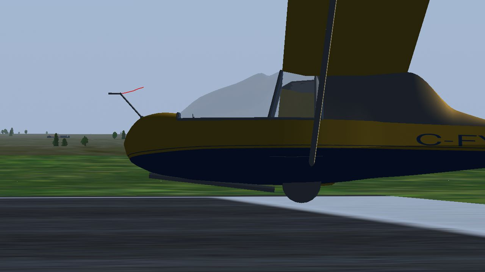
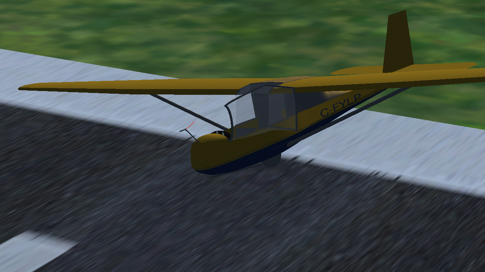
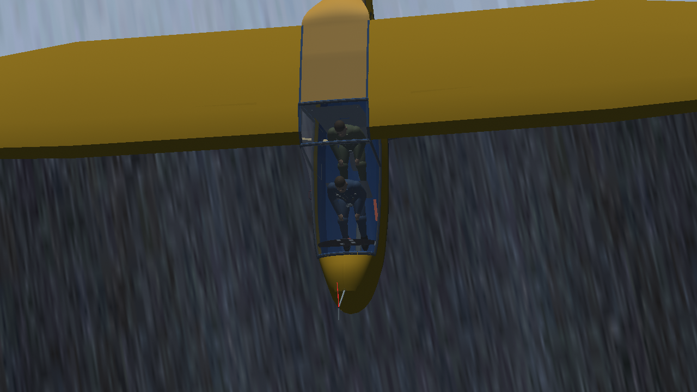

# 28. Comparer la silhouette de la verrière

**Pour vous :** cet atelier vise un débutant, dès 10 ans, accompagné au besoin.
**But :** repérer la courbe du vitrage et la limite entre les parties mobile et fixe.
**Avant de commencer :** utiliser la version de travail du lot46 dans FlightGear.
Cette version n’est pas encore une publication validée. La ressemblance reste à confirmer.

## Comprendre la forme

La **silhouette** est le contour extérieur d’une pièce.
Le **hauban** est la barre qui relie l’aile au fuselage.
Le montant arrière de la verrière avant est incliné. Le vitrage forme un léger bombé avant de rejoindre l’aile.
Le vitrage central reste fixe. Il se termine près du hauban, vers le premier tiers de l’aile.
La cloison grise se trouve derrière le passager, au même endroit dans la vue de profil.

## Comparer la courbe

1. Placer le planeur au sol.
2. Fermer la verrière avec le menu SW233.
3. Choisir une vue de profil du cockpit.
4. Comparer les contours suivants.

*Figure 1 — Essai rejeté : le bombé ajouté créait une cassure dans le contour.*

*Figure 2 — Correction en cours : la pointe est supprimée. L’aile masque une partie du raccord dans cette vue.*

La courbe actuelle est calculée en une seule fois. Sa hauteur reste estimée depuis les photos.
Cette image montre une amélioration technique. Elle ne prouve pas encore une ressemblance suffisante.

## Vérifier l’ouverture

1. Ouvrir la verrière avec le menu SW233.
2. Vérifier que toute la partie avant bouge ensemble.
3. Vérifier que le vitrage entre les ailes reste fixe.

*Figure 3 — Capture FlightGear. Les cadres intermédiaires ont été retirés. La porte arrière reste fixe.*

## Repérer la place arrière

1. Afficher les occupants.
2. Regarder le cockpit depuis le dessus.
3. Repérer la cloison derrière le passager arrière.

*Figure 4 — Le siège et le personnage arrière ont été avancés avec le dossier. Les masses physiques restent inchangées.*

## Corriger et retrouver les preuves

Si un cadre traverse encore le milieu du vitrage avant, vérifier le paquet chargé.
Si la courbe paraît encore différente, comparer une vue de profil avec la photo de référence avant toute publication.
Les images annotées du mainteneur sont conservées dans le dossier local des références.
Le [relevé du lot46](../references/corrections-lot46.md) donne leurs noms et leurs limites.

Les recettes actuelles se trouvent dans les ateliers [2](02-maillage.md), [4](04-configuration.md), [21](21-equipage.md) et [24](24-formes-avant.md).
Le plan du lot46 reste ouvert pour l’acceptation de la silhouette et la publication.
L’antenne blanche et les deux roues d’aile sont prévues dans EXT-47.

**Relecture :** mots expliqués, actions ordonnées, images légendées et textes alternatifs présents.
L’essai avec un lecteur débutant reste à faire. Aucune conformité globale aux normes n’est déclarée.
