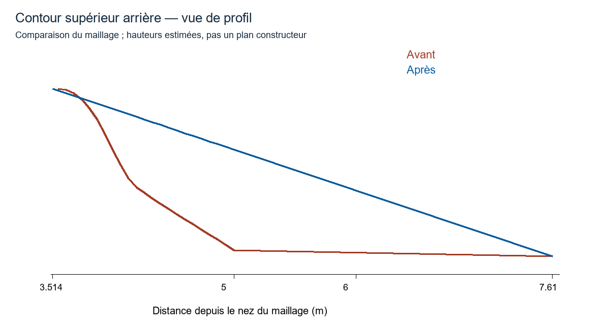
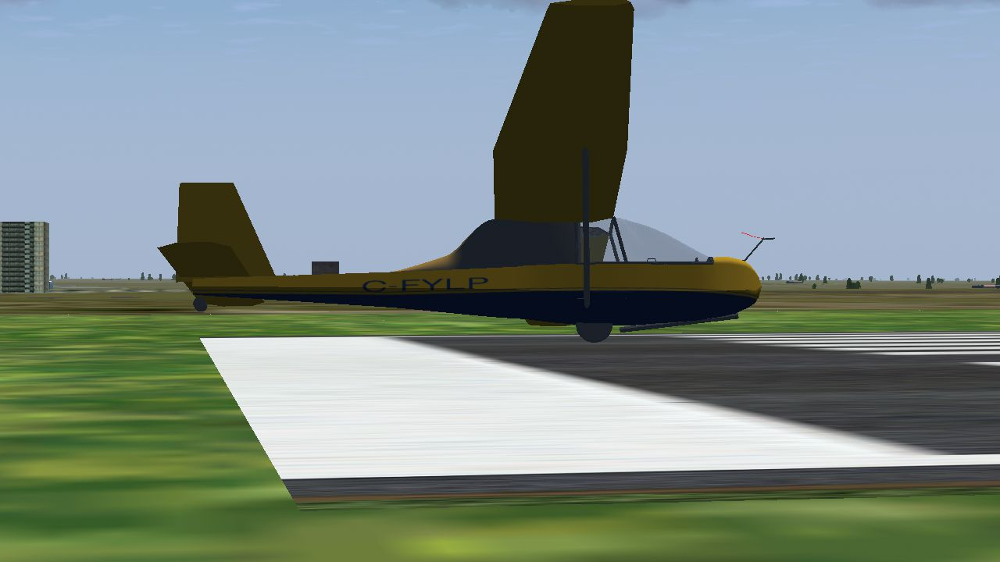
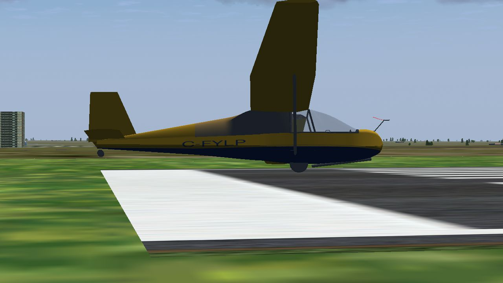
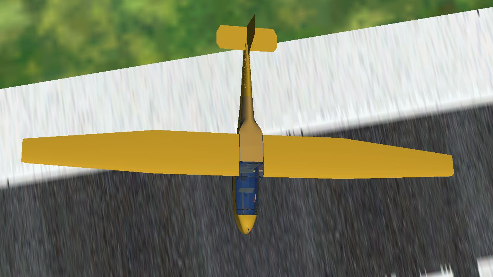
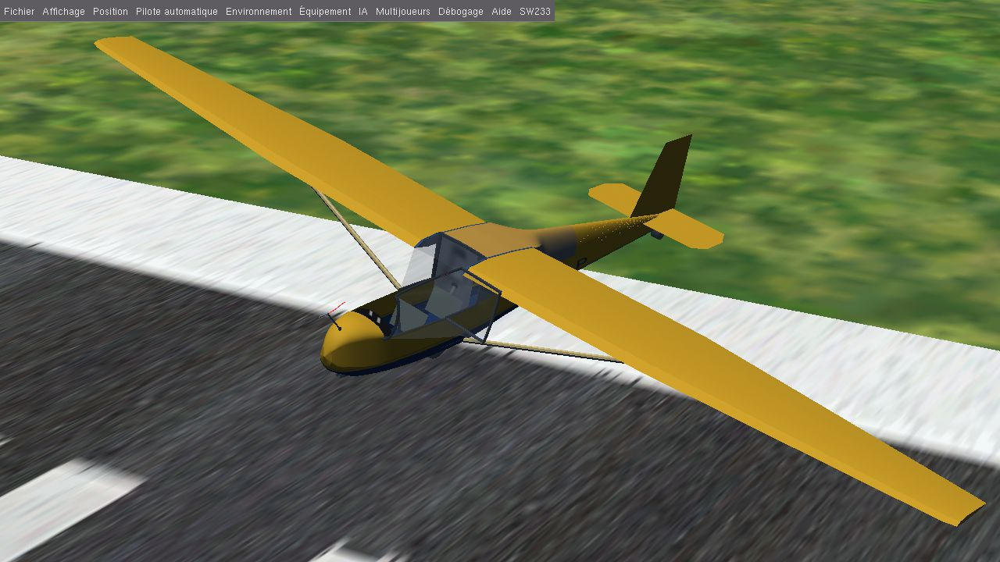

# 29 — Vérifier les dimensions et redresser le dos du fuselage

**But :** comprendre quelles mesures viennent du manuel et comparer la forme avant et après correction.
Cet atelier s’adresse à un débutant accompagné.

## Avant de commencer

Préparer FlightGear, le paquet alpha.4 en cours et les recettes des ateliers 2, 20 et 24.
Consulter le [relevé du manuel](../references/manuel-stations-369.md#manuel-complet-et-dimensions-de-construction).
La copie du manuel reste dans les références locales. Elle n’est pas incluse dans le paquet.

## Comprendre les mesures

L’**envergure** est la distance entre les deux bouts d’une aile.
La **corde** relie le bord avant au bord arrière.
Le manuel donne une corde maximale de 60 pouces, soit 1,524 m.
Le modèle utilisait 1,57 m. La correction retire donc 0,046 m, ou 4,6 cm.

Le stabilisateur horizontal mesure 93 pouces, soit 2,3622 m entre ses deux bouts.
Le modèle mesurait 3,86 m. Chaque moitié mesure maintenant 1,1811 m.
Sa forme et son épaisseur restent à affiner.
La longueur totale de 7,8486 m et l’envergure principale de 15,5448 m étaient déjà correctes.

Le dos du fuselage suit maintenant une droite derrière l’aile.
Ses deux hauteurs restent des estimations. Le manuel consulté ne les cote pas.
Une forme droite vue de côté peut garder une section arrondie.

Figure 1 — Projection du maillage. La ligne bleue est rectiligne ; les hauteurs ne sont pas des cotes constructeur.

## Agir

1. Lire la page PDF 9 du manuel, imprimée A2.
2. Convertir les pouces en mètres en multipliant par 0,0254.
3. Utiliser la corde corrigée dans les anneaux d’aile de l’atelier 2.
4. Utiliser la même corde dans `ROOT_CHORD`, à l’atelier 24.
5. Réduire la largeur de l’empennage avec le rapport 1,1811 / 1,93.
6. Relier les sommets du fuselage entre la sortie d’aile et la queue par une droite.
7. Reconstruire les recettes, puis le paquet.
8. Ouvrir le paquet dans FlightGear et choisir une vue extérieure de profil.

La sortie d’aile passe de x = 3,56 m à x = 3,514 m.
Cette position dépend du bord avant choisi dans la maquette, à x = 1,99 m.
Le manuel ne confirme pas cette distance depuis notre nez.
Le repère de centrage du manuel ne donne pas directement la position d’un dossier.

Les recettes complètes des ateliers 2, 20 et 24 contiennent ces corrections.
La texture des flancs a une zone verticale plus grande pour couvrir le nouveau dos.
Les bandes gardent leurs coordonnées. Les petites sections superposées sont fusionnées avant l’export.

## Voir le résultat

Figure 2 — Capture native avant correction, sans occupants.

Figure 3 — Capture native après correction, avec les mêmes réglages de vue.

Figure 4 — Capture native. L’envergure du stabilisateur vaut maintenant 2,3622 m dans le maillage.

Figure 5 — Contrôle supplémentaire de la position ouverte, après correction dimensionnelle.

## Vérifier

Observer le dos depuis les deux côtés. Il doit rester droit jusqu’au pied de la dérive.
Vérifier que les ailes touchent encore les bandes bleues du vitrage central.
Ouvrir puis fermer la verrière avec sa commande au sol.
Comparer les deux bouts de l’empennage : ils doivent être symétriques.

Les 72 tests automatisés, les 14 contrôles natifs de verrière et la reconstruction des recettes réussissent.
Le [bilan des essais](../validation/fuselage-lot48.md) décrit les captures et leurs limites.
La silhouette complète de la verrière reste à faire accepter.
La hauteur totale, les attaches et les détails de livrée restent à vérifier.
Un essai avec un lecteur débutant reste à organiser ; aucune conformité globale de rédaction n’est annoncée.
