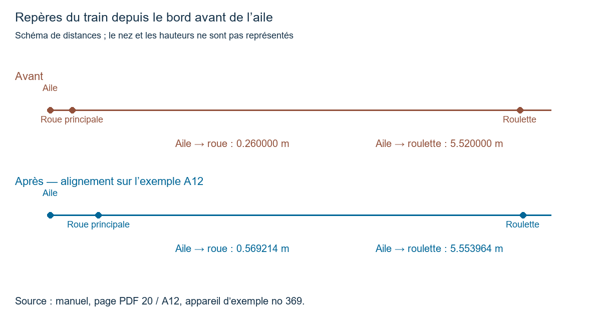
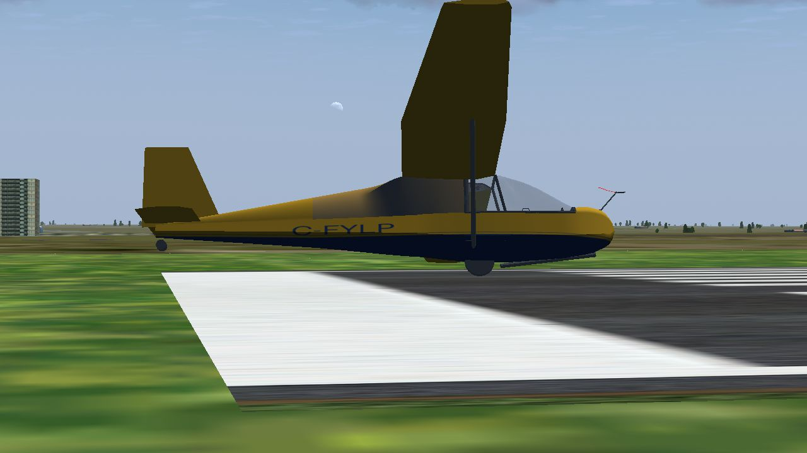
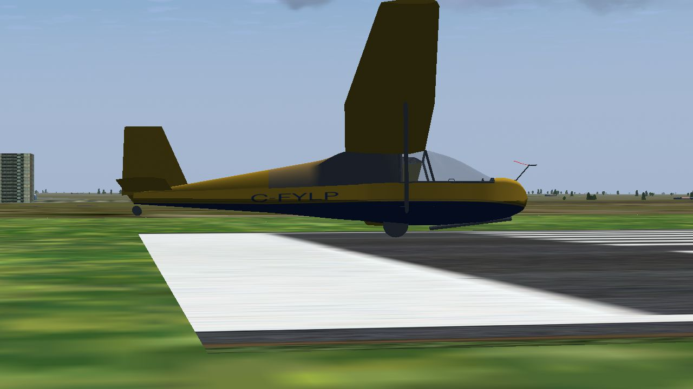
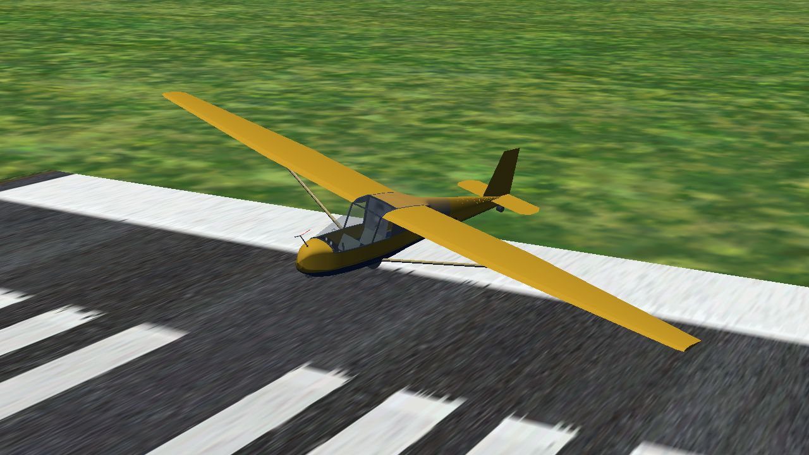

# 30 — Placer les roues avec les repères du manuel

**But :** placer les roues à la bonne distance de l’aile, puis comprendre pourquoi la hauteur reste à vérifier.
Cet atelier s’adresse à un débutant accompagné.

## Avant de commencer

Préparer le manuel local, FlightGear et la recette de l’atelier 2.
Consulter le [registre dimensionnel](../references/dimensions-lot51.md) pour retrouver les pages exactes.
Le manuel donne un schéma de centrage pour un appareil d’exemple, numéro 369.
Ce schéma sert de référence de maquette. Il ne prouve pas la configuration de l’appareil photographié.

## Comprendre

Une **station** est une distance depuis une origine commune.
Imagine deux marques sur une règle. Leur distance ne change pas si la règle est déplacée.
Pour les roues, nous utilisons donc la différence entre leur station et celle de l’aile.

La **roue principale** est la grande roue sous le fuselage.
La **roulette** est la petite roue près de la queue.
L’**assiette** indique l’inclinaison du planeur. Elle change sa hauteur apparente.

Figure 1 — Schéma original des distances. Les hauteurs et le nez ne sont pas représentés.

## Agir

1. Ouvrir la page PDF 20 du manuel, imprimée A12.
2. Repérer les stations 66,34 pour l’aile, 88,75 pour la roue principale et 285 pour la roulette.
3. Soustraire la station de l’aile à celle de chaque roue.
4. Multiplier chaque résultat par 0,0254 pour convertir les pouces en mètres.
5. Ajouter la distance obtenue à la position du bord avant de l’aile dans la maquette.
6. Reconstruire le modèle avec la recette mise à jour de l’atelier 2.
7. Ouvrir le paquet dans FlightGear et comparer les roues en vue de profil.

La roue principale recule d’environ 31 cm. La roulette recule d’environ 3,4 cm.
Leurs dimensions et leurs hauteurs ne changent pas dans cet atelier.
La position de l’aile depuis le nez reste estimée.

## Voir et vérifier

Figure 2 — Capture native avant correction.

Figure 3 — Capture native après correction, avec le même cadrage.

Vérifier que seule la position longitudinale des roues change.
Comparer aussi le nez, le vitrage et la dérive : leur forme doit rester identique.
Ouvrir puis fermer la verrière pour contrôler sa commande.

## Comprendre la limite de hauteur

Le maillage à niveau mesure 2,265 m de haut. Le manuel annonce 2,8321 m.
Dans la séance FlightGear, une aile est inclinée vers le sol.
Avec cette inclinaison, l’encombrement vertical calculé du maillage atteint environ 3,513 m.
Ces trois valeurs ne décrivent pas forcément les mêmes conditions.
Il faut préciser les appuis, l’inclinaison et les points mesurés avant de corriger une pièce.

Figure 4 — Le roulis observé est d’environ 12,6 degrés. L’inclinaison empêche une comparaison directe des hauteurs.

## Corriger un résultat différent

Vérifier d’abord le signe des distances et la conversion des pouces.
Ne pas utiliser les stations des occupants pour placer leurs dossiers.
Ne pas agrandir la dérive pour combler automatiquement l’écart de hauteur.
Les points de contact du modèle de vol doivent aussi être recalés dans une étape distincte.

## Retrouver la preuve

Le [registre technique](../references/dimensions-lot51.md) fournit les calculs et une commande reproductible.
Le [bilan](../validation/dimensions-lot51.md) contient les essais et leurs limites.
Les dessins de verrière examinés sont utiles pour les assemblages, mais ne donnent pas les cotes extérieures recherchées.
L’essai du texte avec un lecteur débutant reste à faire. Aucune conformité globale de rédaction n’est annoncée.
