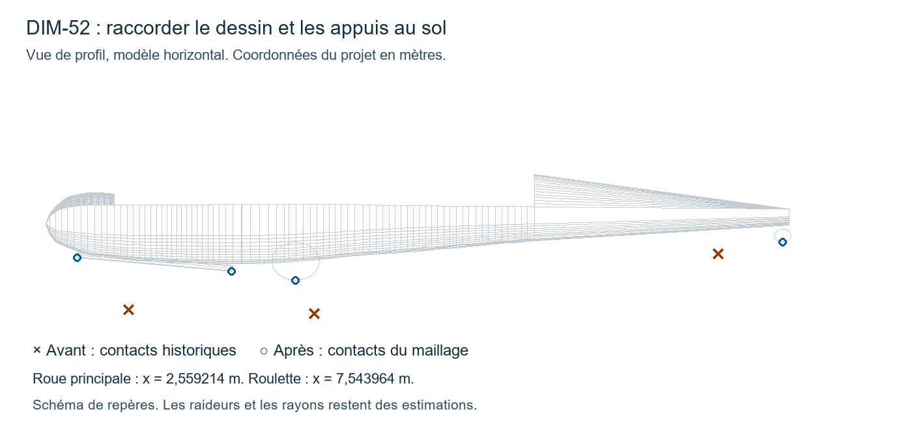
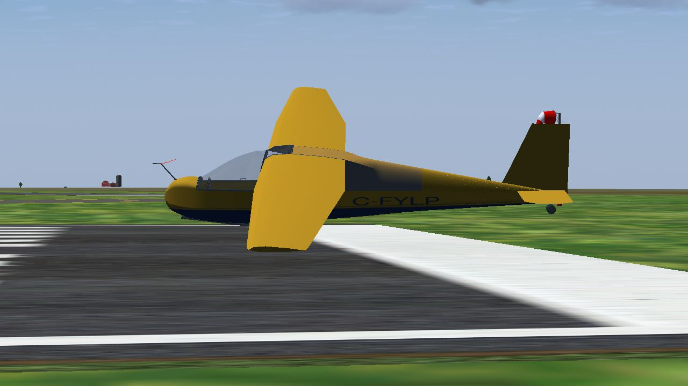
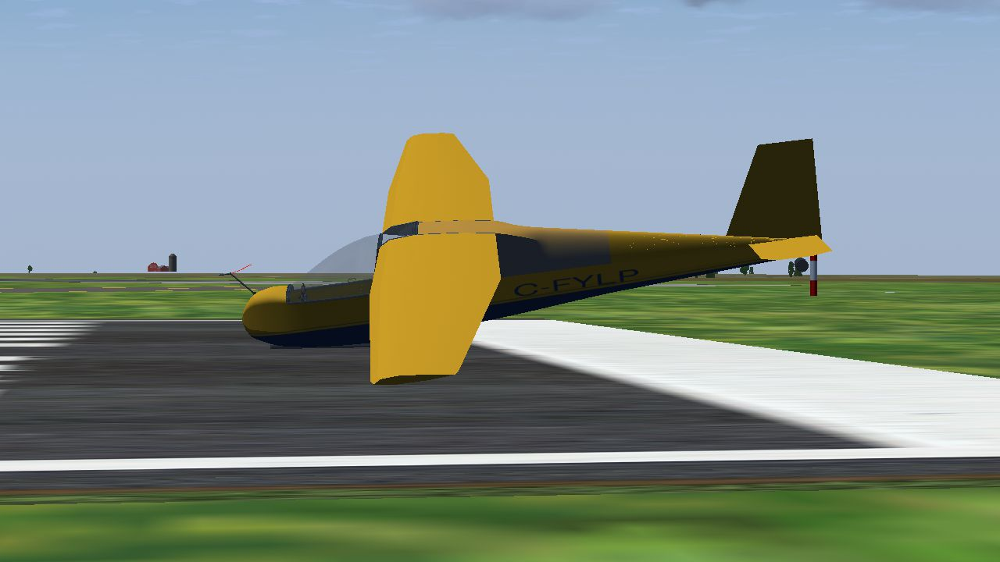
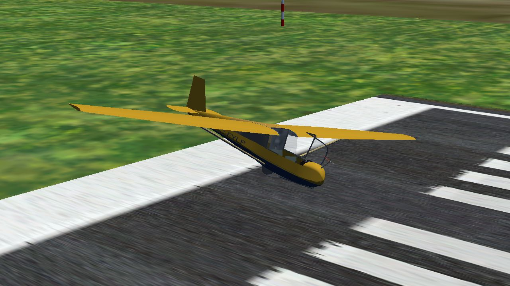

# 31 · Faire toucher le dessin au sol

**Public :** débutant, avec l’aide d’un adulte pour lancer les commandes.

**But :** voir pourquoi une roue dessinée peut flotter, puis vérifier sa pose.

## Avant de commencer

Utiliser le paquet de travail 0.1.0-alpha.4 et FlightGear.
Lire l’[atelier 30 sur les repères](30-reperes-et-train.md).
Le paquet reste expérimental. Cette séance ne valide pas le pilotage du vrai planeur.

## Comprendre les appuis

Le dessin montre les roues. Le calcul du vol utilise des points qui touchent le sol.
Ces points sont les **contacts**. Le calcul ne lit pas la forme des roues.
Un ressort simule leur souplesse. Un amortisseur réduit les rebonds.

Avant ce lot, les contacts se trouvaient trop loin sous le dessin.
La roue principale semblait flotter. Les contacts suivent maintenant les dessous du train et du patin.



*Figure 1 — Repères du modèle horizontal. Ce schéma ne donne pas les dimensions certifiées du planeur.*

## Agir

1. Ouvrir le paquet corrigé dans FlightGear, à CYJN, sans vent.
2. Attendre que le planeur cesse de bouger.
3. Choisir la vue extérieure.
4. Observer la roue principale et le patin sous le nez.
5. Ouvrir la verrière avec sa commande habituelle, une fois le planeur immobile.



*Figure 2 — Avant DIM-52. Le calcul sur sol plat mesure environ 26 cm sous la roue principale.*



*Figure 3 — Après DIM-52, avec le même chargement. Le planeur repose sur le train, le patin et un bout d’aile.*



*Figure 4 — L’ouverture fonctionne avec le contact au sol réel. Sa silhouette reste à faire accepter.*

## Vérifier

Le planeur doit rester immobile après stabilisation. Il peut pencher sur une aile.
Sa roulette arrière peut rester levée lorsque le nez repose sur le patin.
Le chargement de cet essai comprend deux occupants de 180 lb.

Un petit enfoncement du pneu reste visible. Le dessin rigide ne suit pas encore la compression du ressort.
Après stabilisation, le banc sur sol plat mesure jusqu’à 2,74 cm dans les cas testés.
Les roues de bout d’aile restent à construire. Les appuis latéraux représentent encore la structure de l’aile.

## Refaire le calcul

Ces commandes visent les contributeurs. Les lancer depuis le dossier du dépôt, avec Python et les dépendances du projet.

```powershell
python -m tools.ground_bench --output contacts.json
python -m unittest tests.test_ground
```

Le premier essai laisse le planeur se poser. Le second lui donne une vitesse initiale de 5 nœuds.
Un nœud vaut environ 1,85 km/h. Aucun câble ne tire le planeur dans cet essai.
Le fichier `contacts.json` conserve les vitesses, les angles et les distances.

## Corriger un résultat différent

Vérifier le dossier du paquet chargé dans FlightGear.
Désactiver le vent et reprendre le même chargement.
Ne pas déplacer une roue pour cacher un contact mal placé.
Conserver une capture et les valeurs de l’essai avant de modifier les réglages.

## Retrouver les preuves

Consulter le [relevé technique](../references/contacts-lot52.md) et les [résultats détaillés](../validation/contacts-lot52.md).
Le manuel de maintenance, PDF 20 / A12, donne les stations des roues d’un appareil d’exemple.
Il ne donne pas les raideurs utilisées ici.
La hauteur totale de 2,8321 m, PDF 9 / A2, reste à rapprocher d’une assiette connue.

La rédaction suit le guide du projet. L’essai de lecture avec un enfant reste à réaliser.
