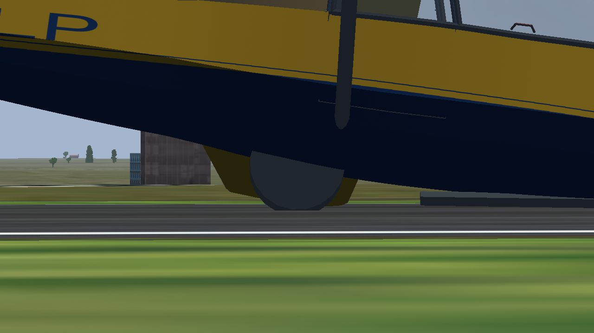
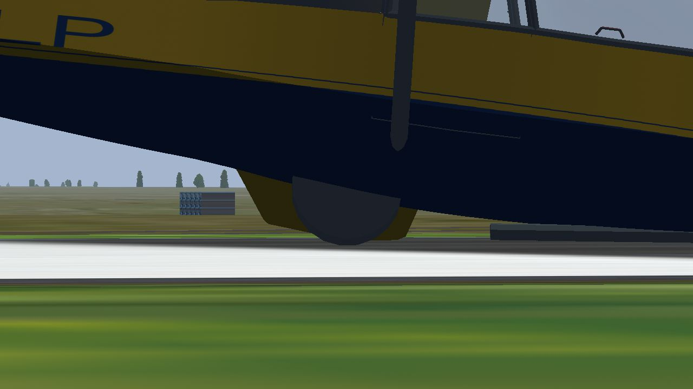
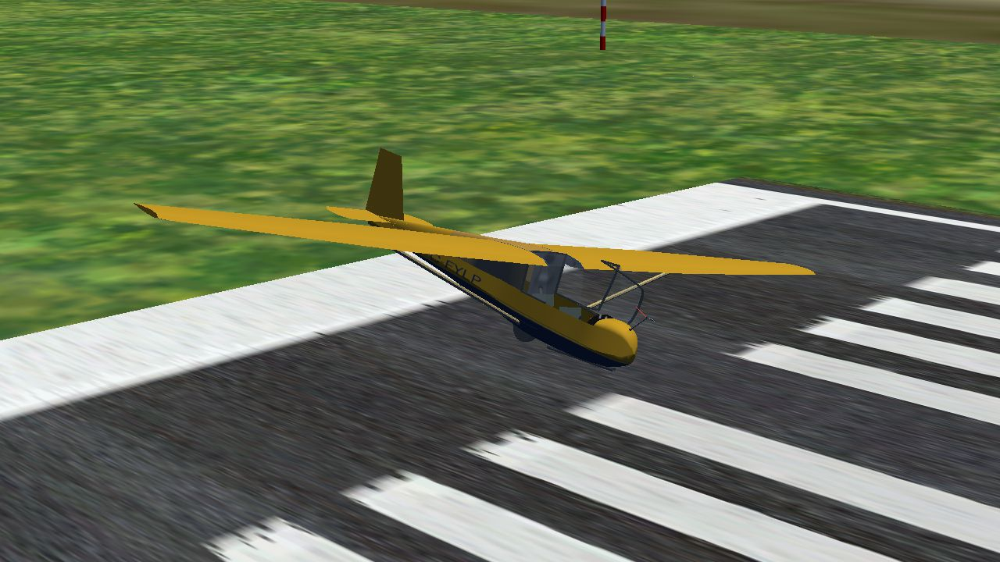

# 32 · Garder le pneu au-dessus du sol

**Public :** débutant accompagné pour les commandes.
**But :** observer le mouvement de la roue quand le planeur repose au sol.

## Comprendre

Le ressort du calcul se comprime. Le dessin de la roue doit suivre ce mouvement.
Quand le planeur penche, le bord du pneu descend aussi.
Le programme tient compte de ces deux effets. Il déplace seulement la roue principale vers le haut.
Les contacts, les masses et les forces du vol restent identiques à DIM-52.
Il s’agit d’une suspension visuelle estimée, pas d’une déformation réaliste du caoutchouc.

## Avant de commencer

Utiliser le paquet de travail 0.1.0-alpha.4, avec la correction DIM-53a.
Lire l’[atelier 31](31-contacts-sol.md) pour comprendre les points de contact.

## Observer le résultat

1. Ouvrir le planeur à CYJN, sans vent.
2. Attendre que le planeur cesse de bouger.
3. Choisir la vue extérieure.
4. Approcher la caméra de la roue principale.
5. Observer le bord inférieur du pneu.



*Figure 1 — Paquet DIM-52 dans FlightGear. Le pneu rigide traverse encore le sol.*



*Figure 2 — Paquet DIM-53a. La roue remonte d’environ 2,9 cm dans cette pose native.*

Les deux captures utilisent le même cadrage. Le terrain visible diffère légèrement après l’essai de roulage du paquet précédent.

## Vérifier et corriger

Le bas du pneu doit toucher le sol sans être coupé.
La roue suit la compression pendant le roulage. Le reste du planeur conserve sa pose calculée.
L’animation revient à zéro lorsque la roue ne touche plus le sol.

Si le pneu reste enfoncé, vérifier le paquet chargé.
Consulter ensuite la propriété `/sim/sw233/gear/main-offset-m` dans FlightGear.
Elle affiche le déplacement de la roue en mètres.
Ne pas déplacer toute la coque pour corriger la roue.



*Figure 3 — L’ouverture de verrière fonctionne toujours au sol.*

## Comprendre la limite

Le programme déplace une roue rigide. Il ne reproduit pas l’écrasement du caoutchouc.
Le calcul suppose un sol presque horizontal. Une pente forte peut demander une correction liée à la normale du terrain.
Les roues de bout d’aile restent dans un autre lot.

## Refaire les contrôles

Ces commandes s’adressent aux contributeurs. Les lancer depuis le dépôt avec les dépendances du projet.
La deuxième commande exige une séance dédiée de FlightGear sur le port 18192.

```powershell
python -m unittest tests.test_tire
python -m tools.tire_bench --port 18192 --output pneu-native.json
```

Consulter les [preuves DIM-53a](../validation/pneu-lot53.md) pour les résultats et les limites.
La rédaction suit le guide du projet. L’essai de lecture avec un enfant reste à réaliser.

## Recette du mouvement

Copier ce fichier dans `src/SW233/Nasal/gear.nas`.
Le chapitre 4 charge le fichier et applique son déplacement à l’objet `roue`.

<!-- atelier-fichier: src/SW233/Nasal/gear.nas -->
```nasal
# SPDX-License-Identifier: GPL-3.0-only
# Visual suspension for the 20-sided main wheel, not a tyre elasticity model.
var base = "/sim/sw233/gear/";
var offset = func(compression, pitch, roll, wow) {
    if (wow != 1 or compression == nil or pitch == nil or roll == nil) return 0;
    if (compression != compression or pitch != pitch or roll != roll) return 0;
    if (compression < 0 or compression > 0.5 or abs(pitch) > 45 or abs(roll) > 60) return 0;
    var theta = pitch * math.pi / 180;
    var phi = roll * math.pi / 180;
    var nx = -math.sin(theta);
    var ny = -math.sin(phi) * math.cos(theta);
    var nz = math.cos(phi) * math.cos(theta);
    var support = 0;
    for (var i = 0; i < 20; i += 1) {
        var a = i * math.pi / 10;
        support = math.max(support, -0.245 * (nx * math.cos(a) + nz * math.sin(a)));
    }
    support += 0.075 * abs(ny);
    return math.max(0, compression * 0.3048 + (support - 0.245 * nz) / nz);
};
var update = func {
    setprop(base ~ "main-offset-m", offset(
        getprop("/fdm/jsbsim/gear/unit/compression-ft"),
        getprop("/orientation/pitch-deg"), getprop("/orientation/roll-deg"),
        getprop("/gear/gear/wow")));
};
var loop = func { update(); settimer(loop, 0.02); };
setprop(base ~ "main-offset-m", 0);
settimer(loop, 0.02);
```
