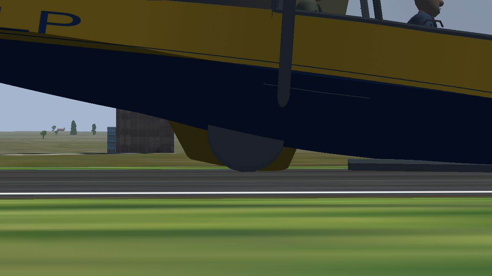
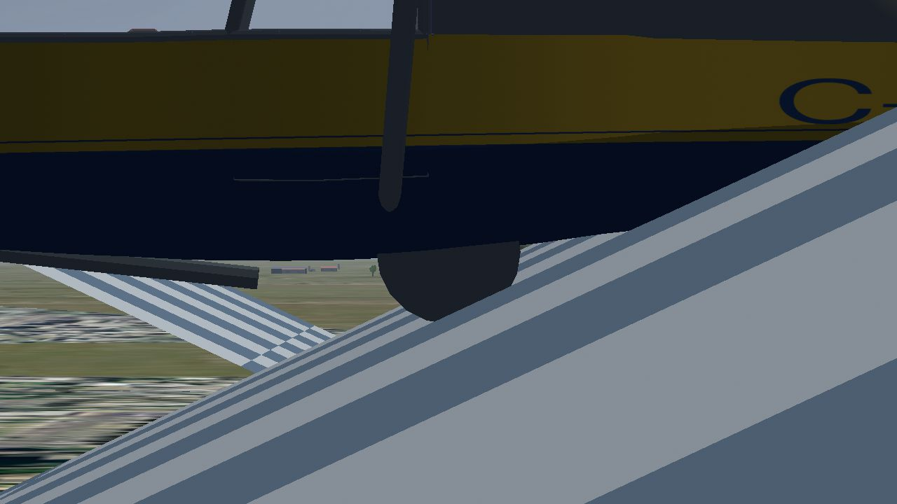
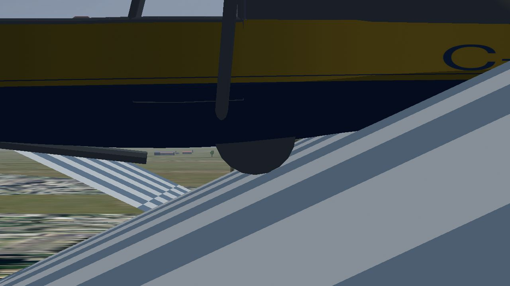
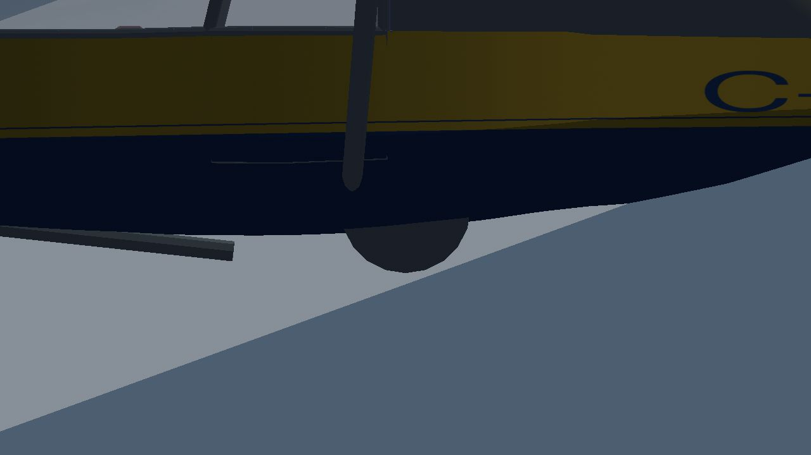
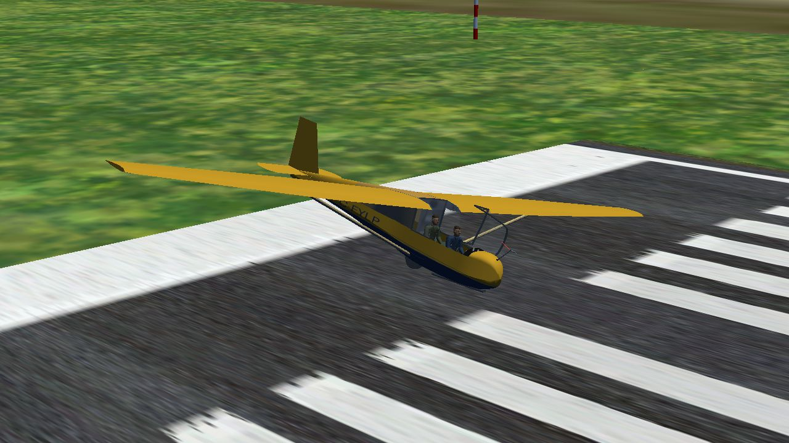

# 33 · Faire suivre la pente au pneu

**Public :** débutant accompagné pour les commandes.
**But :** reconnaître un pneu qui touche une pente sans la traverser.

## Avant de commencer

Utiliser le paquet de travail 0.1.0-alpha.4 avec DIM-53c.
Lire l’[atelier 32](32-pneu-au-sol.md) pour comprendre le mouvement de la roue.
Prévoir FlightGear 2024.1.7 et une vue extérieure.
Les commandes avancées demandent Python et les dépendances du dépôt.

## Comprendre

Une pente monte devant le planeur ou sur son côté.
Le bord du pneu peut alors traverser le sol.
Le programme mesure cinq points autour de la roue principale.
Ces points décrivent une petite surface plane sous le pneu.
Le programme remonte la roue jusqu’à cette surface.
Il utilise le contour du pneu et sa largeur.

La coque et les forces du vol conservent leurs réglages.
Le pneu reste rigide : son caoutchouc ne se déforme pas.
Une déformation n’est pas nécessaire pour supprimer la pénétration sur les surfaces planes testées.

## Agir et voir

1. Ouvrir le planeur à CYJN, sans vent.
2. Attendre son arrêt.
3. Choisir la vue extérieure.
4. Approcher la caméra de la roue principale.
5. Observer le contour inférieur du pneu.



*Figure 1 — FlightGear avec le calcul du vol actif. Le pneu reste au contact après une courte impulsion de roulage.*

Comparer ensuite les deux vues du banc ci-dessous.
Un **banc** est ici un décor construit pour faire un essai précis.
Le planeur est immobilisé dans une pose imposée. Ce n’est pas un atterrissage.



*Figure 2 — Rampe longitudinale de 25°. Le déplacement visuel de la roue est temporairement mis à zéro.*



*Figure 3 — Même pose et même caméra. Le déplacement atteint environ 5,33 cm dans cet essai.*



*Figure 4 — Pente combinée de 20° dans chaque direction. Le déplacement atteint environ 7,29 cm.*

Le sol masque parfois le bord éloigné du pneu.
Observer le point où le contour visible rejoint la rampe.
Les chiffres du banc complètent les images.

## Vérifier et corriger

Le pneu doit rejoindre la surface sans la traverser.
En vol, son déplacement revient à zéro.
La propriété `/sim/sw233/gear/mode` indique la méthode utilisée :

| Valeur affichée | Sens |
|---|---|
| `terrain` | Les cinq mesures décrivent une surface utilisable. |
| `fallback-flat` | Le programme reprend le calcul précédent, prévu pour un sol presque horizontal. |
| `airborne` | La roue ne porte plus le planeur ; le déplacement vaut zéro. |

Si le mode indique `fallback-flat`, attendre le chargement du décor.
Si ce mode persiste sur une pente, relever le lieu et la pose du planeur.
Ne pas considérer ce mode comme une validation de la pente.
Une marche, un trou ou une surface très irrégulière demande un autre essai.



*Figure 5 — L’ouverture au sol fonctionne après l’essai physique sur piste.*

## Refaire le banc — parcours contributeur

Utiliser une séance dédiée. Le banc déplace le planeur et remplace temporairement sa mise à jour visuelle.
Il rétablit cette fonction à la fin, même si une mesure échoue.
Fermer cette séance après l’essai.

1. Construire les sept rampes dans un nouveau dossier.

```powershell
python -m tools.slope_scene D:/SW233-work/essai-pentes/scenery
```

2. Construire le paquet dans un autre dossier vide.

```powershell
python -m tools.package --output D:/SW233-work/essai-pentes/paquet --preview docs/images/lot54/canopy.jpg
```

3. Lancer FlightGear avec ce paquet et les rampes.

Adapter les chemins du programme, des données et du décor habituel.
Le paramètre `--fdm=null` désactive les forces du vol pour ce banc géométrique.

```powershell
& 'C:/Program Files/FlightGear 2024.1/bin/fgfs.exe' `
  --fg-root=C:/Users/steve/FlightGear/Downloads/fgdata_2024_1 `
  --fg-aircraft=D:/SW233-work/essai-pentes/paquet/Aircraft `
  '--fg-scenery=D:/SW233-work/essai-pentes/scenery;C:/Users/steve/FlightGear/Downloads/TerraSync' `
  --aircraft=sw233 --fdm=null --airport=CYJN --heading=0 `
  --start-date-gmt=2026:06:21:16:45:00 --wind=0@0 `
  --disable-real-weather-fetch --disable-terrasync --geometry=1280x720 `
  --read-only --ignore-autosave --httpd=18196
```

4. Attendre l’affichage du décor.
5. Lancer les mesures dans un deuxième terminal.

```powershell
python -m tools.slope_bench --port 18196 --scenery D:/SW233-work/essai-pentes/scenery --output D:/SW233-work/essai-pentes/resultats
```

Le dossier contient six images et les sept mesures dans `results.json`.
Le fichier `math.json` contient les 34 contrôles du calcul.
Le banc vérifie les pentes mesurées et compare le déplacement aux sommets du dessin.
Une surface non chargée provoque un échec explicite.

6. Exécuter les contrôles locaux.

```powershell
python -m unittest tests.test_slope tests.test_tire
python -m tools.check_workbook D:/SW233-work/essai-pentes/reconstruction
```

La recette complète de `gear.nas` reste dans l’[atelier 32](32-pneu-au-sol.md#recette-du-mouvement).
Ne pas créer une deuxième copie dans cet atelier.

## Retrouver la preuve

Consulter les [mesures et limites du lot54](../validation/pneu-pentes-lot54.md).
Elles distinguent les rampes immobilisées du roulage physique sur piste.
Les dimensions du pneu viennent du modèle existant ; aucune nouvelle cote constructeur n’est affirmée.

Le texte applique le guide de rédaction du projet.
L’essai avec un enfant, la navigation au clavier et l’audit de la page publiée restent à réaliser.
