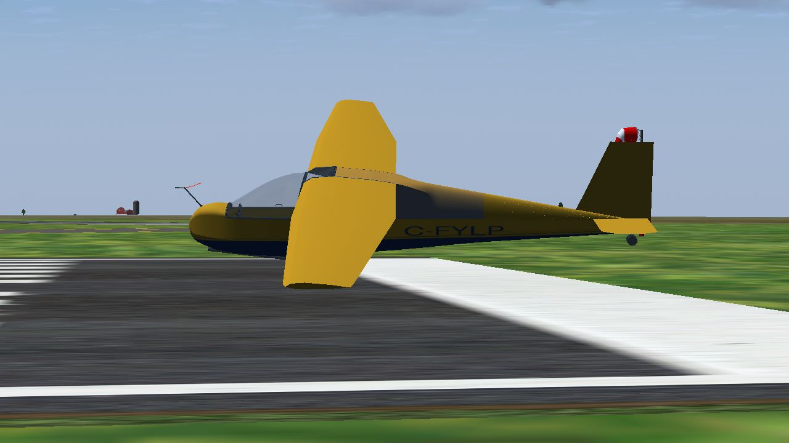
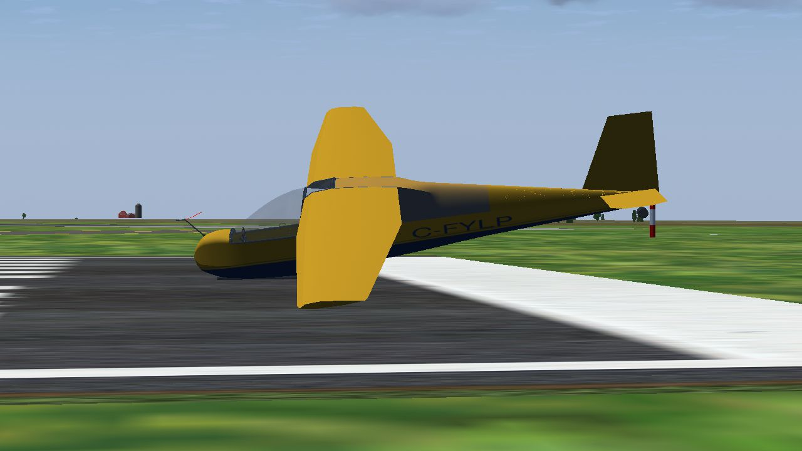
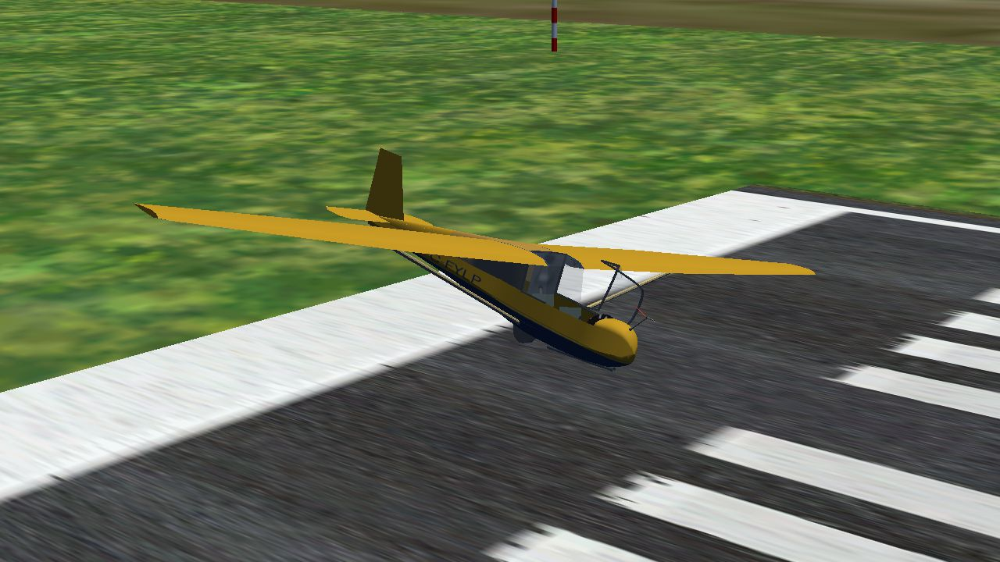

# DIM-52 — Vérification des appuis au sol

Public : contributeurs et personnes qui vérifient le modèle.
Date : 17 novembre 2026. Version de travail : 0.1.0-alpha.4, non publiée.
Plan enregistré avant modification : `c7c3482`. Référence avant correction : `2064164`.

## Résultat

Les contacts suivent maintenant les roues visibles, les extrémités du patin et les bouts d’aile.
Le modèle ne flotte plus à environ 26 cm au-dessus de sa roue principale sur le banc plat.
La correction conserve un résidu de pénétration du pneu rigide d’environ 2,73 cm.
Elle ne valide ni les dimensions réelles du train ni le comportement du vrai planeur.

## Calcul reproductible

JSBSim 1.2.3, pas de 1/120 s, masse 970 lb, sol plat et air calme.
Chaque cas commence par 60 s de stabilisation, puis conserve 60 s de mesures.
Les cas utilisent une inclinaison initiale de −1° ou +1°.
Deux cas restent immobiles. Deux autres reçoivent une vitesse initiale de 5 nœuds.

| Mesure après stabilisation | Avant | Après |
|---|---:|---:|
| Assiette longitudinale | +0,514° | −7,003° |
| Inclinaison latérale, valeur absolue | 12,321° | 12,530° |
| Hauteur du centre de gravité | 3,412 ft | 2,321 ft |
| Compression principale | 0,477 ft | 0,0378 ft |
| Dégagement minimal de la roue | +0,259 m | −0,0273 m |
| Distance après impulsion de 5 nœuds | 1,45 m | 2,41 m |

Le signe négatif du dégagement indique une pénétration dans le plan du sol.
Les deux sens d’inclinaison donnent des résultats symétriques dans ce banc.
Les vitesses finales sont inférieures à 0,01 ft/s. Les rotations cessent après stabilisation.
Le frottement du patin et du bout d’aile freine rapidement le roulage.
Les distances ne constituent pas une prévision opérationnelle.

## Observation dans FlightGear

FlightGear 2024.1.7, CYJN, cap 190°, vent nul, date simulée 21 juin 2026 à 16 h 45 UTC.
Paquets : DIM-51 `final` pour l’avant ; DIM-52 `candidat-v2` pour l’après.
Captures natives de 1 280 × 720 pixels, sans retouche.
La vue de profil utilise 270° et un champ de 30°. La vue oblique utilise 220°, 15° et 42°.
Les captures de profil masquent les personnages pour dégager la lecture.

| Mesure native | Avant | Après |
|---|---:|---:|
| Assiette longitudinale | +0,741° | −6,808° |
| Inclinaison latérale | −12,634° | −12,838° |
| Hauteur affichée au-dessus du sol | 3,411 ft | 2,321 ft |

Les angles diffèrent légèrement du banc plat. Le terrain natif ne représente pas exactement son plan horizontal.

*Avant — mêmes points visuels, anciens appuis physiques.*

*Après — appuis recalés, sans changement du maillage.*

Une impulsion native utilise `/velocities/uBody-fps = 8.4` et `/velocities/wBody-fps = -1.0`.
Le premier échantillon mesure 4,853 nœuds. Le suivant mesure 2,372 nœuds, puis 0,029 nœud.
La position change d’environ deux mètres. La vitesse finale devient négligeable, sans basculement.
Les valeurs et positions sont conservées dans le registre JSON.
Les propriétés internes `/fdm/jsbsim/velocities/*` n’avaient pas transmis l’impulsion ; cet essai immobile n’est pas compté.

La verrière atteint sa position ouverte avec le vrai contact au sol et une vitesse nulle.
Les 14 contrôles Nasal de verrière passent également.

*Ouverture — essai réel au sol, distinct des contrôles avec valeurs simulées.*

## Limites et suites

- Corriger le rendu de compression du pneu et tenir compte de sa largeur.
- Construire les roues de bout d’aile avant de leur attribuer des contacts roulants.
- Réconcilier le datum du constructeur et les positions historiques des masses.
- Clarifier les conditions de mesure de la hauteur de 2,8321 m.
- Faire accepter la silhouette de verrière avec les photos de référence.
- Réaliser l’essai de lecture du tutoriel avec le public visé.

Le [registre JSON](contacts-lot52.json) conserve les séries, les dimensions et les empreintes des images.
Voir le [relevé des contacts](../references/contacts-lot52.md) et l’[atelier 31](../construction/31-contacts-sol.md).

## Contrôles du dépôt

Les 78 tests automatisés passent, dont trois nouveaux contrôles de contact et de roulage.
La reconstruction intégrale depuis le tutoriel reproduit les fichiers sources.
Les contrôles de style, de sources et d’espaces passent également.
Les empreintes des six images correspondent au registre JSON.
