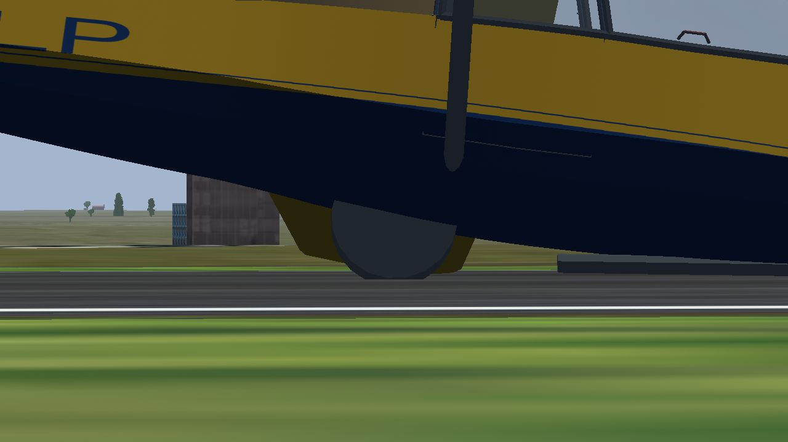
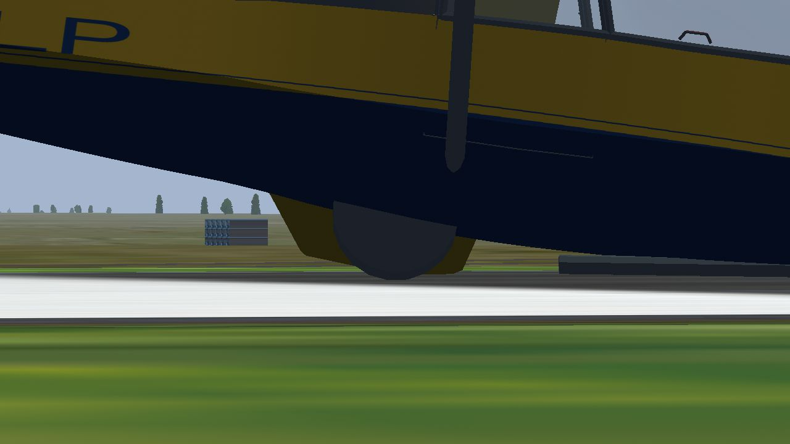
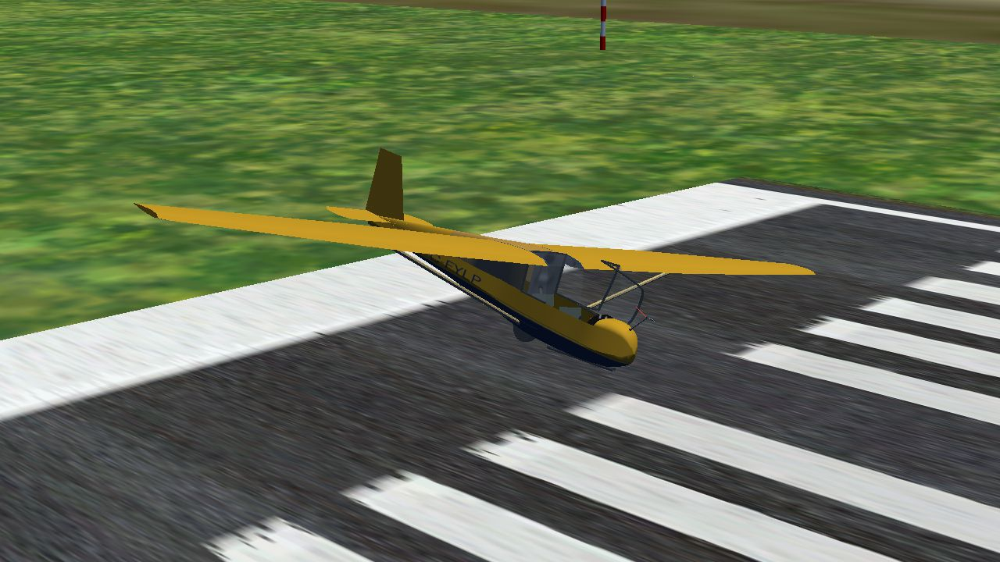

# DIM-53a — Pneu principal sans enfoncement visible

Public : contributeurs et personnes qui vérifient le modèle.
Date : 17 novembre 2026. Plan préalable : `b101e8a`. Référence avant : `c8ec444`.
Version : 0.1.0-alpha.4 en préparation.

## Correction

DIM-52 raccordait les contacts physiques au maillage. La roue rigide restait enfoncée d’environ 27,3 mm sur le banc plat.
Deux effets s’additionnaient : la compression du ressort et la largeur du pneu incliné.

Le module `Nasal/gear.nas` calcule maintenant le déplacement vertical de la roue principale.
L’animation XML déplace uniquement l’objet `roue`.
Elle ne modifie ni les contacts, ni les masses, ni les forces aérodynamiques.
Les rayons, la largeur et le contour à 20 côtés restent ceux de la recette du maillage.
Ces dimensions demeurent des estimations visuelles. Le manuel de maintenance ne justifie pas leur précision.

## Calcul et limites

La compression JSBSim est convertie de pieds en mètres, avec le facteur 0,3048.
La correction supplémentaire utilise le point le plus bas du pneu projeté selon l’assiette.
Le calcul tient compte des deux flancs, distants de 0,15 m, et des 20 sommets de chaque cercle.
La remontée supplémentaire évite que le bord inférieur traverse le plan du sol.

Le déplacement est actualisé toutes les 0,02 s demandées au minuteur Nasal.
La fréquence réelle dépend du simulateur. Le calcul reste actif pendant une pause pour maintenir la pose affichée.
Sans contact principal, le déplacement revient à zéro.
Les valeurs absentes, négatives ou hors du domaine prévu produisent aussi zéro.
Le domaine couvre une compression de 0 à 0,5 ft, un tangage de ±45° et un roulis de ±60°.
Ces bornes protègent l’affichage ; elles ne représentent pas une course certifiée de suspension.

Le calcul utilise un plan horizontal. Les fortes pentes et les irrégularités locales restent à traiter.
La roue reste rigide : aucune pression de pneu ni déformation du caoutchouc n’est simulée.
Le module ne déplace pas la roulette arrière et ne construit pas les roues de bout d’aile.

## Mesures sur sol plat

JSBSim 1.2.3, masse 970 lb, air calme, pas de 1/120 s.
Les quatre cas DIM-52 sont rejoués : inclinaison initiale ±1°, au repos ou avec une impulsion de 5 nœuds.
Chaque cas conserve 60 s de stabilisation puis 60 s d’observation.
Le décalage est calculé par la fonction Nasal dans FlightGear, puis appliqué aux sommets mesurés du pneu.

| Cas | Pénétration avant animation | Remontée locale | Résidu après animation |
|---|---:|---:|---:|
| Aile gauche, repos | 27,30 mm | 28,176 mm | moins de 0,01 mm |
| Aile droite, repos | 27,30 mm | 28,176 mm | moins de 0,01 mm |
| Aile gauche, impulsion | 27,30 mm | 28,176 mm | moins de 0,01 mm |
| Aile droite, impulsion | 27,30 mm | 28,176 mm | moins de 0,01 mm |

La remontée locale suit l’axe vertical du planeur incliné ; elle diffère donc du dégagement vertical terrestre.
Le très petit résidu vient notamment de l’arrondi des coordonnées exportées et des propriétés lues.
Cette précision numérique n’est pas une précision physique du modèle réel.

## Contrôles dans FlightGear

FlightGear 2024.1.7, CYJN, cap 190°, vent nul, date simulée 21 juin 2026 à 16 h 45 UTC.
Paquet avant : DIM-52 `candidat-v2`, port 18190. Après : DIM-53 `candidat`, port 18192.
Captures natives de 1 280 × 720 pixels, sans retouche.
Gros plans : vue 1, cap relatif 90°, inclinaison de caméra 0°, champ 7°.
Point visé : x arrière 2,559214 m, hauteur −0,60 m.

*Avant — pneu rigide du lot DIM-52.*

*Après — la translation du pneu suit le contact calculé.*

La remontée native avant roulage vaut environ 28,64 mm.
Pendant l’impulsion, le premier échantillon mesure 4,854 nœuds et une remontée de 28,117 mm.
La vitesse finale devient négligeable. La remontée se stabilise à environ 28,656 mm.
Le pneu suit donc l’évolution du ressort au lieu de recevoir une translation constante.

Les 24 contrôles Nasal couvrent trois compressions, cinq assiettes et neuf cas sans contact ou invalides.
Leur résultat est comparé à un calcul indépendant à partir des sommets AC3D.
L’erreur maximale autorisée est de 0,02 mm ; tous les contrôles passent.
Ils vérifient le retour sans contact par appel de fonction. Ils ne remplacent pas un essai complet de décollage.

Les 14 contrôles de verrière passent. Une demande d’ouverture au sol atteint également la position 1 avec le contact réel.

*Vérification de compatibilité — la correction de roue conserve l’ouverture au sol.*

## Reproduire et retrouver les preuves

L’[atelier 32](../construction/32-pneu-au-sol.md) contient la recette complète et les commandes.
Le [registre JSON](pneu-lot53.json) conserve les cas du banc, les valeurs natives et les empreintes des images.
Le [banc indépendant](../../tools/tire_bench.py) lit le maillage et interroge la fonction réellement chargée dans FlightGear.
La recette et les objets du maillage figurent au chapitre 2 ; le branchement XML figure au chapitre 4.

L’essai de lecture avec le public débutant reste à réaliser.

## Contrôles du dépôt

Les 81 tests passent, avec l’inventaire des animations mis à jour pour la roue et la translation.
La reconstruction depuis le tutoriel reproduit exactement les fichiers sources.
Les contrôles de style, de sources et d’espaces passent.
Les empreintes des trois captures correspondent au registre JSON.
